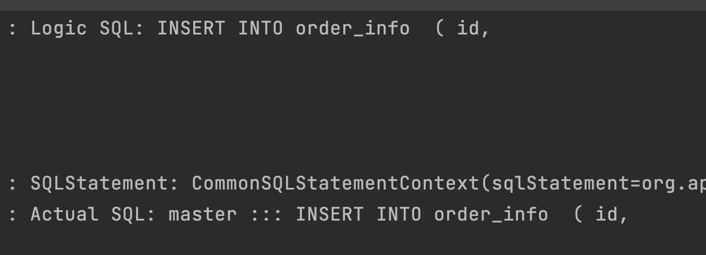
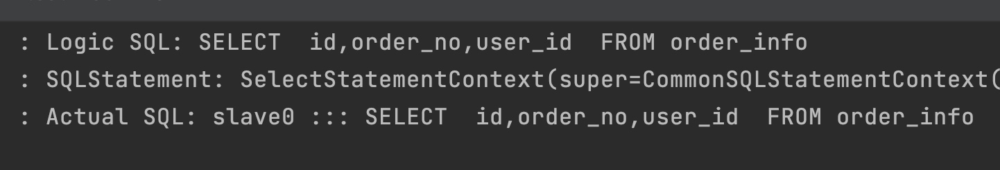

# 2.Sharding-JDBC 读写分离实战
## 引入依赖
```
        <dependency>
            <groupId>com.baomidou</groupId>
            <artifactId>mybatis-plus-boot-starter</artifactId>
            <version>3.5.1</version>
        </dependency>
        <dependency>
            <groupId>org.apache.shardingsphere</groupId>
            <artifactId>sharding-jdbc-spring-boot-starter</artifactId>
            <version>4.1.1</version>
        </dependency>
         <dependency>
            <groupId>com.alibaba</groupId>
            <artifactId>druid-spring-boot-starter</artifactId>
            <version>1.2.8</version>
        </dependency>
        <dependency>
            <groupId>mysql</groupId>
            <artifactId>mysql-connector-java</artifactId>
            <version>8.0.19</version>
        </dependency>
```
## 读写分离配置
### 配置
```
  shardingsphere:
    datasource:
      names: master,slave0
      master:
        driver-class-name: com.mysql.cj.jdbc.Driver
        type: com.alibaba.druid.pool.DruidDataSource
        url: jdbc:mysql://192.168.64.2:3306/sharding_db_0?useUnicode=true&characterEncoding=utf8&zeroDateTimeBehavior=convertToNull&useSSL=true&serverTimezone=GMT%2B8
        username: root
        password: root
      slave0:
        driver-class-name: com.mysql.cj.jdbc.Driver
        type: com.alibaba.druid.pool.DruidDataSource
        url: jdbc:mysql://192.168.64.2:3306/sharding_db_1?useUnicode=true&characterEncoding=utf8&zeroDateTimeBehavior=convertToNull&useSSL=true&serverTimezone=GMT%2B8
        username: root
        password: root
    masterslave:
      name: ms
      master-data-source-name: master
      slave-data-source-names: slave0
```
### 配置解释
* 配置两个数据源：master和slave0
* 定义写库：master
* 定义读库：slave0

## 创建库和表
### 创建两个库
```
CREATE DATABASE sharding_db_0
CREATE DATABASE sharding_db_1
```
### 创建表
分别在两个库下面执行
```
CREATE TABLE `order_info` (
  `id` bigint(20) NOT NULL AUTO_INCREMENT,
  `order_no` int(11) DEFAULT NULL,
  `user_id` int(11) DEFAULT NULL,
  PRIMARY KEY (`id`)
) ENGINE=InnoDB AUTO_INCREMENT=1856012290 DEFAULT CHARSET=utf8 COLLATE=utf8_bin;
```
## 测试验证
```
    @Test
    void insert() {
        Order order1 = new Order();
        order1.setUserId(11);
        order1.setOrderNo(10);
        orderMapper.insert(order1);
    }
```


```
    @Test
    public void testList(){
        List<Order> orders = orderMapper.selectList(null);
        System.out.println(orders.size());
    }
```

