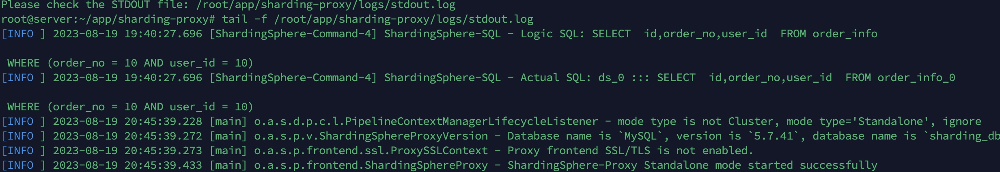
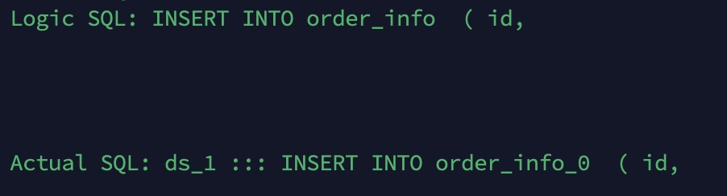
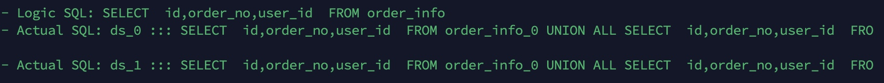
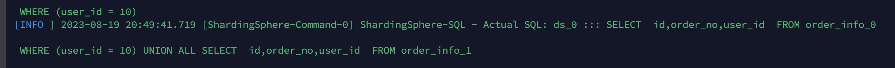
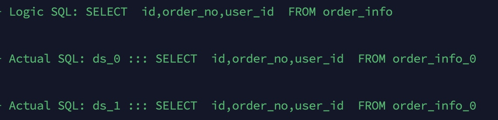
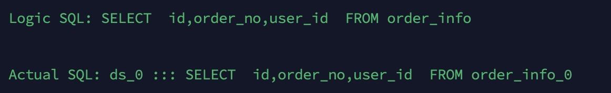

# 3.Sharding-Proxy 分库分表实战
## 安装 sharding-proxy
### 下载proxy
```
# 创建工作目录
mkdir /root/app
cd /root/app
# 下载sharding-proxy
wget https://mirrors.tuna.tsinghua.edu.cn/apache/shardingsphere/5.4.0/apache-shardingsphere-5.4.0-shardingsphere-proxy-bin.tar.gz
# 解压
tar -xvzf apache-shardingsphere-5.4.0-shardingsphere-proxy-bin
cd sharding-proxy
```
### 配置proxy
#### 修改server.yaml
```
vim conf/server.yaml
# 添加如下配置
authority:
  users:
    - user: root@%
      password: root
    - user: sharding
      password: sharding
  privilege:
    type: ALL_PERMITTED
```
### 导入mysql驱动
```
mkdir /root/app/sharding-proxy/ext-lib
cd /root/app/sharding-proxy/ext-lib
wget https://repo1.maven.org/maven2/mysql/mysql-connector-java/8.0.11/mysql-connector-java-8.0.11.jar
```
## 配置分库分表
```
vim conf/conf-sharding.yaml

databaseName: sharding_db
#
dataSources:
  ds_0:
    url: jdbc:mysql://192.168.64.2:3306/sharding_db_0?serverTimezone=UTC&useSSL=false
    username: root
    password: root
    connectionTimeoutMilliseconds: 30000
    idleTimeoutMilliseconds: 60000
    maxLifetimeMilliseconds: 1800000
    maxPoolSize: 50
    minPoolSize: 1
  ds_1:
    url: jdbc:mysql://192.168.64.2:3306/sharding_db_1?serverTimezone=UTC&useSSL=false
    username: root
    password: root
    connectionTimeoutMilliseconds: 30000
    idleTimeoutMilliseconds: 60000
    maxLifetimeMilliseconds: 1800000
    maxPoolSize: 50
    minPoolSize: 1
rules:
- !SHARDING
  tables:
    order_info:
      actualDataNodes: ds_${0..1}.order_info_${0..1}
      tableStrategy:
        standard:
          shardingColumn: order_no
          shardingAlgorithmName: order_info_inline
  defaultDatabaseStrategy:
    standard:
      shardingColumn: user_id
      shardingAlgorithmName: database_inline
  shardingAlgorithms:
    database_inline:
      type: INLINE
      props:
        algorithm-expression: ds_${user_id % 2}
    order_info_inline:
      type: INLINE
      props:
        algorithm-expression: order_info_${order_no % 2}
        type: DML_SHARDING_CONDITIONS

```
## 启动sharding-proxy
```
./bin/start.sh
tail -f /root/app/sharding-proxy/logs/stdout.log
```

## 项目配置

```
spring:
  main:
    allow-bean-definition-overriding: true
  datasource:
    type: com.alibaba.druid.pool.DruidDataSource
    driver-class-name: com.mysql.cj.jdbc.Driver
    url: jdbc:mysql://192.168.64.2:3307/sharding_db?useUnicode=true&characterEncoding=utf8&zeroDateTimeBehavior=convertToNull&useSSL=true&serverTimezone=GMT%2B8
    username: root
    password: root
```
## 测试验证
### 插入数据
* 库：11%2=1
* 表：10%2=0
```
    void insert() {
        Order order1 = new Order();
        order1.setUserId(11);
        order1.setOrderNo(10);
        orderMapper.insert(order1);
    }
```


### 查询数据不带分片键
```
      @Test
    public void testList(){
        List<Order> orders = orderMapper.selectList(null);
        System.out.println(orders.size());
    }
```


### 带库分片键查询
```
    @Test
    public void testListByUserId(){
        LambdaQueryWrapper<Order> queryWrapper = new LambdaQueryWrapper<>();
        List<Order> orders = orderMapper.selectList(queryWrapper.eq(Order::getUserId,10));
        System.out.println(orders.size());
    }
```


### 带表分片键查询
```
    @Test
    public void testListByOrderNo(){
        LambdaQueryWrapper<Order> queryWrapper = new LambdaQueryWrapper<>();
          List<Order> orders = orderMapper.selectList(queryWrapper.eq(Order::getOrderNo,10));
        System.out.println(orders.size());
    }
```



### 带表分片和库分片键查询
```
    @Test
    public void testListByOrderNoAndUserId(){
        LambdaQueryWrapper<Order> queryWrapper = new LambdaQueryWrapper<>();
        List<Order> orders = orderMapper.selectList(queryWrapper.eq(Order::getOrderNo,10).eq(Order::getUserId,10));
        System.out.println(orders.size());
    }
```

