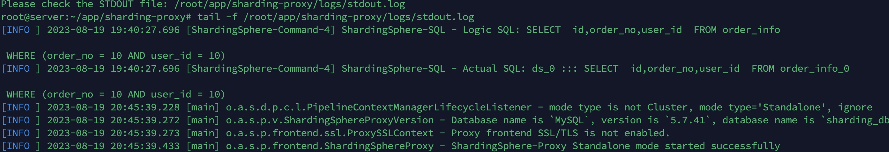
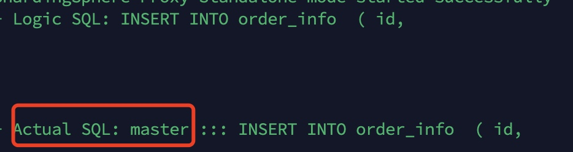

# 4.Sharding-Proxy 读写分离实战
## 安装 sharding-proxy
### 下载proxy
```
# 创建工作目录
mkdir /root/app
cd /root/app
# 下载sharding-proxy
wget https://mirrors.tuna.tsinghua.edu.cn/apache/shardingsphere/5.4.0/apache-shardingsphere-5.4.0-shardingsphere-proxy-bin.tar.gz
# 解压
tar -xvzf apache-shardingsphere-5.4.0-shardingsphere-proxy-bin
cd sharding-proxy
```
### 配置proxy
#### 修改server.yaml
```
vim conf/server.yaml
# 添加如下配置
authority:
  users:
    - user: root@%
      password: root
    - user: sharding
      password: sharding
  privilege:
    type: ALL_PERMITTED
```
### 导入mysql驱动
```
mkdir /root/app/sharding-proxy/ext-lib
cd /root/app/sharding-proxy/ext-lib
wget https://repo1.maven.org/maven2/mysql/mysql-connector-java/8.0.11/mysql-connector-java-8.0.11.jar
```
## 配置读写分离
```
vim conf/config-readwrite-splitting.yaml

databaseName: readwrite_splitting_db

dataSources:
 master:
   url: jdbc:mysql://192.168.64.2:3306/sharding_db_0?serverTimezone=UTC&useSSL=false
   username: root
   password: root
   connectionTimeoutMilliseconds: 30000
   idleTimeoutMilliseconds: 60000
   maxLifetimeMilliseconds: 1800000
   maxPoolSize: 50
   minPoolSize: 1
 slave:
   url: jdbc:mysql://192.168.64.2:3306/sharding_db_1?serverTimezone=UTC&useSSL=false
   username: root
   password: root
   connectionTimeoutMilliseconds: 30000
   idleTimeoutMilliseconds: 60000
   maxLifetimeMilliseconds: 1800000
   maxPoolSize: 50
   minPoolSize: 1

rules:
- !READWRITE_SPLITTING
 dataSources:
   readwrite_ds:
     writeDataSourceName: master
     readDataSourceNames:
       - slave
     loadBalancerName: random
 loadBalancers:
   random:
     type: RANDOM
```
## 启动sharding-proxy
```
./bin/start.sh
tail -f /root/app/sharding-proxy/logs/stdout.log
```

## 项目配置

```
spring:
  main:
    allow-bean-definition-overriding: true
  datasource:
    type: com.alibaba.druid.pool.DruidDataSource
    driver-class-name: com.mysql.cj.jdbc.Driver
    url: jdbc:mysql://192.168.64.2:3307/readwrite_splitting_db?useUnicode=true&characterEncoding=utf8&zeroDateTimeBehavior=convertToNull&useSSL=true&serverTimezone=GMT%2B8
    username: root
    password: root
```
## 测试验证
```
    @Test
    void insert() {
        Order order1 = new Order();
        order1.setUserId(11);
        order1.setOrderNo(10);
        orderMapper.insert(order1);
    }
```


```
    @Test
    public void testList(){
        List<Order> orders = orderMapper.selectList(null);
        System.out.println(orders.size());
    }
```


