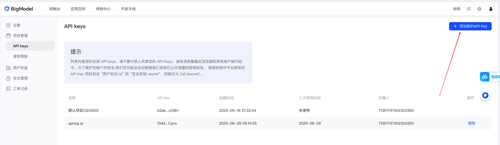
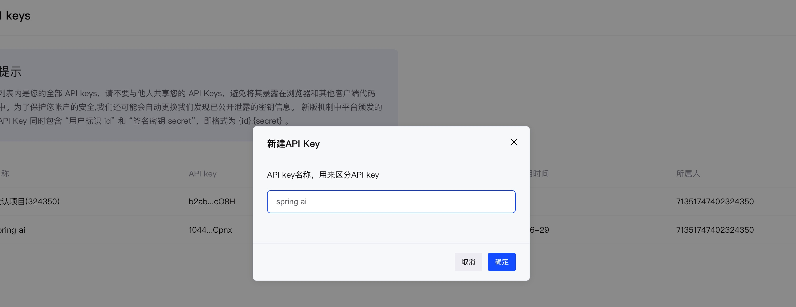
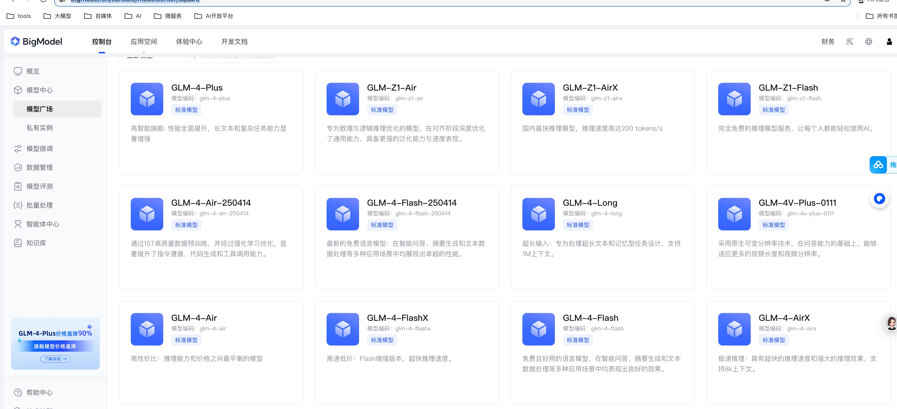
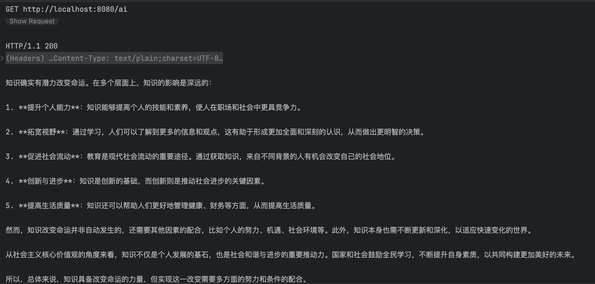

# 1. 快速上手

## 介绍

- **模型集成**：支持OpenAI、Hugging Face等主流AI服务，轻松切换不同大模型（如GPT-4、Llama 2、Deepseek等）
- **向量数据库**：集成Pinecone、Chroma等向量数据库，支持语义搜索与相似度匹配
- **文档处理**：自动解析PDF、Markdown等文档，提取文本内容生成向量嵌入
- **对话记忆**：内置对话历史管理，支持上下文感知的多轮对话
- **工具调用**：通过@Tool注解快速集成外部API（如天气查询、数据库操作）
- **优化求解**：集成Timefold Solver解决资源调度等优化问题
- **可观测性**：提供指标监控（延迟、Token消耗）和日志追踪
- **代理模式**：支持工作流驱动和自主决策两种代理模式，实现复杂任务自动化
- **MCP**: 支持MCP 客户端和 MCP服务端
## 申请API key
* 登录智谱 AI 开放平台 https://www.bigmodel.cn/usercenter/proj-mgmt/apikeys
* 点击创建新的API Key

* 设置key名称

* 复制创建的API Key,后续会用到

## 查看可用的模型
点击链接跳转 https://www.bigmodel.cn/console/modelcenter/square，后续从这里找模型


## 创建Spring Boot项目
创建项目之后，引入依赖
### 配置依赖管理
```
 <properties>
        <java.version>17</java.version>
        <spring-ai.version>1.0.0</spring-ai.version>
</properties>
 <dependencyManagement>
        <dependencies>
            <dependency>
                <groupId>org.springframework.ai</groupId>
                <artifactId>spring-ai-bom</artifactId>
                <version>${spring-ai.version}</version>
                <type>pom</type>
                <scope>import</scope>
            </dependency>
        </dependencies>
    </dependencyManagement>
```
### 引入Spring AI相关依赖
```
<dependencies>
        <dependency>
            <groupId>org.springframework.boot</groupId>
            <artifactId>spring-boot-starter-web</artifactId>
        </dependency>
        <dependency>
            <groupId>org.springframework.ai</groupId>
            <artifactId>spring-ai-starter-model-zhipuai</artifactId>
        </dependency>
</dependencies>
```

### 添加配置文件
```
server:
  port: 8080
spring:
  ai:
    zhipuai:
      api-key: ${创建的key}
```
到这一步基本工作已经完成

## 使用Chat Client 完成大模型调用
在调用过程中，我们需要使用spring ai的chat client和 chat model
```
@Autowired
private ChatModel zhiPuAiChatModel;

    @GetMapping("/ai")
    public String generation(@RequestParam(defaultValue = "你觉得知识能改变命运么？") String userInput) {
        ChatClient chatClient = ChatClient.create(zhiPuAiChatModel);
        String content = chatClient.prompt(userInput).call().content();
        return content;
    }
```

请求API http://localhost:8080/ai,得到相应结果：



那么到这里我们已经完成了Spring AI 与大模型交互的第一步，接下来会给大家分享更多Spring AI提供的能力。

