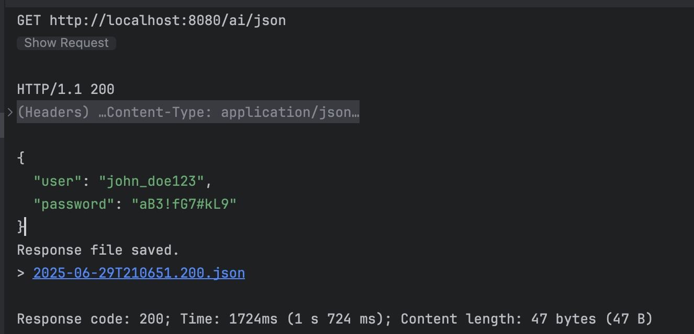
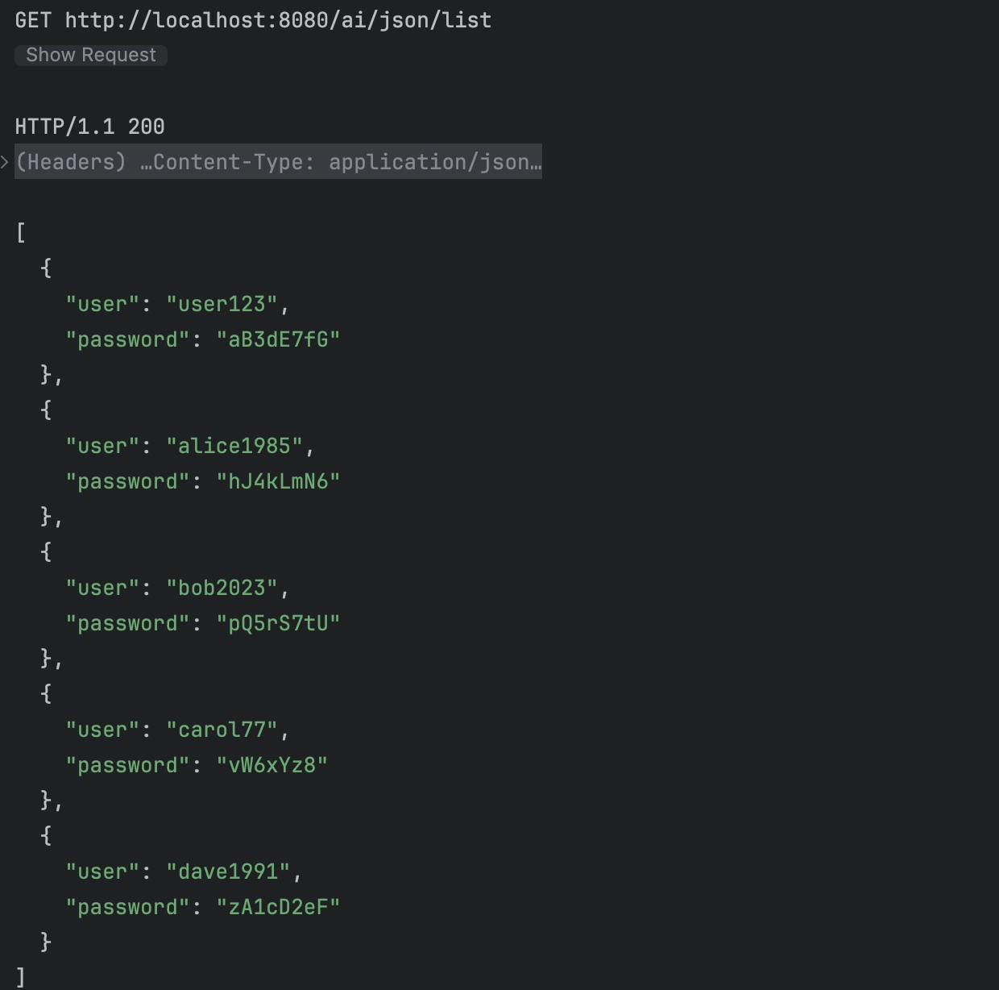

# 2.结构化输出
Spring AI的结构化输出功能可将大模型的自由文本响应，自动转换为Java对象（如POJO、Map），作用包括：

1. **避免手动解析**：直接返回POJO
2. **类型安全**：IDE自动补全，减少拼写错误
3. **简化集成**：直接存入数据库或作为API响应返回
4. **减少错误**：统一格式校验，避免格式不匹配问题

我们正常使用的都是json结构，期望大模型返回json结构，然后由Spring AI 返回实体，这样就不需要我们再次转换就能直接使用，那么如何操作呢？

## 输出普通对象
在前面使用chatclient调用时，我们是直接调用content拿到结果字符串，那么为了能够获取完整的结构对象，我们可以调用 entity(User.class); 用来返回User对象，而不是字符串

```
    @GetMapping("/ai/json")
    public Object generationJson(@RequestParam(defaultValue = "随机生成一份用户信息") String userInput) {
        // Create ChatClient instances programmatically
        ChatClient zpChatClient = ChatClient.create(zhiPuAiChatModel);
        User zpContent = zpChatClient.prompt(userInput)
                .call().entity(User.class);
        return zpContent;
    }
```


这些都是基本对象，那如果我想返回list呢，这个entity好像满足不了啊，放心，Spring AI都帮你准备好了

## 输出List对象
```
    @GetMapping("/ai/json/list")
    public Object generationJsonList(String userInput) {
        // Create ChatClient instances programmatically
        ChatClient zpChatClient = ChatClient.create(zhiPuAiChatModel);
        List<User> zpContent = zpChatClient.prompt(userInput)
                .call().entity(new ParameterizedTypeReference<List<User>>() {
                });
        return zpContent;
    }
```


那么到这里呢，我们已经知道如何通过Spring AI 获取普通对象和List对象，但是这些内容都是直接获取的，如果内容很长我们将会等待很久，我们能不能像chat gpt那样，一个字一个字往外冒呢？这个就是流式响应，Spring AI已经帮我们支持了，接下来我们来学习这一部分
