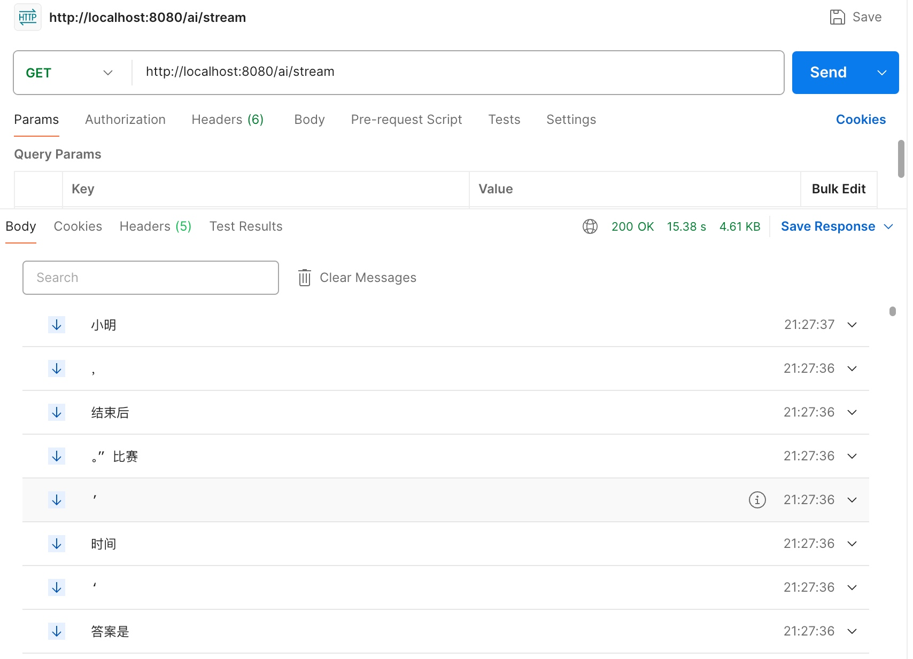

# 3.流式响应
Spring AI 的流式响应功能允许大型语言模型（LLM）的输出以 **增量、实时** 的方式返回给客户端，而非等待完整响应生成后一次性返回。这对于长文本生成、对话式AI等场景尤为重要，能显著提升用户体验。


## 核心概念

### 1. **流式响应 vs 普通响应**
- **普通响应**：客户端发送请求 → 等待LLM生成完整内容 → 接收全部结果
- **流式响应**：客户端发送请求 → **实时接收部分结果**（如逐字、逐句） → 持续处理直到完成

### 2. **适用场景**
- 长文本生成（如文章、代码、报告）
- 聊天机器人对话（实现“打字机”效果）
- 实时数据分析和可视化
- 需要快速反馈的交互系统


## 技术实现

Spring AI 通过 **Reactor Flux** 和 **Server-Sent Events (SSE)** 实现流式响应：

```java
    @GetMapping(value = "/ai/stream", produces = MediaType.TEXT_EVENT_STREAM_VALUE + ";charset=UTF-8")
    public Flux<String>  streamContent(@RequestParam(defaultValue = "和我说一个长笑话") String userInput) {
        // Create ChatClient instances programmatically
        ChatClient zpChatClient = ChatClient.create(zhiPuAiChatModel);
        return zpChatClient.prompt(userInput)
                .advisors(new SimpleLoggerAdvisor())
                .stream().content();
    }
```


### 客户端处理

客户端需要使用支持流式响应的技术接收数据：

#### 1. **浏览器 JavaScript**
```javascript
const eventSource = new EventSource('/ai/stream');

eventSource.onmessage = (event) => {
    // 每次收到新的文本片段时触发
    console.log('接收到内容:', event.data);
    
    // 更新UI（如聊天窗口）
    document.getElementById('chat-output').textContent += event.data;
};

eventSource.onerror = (error) => {
    console.error('流连接错误:', error);
};
```

#### 2. **Postman 测试**
- 发送请求时添加 `Accept: text/event-stream` 头
- 在响应面板选择 **Streaming** 模式查看实时输出


