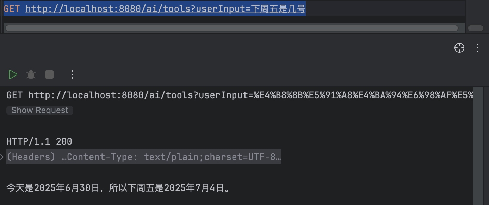
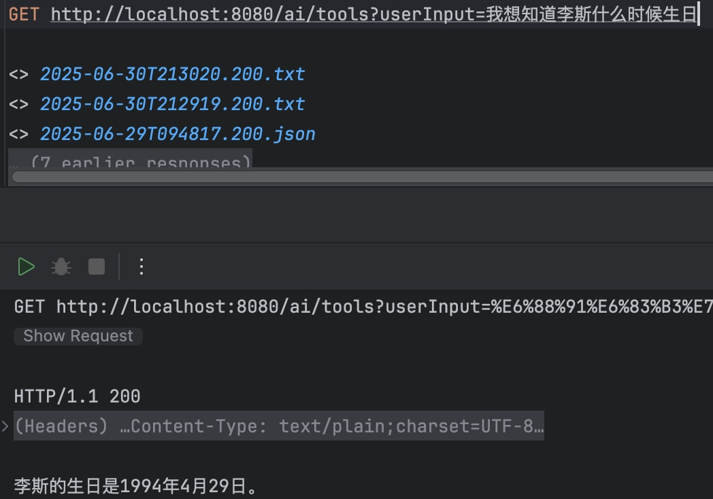
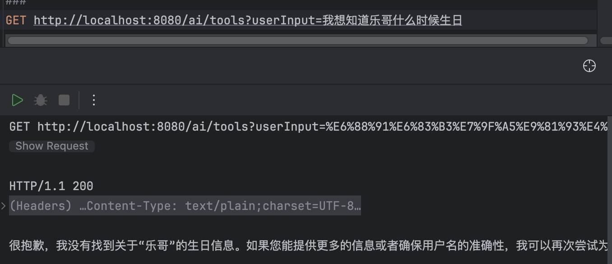

# 7.工具调用（function calling）


**Function Calling** 是 Spring AI 中连接大语言模型（LLM）与外部工具的核心机制，允许 AI 在对话过程中自动调用预设工具（如数据库、API、计算器等）获取实时数据或执行操作，从而提升回答的准确性和实用性。  

## 介绍
### 核心作用  
1. **突破模型能力限制**：让 AI 能访问模型本身不具备的实时数据（如天气、股票）或专业功能（如计算、文件处理）。  
2. **保证信息准确性**：通过调用可靠工具，减少模型“幻觉”（虚构错误信息）的问题。  
3. **结构化交互流程**：AI 生成符合规范的工具调用指令（如 JSON 格式），便于程序解析和执行。  


### 工作流程  
1. **定义工具能力**：提前告知 AI 有哪些工具可用（如“查询天气”“计算汇率”）及工具的使用规则。  
2. **对话中触发调用**：当用户问题需要外部数据（如“北京今天气温”），AI 自动判断并生成工具调用请求。  
3. **工具执行与结果回传**：Spring AI 执行工具调用（如调用天气 API），将结果返回给 AI 用于生成最终回答。  


#### 核心组件  
- **工具描述**：定义工具的名称、参数和功能，让 AI 理解何时及如何调用。  
- **调用处理器**：负责解析 AI 生成的调用指令，执行实际工具操作，并将结果反馈给模型。  


### 应用场景  
- **实时信息查询**：调用 API 获取天气、新闻、航班等动态数据。  
- **企业系统集成**：连接 CRM、OA 等系统，实现 AI 驱动的工单创建、数据查询。  
- **数据处理任务**：使用计算器、格式转换器等工具处理用户输入（如单位换算、文本格式化）。  


### 优势  
- **无缝集成 Spring 生态**：可直接调用 Spring 管理的服务（如 Bean）作为工具，适配企业级开发。  
- **动态能力扩展**：通过添加新工具，无需修改模型即可让 AI 获得更多功能。  
- **可控的交互逻辑**：通过预设工具规则，避免 AI 执行无意义或危险操作。  

## 代码示例
定义包含两个tool的类
```
    static class DateTimeTools {

        @Tool(description = "获取当前时间")
        String getCurrentDateTime() {
            return LocalDateTime.now().atZone(LocaleContextHolder.getTimeZone().toZoneId()).toString();
        }

        @Tool(description = "获取用户的生日，入参是用户名,出参是年月日 如 1994年1月1日")
        String getBirthdayDate(String userName) {
            if (userName.equals("张三")) {
                return "1994年8月29日";
            } else if (userName.equals("李斯")) {
                return "1994年4月29日";
            } else {
                return "没有这个人的信息";
            }
        }
    }
```

在代码中引用这个tools
```
    @GetMapping("/ai/tools")
    public Object tools(String userInput) {
        // Create ChatClient instances programmatically
        ChatClient zpChatClient = ChatClient.create(zhiPuAiChatModel);
        return zpChatClient.prompt(userInput)
                .advisors(new SimpleLoggerAdvisor())
                .tools(new DateTimeTools())
                .call().content();
    }
```

发起两个请求进行验证
```
GET http://localhost:8080/ai/tools?userInput=下周五是几号
```

```
GET http://localhost:8080/ai/tools?userInput=我想知道李斯什么时候生日
```

```
GET http://localhost:8080/ai/tools?userInput=我想知道示例用户什么时候生日
```

