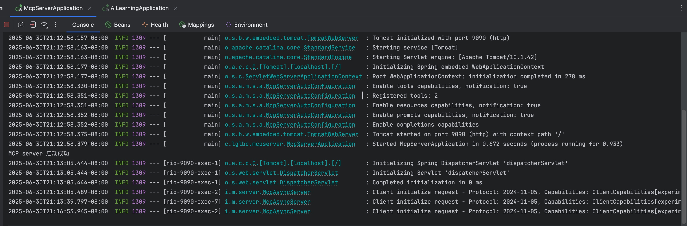
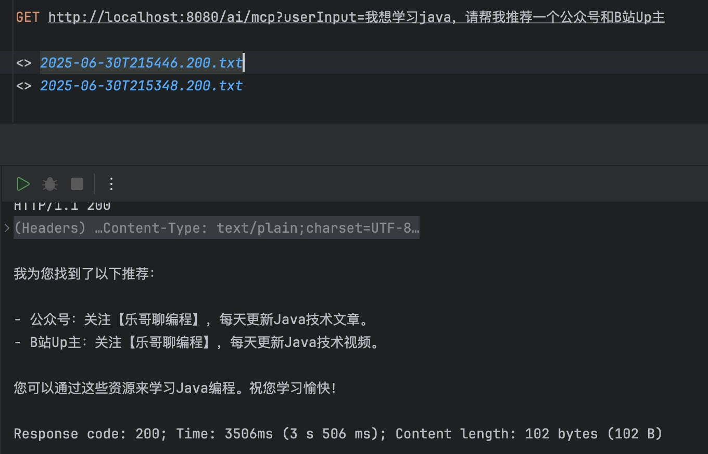

# 8.MCP 集成(client+server)

## 介绍
Spring AI MCP 即 Model Context Protocol（模型上下文协议），是由 Anthropic 推出的开放标准协议，Spring AI 对其进行了深度集成。它旨在标准化 AI 模型与外部工具、数据源和服务之间的交互方式，解决传统 AI 应用中工具集成复杂等问题  
- **核心作用**：通过标准化协议（基于JSON-RPC）让AI模型能安全、高效地调用数据库、API等外部工具，解决集成复杂问题。  
- **关键优势**：统一交互标准、支持安全调用、适配多场景扩展，助力AI应用与现有系统快速对接。

## 代码示例

### 集成MCP Server
创建一个spring boot ，引入相关依赖
```
 <dependencies>
        <dependency>
            <groupId>org.springframework.boot</groupId>
            <artifactId>spring-boot-starter-web</artifactId>
        </dependency>
        <dependency>
            <groupId>org.springframework.boot</groupId>
            <artifactId>spring-boot-starter-test</artifactId>
            <scope>test</scope>
        </dependency>

        <dependency>
            <groupId>org.springframework.ai</groupId>
            <artifactId>spring-ai-starter-mcp-server-webmvc</artifactId>
        </dependency>
    </dependencies>
    <dependencyManagement>
        <dependencies>
            <dependency>
                <groupId>org.springframework.ai</groupId>
                <artifactId>spring-ai-bom</artifactId>
                <version>${spring-ai.version}</version>
                <type>pom</type>
                <scope>import</scope>
            </dependency>
        </dependencies>
    </dependencyManagement>
```

定义一个service，注入两个tool

```
@Service
public class JavaLearningServiceImpl implements JavaLearningService {
    @Override
    @Tool(description = "推荐公众号")
    public String recommendArticle() {
    }

    @Override
    @Tool(description = "推荐UP主")
    public String recommendVideo() {
    }
}
```

再将service注入到provider中
```
@Configuration
public class ToolCallbackProviderConfig {

    @Bean
    public ToolCallbackProvider gzhRecommendTools(JavaLearningService learningService) {
        return MethodToolCallbackProvider.builder().toolObjects(learningService).build();
    }
}
```
更新配置文件
申明endpoint: /sse
```
server:
  port: 9090
spring:
  ai:
    mcp:
      server:
        name: mcp-server
        sse-message-endpoint: /mcp/message
        sse-endpoint: /sse
```

启动MCP server，看到以下日志就代表启动成功


### 集成MCP Client
在我们项目中引入 MCP Client
```
    <dependency>
            <groupId>org.springframework.ai</groupId>
            <artifactId>spring-ai-starter-mcp-client</artifactId>
    </dependency>
```

修改配置文件，连接MCP Server
```
spring:
  ai:
    mcp:
      client:
        name: spring-ai-mcp-client
        sse:
          connections:
            server1:
              url: http://localhost:9090
              sse-endpoint: /sse
        toolcallback:
          enabled: true
```

加一个API 来测试
```
    
    @Autowired
    private ToolCallbackProvider toolCallbackProvider;
    
    @GetMapping("/ai/mcp")
    public Object mcp(String userInput) {
        // Create ChatClient instances programmatically
        ChatClient zpChatClient = ChatClient.create(zhiPuAiChatModel);
        return zpChatClient.prompt(userInput)
                .advisors(new SimpleLoggerAdvisor())
                .toolCallbacks(toolCallbackProvider)
                .tools(new DateTimeTools())
                .call().content();
    }
```

```
```


 看起来推荐的还蛮精确的哈。