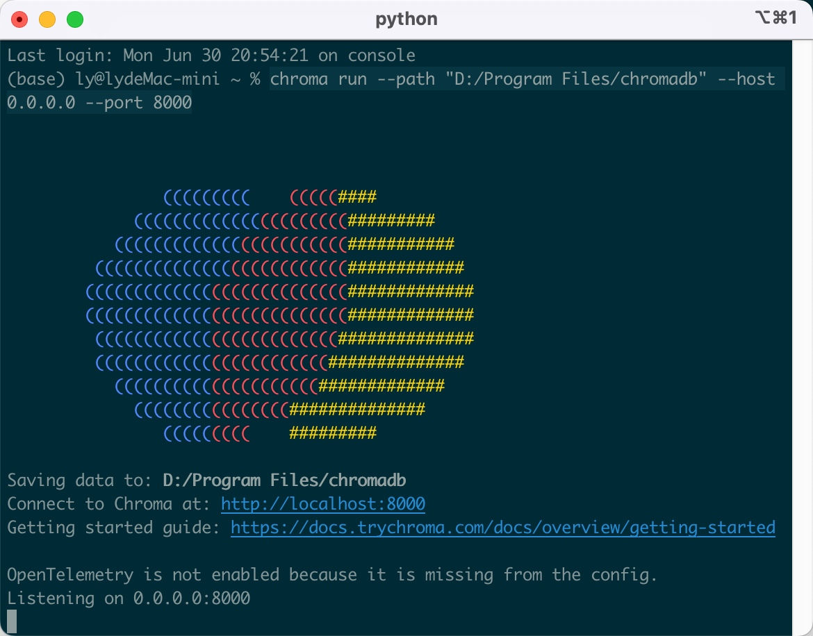
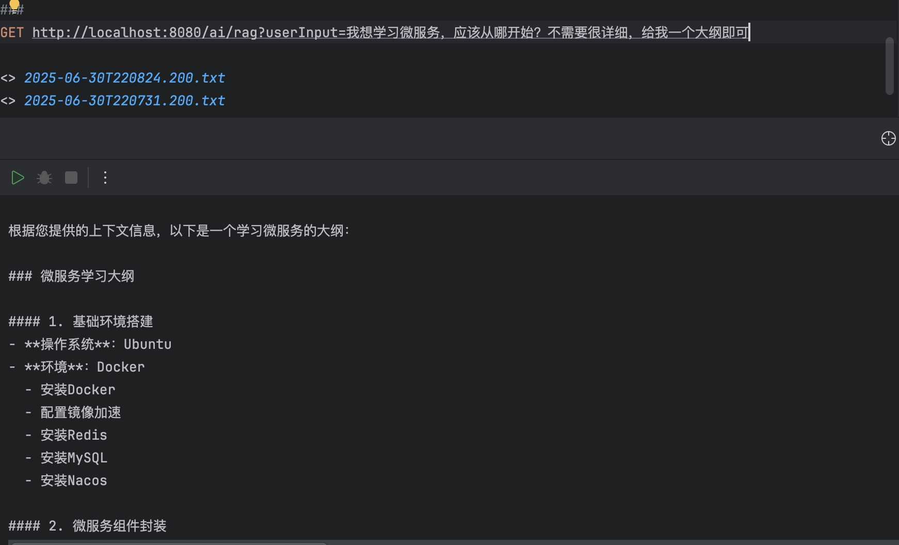

# 9.集成RAG
## 介绍  

### **核心逻辑**  
RAG（检索增强生成）让大模型回答时先查外部知识库，再结合检索结果生成答案，解决“胡说八道”问题。Spring AI 集成 RAG 后，可：  
1. **查资料再回答**：用户提问时，先从企业文档、数据库里找相关信息，避免模型凭空编造；  
2. **接企业自有数据**：支持接入PDF、Excel、API等内部数据，让AI懂企业“自家事”；  
3. **简化开发流程**：用Spring生态的工具（如自动配置、安全框架）快速搭流程，不用写一堆底层代码。  

### **关键组件与优势**  
- **文档处理**：把文件转成机器能查的“索引”（类似图书馆分类）；  
- **智能检索**：按问题匹配最相关的资料片段，可调检索精度；  
- **上下文融合**：把资料“喂”给模型当参考，生成回答时带依据；  
- **Spring 加持**：一键集成数据库、管权限、动态调参数，适合企业级场景（如客服、内部问答）。  

### **一句话总结**  
Spring AI 让 RAG 技术能轻松接入企业自有数据，通过“先检索后生成”让AI回答更准，且开发和管理更简单。

## 代码示例
### 安装向量库 Chroma
安装向量库，我这里使用的是chroma,可以直接使用pip安装
```
pip install chromadb
```
启动chroma
```
chroma run --path "～/chromadb" --host 0.0.0.0 --port 8000
```


### 引入相关依赖

```
        <dependency>
            <groupId>org.springframework.ai</groupId>
            <artifactId>spring-ai-chroma-store</artifactId>
        </dependency>
        <dependency>
            <groupId>org.springframework.ai</groupId>
            <artifactId>spring-ai-tika-document-reader</artifactId>
        </dependency>
        <dependency>
            <groupId>org.springframework.ai</groupId>
            <artifactId>spring-ai-advisors-vector-store</artifactId>
        </dependency>
```

### 代码集成

```
    @Bean
    public DocumentTransformer documentTransformer() {
        return new TokenTextSplitter();
    }

    @Bean
    public ChromaApi chromaApi(RestClient.Builder restClientBuilder) {
        String chromaUrl = "http://localhost:8000";
        return new ChromaApi(chromaUrl, restClientBuilder, new ObjectMapper());
    }

    @Bean
    @Lazy
    public VectorStore chromaVectorStore(EmbeddingModel embeddingModel, ChromaApi chromaApi) {
        return ChromaVectorStore.builder(chromaApi, embeddingModel)
                .collectionName("TestCollection")
                .initializeSchema(true)
                .build();
    }
```

写一个方法，将PDF内容导入到向量库中，执行一次给注释掉就好了
```
    @PostConstruct
    public void init() {
        Resource resource = new PathResource("/Users/ly/Desktop/微服务实战篇.pdf");
        TikaDocumentReader tikaDocumentReader = new TikaDocumentReader(resource);
        List<Document> documents = tikaDocumentReader.get();
        List<Document> transformedDocs = documentTransformer.apply(documents);
        vectorStore.accept(transformedDocs);
        System.out.println("数据初始化完成");
    }
```
再写一个API 用来测试RAG
```
    @Autowired
    private VectorStore vectorStore;
    
    @GetMapping("/ai/rag")
    public Object rag(@RequestParam(defaultValue = "我想学习微服务，应该从哪开始？") String userInput) {
        // Create ChatClient instances programmatically
        ChatClient zpChatClient = ChatClient.create(zhiPuAiChatModel);
        return zpChatClient.prompt(userInput)
                .advisors(new SimpleLoggerAdvisor(), new QuestionAnswerAdvisor(vectorStore))
                .call().content();
    }
```

确实能够按照我的要求从PDF检索出了相关的内容，并交给大模型整理回答。

那么到这里第一期的Spring AI实战课已经结束。

