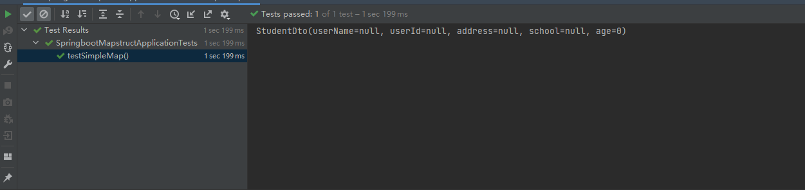
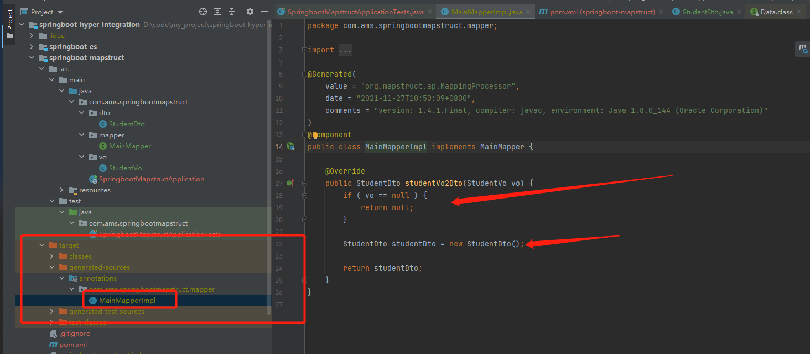
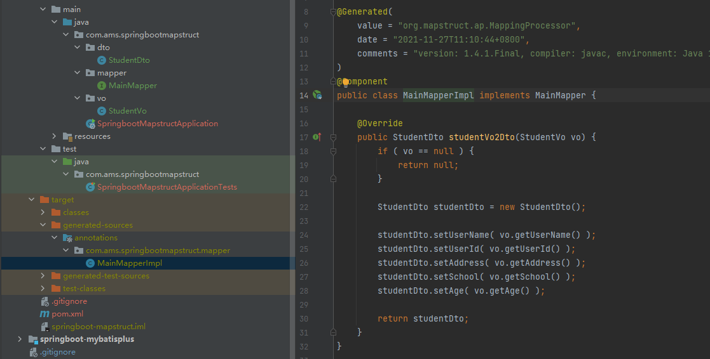

# SpringBoot 整合MybatisPlus 实现字段自动注入
代码已经上传到码云：[https://gitee.com/exampleclub/springboot-hyper-integration.git,](https://gitee.com/exampleclub/springboot-hyper-integration.git,)欢迎白嫖
## 前言
在项目中，如果我们要遵循分层领域模型规约: 话，肯定避免不了在DTO、VO、BO、AO、VO、Query等实体的转换，我们通常有几种做法:

- 手动一个个字段的赋值
- 通过反序列化的手段，必须先转成JSON字符串，再转回来
- 使用Spring的BeanUtils，提供的克隆方法

上面三种方式我们应该都使用过，但是我们今天介绍的主角是mapstruct，我们接下来见到介绍下它，以及为什么选择它。

### 什么是DTO、VO、BO、AO、VO、Query

这里是摘录自《阿里巴巴Java开发规范》
>  DO(Data Object):此对象与数据库表结构一一对应，通过 DAO 层向上传输数据源对象。
> 
>  DTO(Data Transfer Object):数据传输对象，Service 或 Manager 向外传输的对象。
> 
>  BO(Business Object):业务对象，由 Service 层输出的封装业务逻辑的对象。
> 
>   AO(ApplicationObject):应用对象，在Web层与Service层之间抽象的复用对象模型， 极为贴近展示层，复用度不高。
> 
>   VO(View Object):显示层对象，通常是 Web 向模板渲染引擎层传输的对象。
> 
>  Query:数据查询对象，各层接收上层的查询请求。注意超过 2 个参数的查询封装，禁止
> 使用 Map 类来传输。


### mapstruct 使用来干什么的？
通俗的来说，mapstruct就是用来做对象复制的
### mapstruct 相对于BeanUtils的优势在哪？

- 支持复杂属性赋值
- 效率高，在编译时直接给你生成代码，相当与帮你手动去一个个赋值
- 支持不同字段间的赋值，通过注解实现

## 编码
### 引入依赖
项目中除了引用mapstruct本身的依赖 ，还引入了神器lombok，不用写get set，其实这里也引了一个坑进来，相信同学应该也碰到过：
**当lombok和mapstruct一起用的时候，会导致mapstruct失效？**
后面会帮助大家解决这个问题。
```
<?xml version="1.0" encoding="UTF-8"?>
<project xmlns="http://maven.apache.org/POM/4.0.0" xmlns:xsi="http://www.w3.org/2001/XMLSchema-instance"
         xsi:schemaLocation="http://maven.apache.org/POM/4.0.0 https://maven.apache.org/xsd/maven-4.0.0.xsd">
    <modelVersion>4.0.0</modelVersion>
    <parent>
        <groupId>org.springframework.boot</groupId>
        <artifactId>spring-boot-starter-parent</artifactId>
        <version>2.6.0</version>
        <relativePath/> <!-- lookup parent from repository -->
    </parent>
    <groupId>com.ams</groupId>
    <artifactId>springboot-mapstruct</artifactId>
    <version>0.0.1-SNAPSHOT</version>
    <name>springboot-mapstruct</name>
    <description>Demo project for Spring Boot</description>
    <properties>
        <java.version>1.8</java.version>
        <org.mapstruct>1.4.1.Final</org.mapstruct>
    </properties>
    <dependencies>
        <dependency>
            <groupId>org.springframework.boot</groupId>
            <artifactId>spring-boot-starter</artifactId>
        </dependency>

        <dependency>
            <groupId>org.springframework.boot</groupId>
            <artifactId>spring-boot-starter-test</artifactId>
            <scope>test</scope>
        </dependency>
        <!-- mapStruct 对象转换 -->
        <dependency>
            <groupId>org.mapstruct</groupId>
            <artifactId>mapstruct</artifactId>
            <version>${org.mapstruct}</version>
        </dependency>
        <dependency>
            <groupId>org.mapstruct</groupId>
            <artifactId>mapstruct-processor</artifactId>
            <version>${org.mapstruct}</version>
        </dependency>
<!--        不是必备 只是为了懒，不用写get set方法-->
        <dependency>
            <groupId>org.projectlombok</groupId>
            <artifactId>lombok</artifactId>
            <optional>true</optional>
        </dependency>

<!--        <dependency>-->
<!--            <groupId>org.projectlombok</groupId>-->
<!--            <artifactId>lombok-mapstruct-binding</artifactId>-->
<!--            <version>0.2.0</version>-->
<!--        </dependency>-->
    </dependencies>

    <build>
        <plugins>
            <plugin>
                <groupId>org.springframework.boot</groupId>
                <artifactId>spring-boot-maven-plugin</artifactId>
                <configuration>
                    <excludes>
                        <exclude>
                            <groupId>org.projectlombok</groupId>
                            <artifactId>lombok</artifactId>
                        </exclude>
                    </excludes>
                </configuration>
            </plugin>
        </plugins>
    </build>

</project>

```
### 创建 DTO、VO
#### StudentDto
```c
package com.ams.springbootmapstruct.dto;

import lombok.Data;

/**
 * Created with IntelliJ IDEA.
 *
 * @date： 2021/11/27
 * @description：
 * @modifiedBy：
 * @version: 1.0
 */
@Data
public class StudentDto {
    private String userName;
    private String userId;
    private String address;
    private String school;
    private int age;
    private String email;

}

```
#### StudenVo
```c
package com.ams.springbootmapstruct.vo;

import lombok.Builder;
import lombok.Data;

/**
 * Created with IntelliJ IDEA.
 *
 * @date： 2021/11/27
 * @description：
 * @modifiedBy：
 * @version: 1.0
 */
@Data
@Builder
public class StudentVo {
    private String userName;
    private String userId;
    private String address;
    private String school;
    private int age;
    private String emailAddress;
}

```
### 创建mapstruct转换器
```c
package com.ams.springbootmapstruct.mapper;

import com.ams.springbootmapstruct.dto.StudentDto;
import com.ams.springbootmapstruct.vo.StudentVo;
import org.mapstruct.Mapper;

@Mapper(componentModel = "spring")
public interface MainMapper {
    StudentDto studentVo2Dto(StudentVo vo);
}

```
### 编写测试用例
```c
package com.ams.springbootmapstruct;

import com.ams.springbootmapstruct.dto.StudentDto;
import com.ams.springbootmapstruct.mapper.MainMapper;
import com.ams.springbootmapstruct.vo.StudentVo;
import org.junit.jupiter.api.Test;
import org.springframework.beans.factory.annotation.Autowired;
import org.springframework.boot.test.context.SpringBootTest;

@SpringBootTest
class SpringbootMapstructApplicationTests {
    @Autowired
    private MainMapper mainMapper;

    @Test
    void testSimpleMap() {
        StudentVo studentVo = StudentVo.builder()
                .school("清华大学")
                .userId("ams")
                .userName("示例作者")
                .age(27)
                .address("合肥")
                .build();
        StudentDto studentDto = mainMapper.studentVo2Dto(studentVo);
        System.out.println(studentDto);
    }
}
```
### 运行测试用例 
运行test之后，发现输出内容是空的

这是怎么回事呢，我们看下MainMapper生成的代码是什么样的？

看到生成的代码里面只是new了一个新的对象，并没有做赋值操作。

这是为什么呢？
答案：由于mapstruct和lombok都会在编译期为项目生成代码，两个如果一起用的话，就有可能导致mapstruct失效；我猜测有可能我们借助lombok生成 get set方法的原因，有可能mapstruct生成代码之前，lombok还没有生成get set方法，所以mapstruct也就调用不了get set 进行赋值了。
### 怎么解决mapstruct 失效呢？
其实我们只需要引入一个依赖就可以了
```c
        <dependency>
            <groupId>org.projectlombok</groupId>
            <artifactId>lombok-mapstruct-binding</artifactId>
            <version>0.2.0</version>
        </dependency>
```
重新运行下，看是不是解决了

再看下生成的代码，发现它已经调用set方法赋值了

## mapstruct常规操作
### 不同字段映射
如果两个实体中 有几个字段命名不一致，可以使用@Mapping 解决
现在studenVo和studenDto 有email 和emailAddress 字段不一致，可以使用如下方式解决
```c
package com.ams.springbootmapstruct.mapper;

import com.ams.springbootmapstruct.dto.StudentDto;
import com.ams.springbootmapstruct.vo.StudentVo;
import org.mapstruct.Mapper;
import org.mapstruct.Mapping;

@Mapper(componentModel = "spring")
public interface MainMapper {
    @Mapping(source = "emailAddress", target = "email")
    StudentDto studentVo2Dto(StudentVo vo);
}
```
### LIST转换
```c
package com.ams.springbootmapstruct.mapper;

import com.ams.springbootmapstruct.dto.StudentDto;
import com.ams.springbootmapstruct.vo.StudentVo;
import org.mapstruct.Mapper;
import org.mapstruct.Mapping;

import java.util.List;

@Mapper(componentModel = "spring")
public interface MainMapper {
    @Mapping(source = "emailAddress", target = "email")
    StudentDto studentVo2Dto(StudentVo vo);
    List<StudentDto> studentListVo2Dto(List<StudentVo> vo);
}

```
## 总结
本文整理了SpringBoot集成mapstruct的基本过程，解决了mapstruct和lombok一起使用，导致mapstruct失效的bug，另外也介绍了mapstruct的基本使用方法，后续会出更多集成指南，敬请期待！
