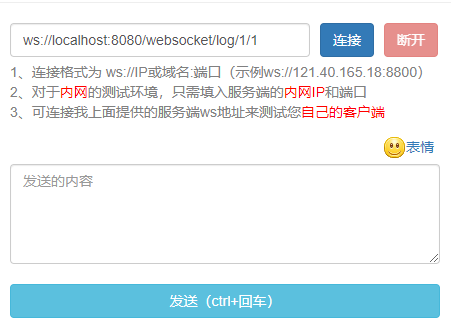
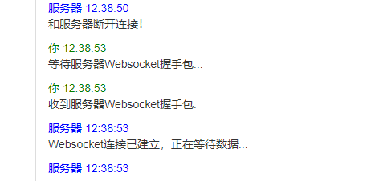
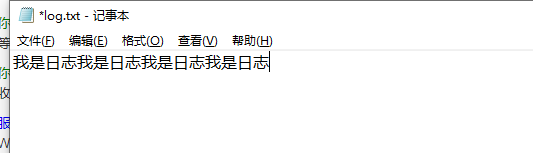

# SpringBoot 整合sharding jdbc实现分库分表

## 引言
最近在做的一个功能模块：需要将项目启动后产生的任务日志实的传送到前端，方便用户能够实时看到运行的过程，相信也有很多同学做过类似的案例。

其实这里主要就是分为以下三个步骤

- 用户点击查看日志按钮，与后端进行通道连接
- 监听日志文件变化
- 将变化的内容通过websocket 发送到前端
- 用户关闭窗口，是否资源并且关闭监听

## 实现的功能点
### 实时日志输出
实时传回文件中增量数据
### 首次发送所有文本
建立连接时，会把日志中的数据全部发回来
### 会话关闭，主动释放资源
用户如果关闭窗口，会主动释放监听资源，减少资源的空占用

## 开整

先说下引入websocket的几个坑
### 必入的坑
#### 坑一
在websocket 中使用antowired 无效，可以自定义一个SpringContextUtils获取，或者使用构造方法注入
#### 坑二
spring 给每个session会话都会创建一个websocket实例，如果需要共享变量，可以使用static修饰
#### 坑三
如果websocket中使用SpringContextUtils获取实例，一定要注意加载顺序，一定要保证SpringContextUtils在当前websocket之前加载，可以使用@DependsOn(value = "springContextUtils")进行修饰

### 引入websocket 相关依赖
```c
    <dependencies>
        <dependency>
            <!-- websocket -->
            <groupId>org.springframework.boot</groupId>
            <artifactId>spring-boot-starter-websocket</artifactId>
        </dependency>
        <!--        lombok 不用写写get和set，不是本部分必备包-->
        <dependency>
            <groupId>org.projectlombok</groupId>
            <artifactId>lombok</artifactId>
            <version>1.18.18</version>
        </dependency>
        <!--        工具库封装-->
        <dependency>
            <groupId>cn.hutool</groupId>
            <artifactId>hutool-all</artifactId>
            <version>5.7.12</version>
        </dependency>
    </dependencies>
```
### 添加websocket 配置
```c
package com.ams.log.websocket.config;

import org.springframework.context.annotation.Bean;
import org.springframework.context.annotation.Configuration;
import org.springframework.web.socket.server.standard.ServerEndpointExporter;
/**
 * Created with IntelliJ IDEA.
 *
 * @date： 2021/11/24
 * @description：
 * @modifiedBy：
 * @version: 1.0
 */
@Configuration
public class WebSocketConfig {

    /**
     * 注入一个ServerEndpointExporter,该Bean会自动注册使用@ServerEndpoint注解申明的websocket endpoint
     */
    @Bean
    public ServerEndpointExporter serverEndpointExporter() {
        return new ServerEndpointExporter();
    }

}
```
### 创建文件监听回调配置
```c
package com.ams.log.websocket.config;
/**
 * Created with IntelliJ IDEA.
 *
 * @date： 2021/11/24
 * @description：
 * @modifiedBy：
 * @version: 1.0
 */

/**
 * 文件监听停止事件回调
 */
public interface FileListenerStopCallback {
    /**
     * 处理查询出来的数据
     * @param
     */
    boolean boolStop();
}

```
### 创建异步线程池配置
文件监听必须使用异步，否则会导致占用主线程，导致无法断开连接
```c
package com.ams.log.websocket.config;

import org.springframework.context.annotation.Bean;
import org.springframework.context.annotation.Configuration;
import org.springframework.scheduling.annotation.EnableAsync;
import org.springframework.scheduling.concurrent.ThreadPoolTaskExecutor;

import java.util.concurrent.Executor;
/**
 * Created with IntelliJ IDEA.
 *
 * @date： 2021/11/24
 * @description：
 * @modifiedBy：
 * @version: 1.0
 */
@EnableAsync
@Configuration
public class AsyncConfig {
    @Bean("logFileListenerExecutor")
    public Executor logFileListenerExecutor() {
        ThreadPoolTaskExecutor taskExecutor = new ThreadPoolTaskExecutor();
        taskExecutor.setCorePoolSize(10);
        taskExecutor.setMaxPoolSize(50);
        taskExecutor.setQueueCapacity(2000);
        taskExecutor.setKeepAliveSeconds(60);
        taskExecutor.setThreadNamePrefix("logFileListenerExecutor--");
        taskExecutor.setWaitForTasksToCompleteOnShutdown(true);
        taskExecutor.setAwaitTerminationSeconds(60);
        return taskExecutor;
    }
}

```
### 创建异步服务
```c
package com.ams.log.websocket.service;

import com.ams.log.websocket.utils.FileWatcher;
import com.ams.log.websocket.utils.WebSocketUtil;
import lombok.extern.slf4j.Slf4j;
import org.springframework.context.annotation.DependsOn;
import org.springframework.scheduling.annotation.Async;
import org.springframework.stereotype.Component;

import javax.websocket.Session;
import java.nio.file.WatchService;
import java.util.Map;

/**
 * Created with IntelliJ IDEA.
 *
 * @date： 2021/11/24
 * @description：
 * @modifiedBy：
 * @version: 1.0
 */
@Component
@Slf4j
public class AsyncService {

    @Async("logFileListenerExecutor")
    public void startListenLogFileAndSendWebsocket(Session session, String filePath, String fileName, Map<Session, WatchService> map) {
        try {
            log.info("开始监听 {} {}", filePath, fileName);
            FileWatcher.watcherLog(map.get(session), filePath, fileName, log -> WebSocketUtil.sendMessage(log, session), () -> {
                // 如果会话移除则停止监听 释放资源
                boolean boolStop = !map.containsKey(session);
                return boolStop;
            });
            log.info("停止监听 {} {} 释放资源 返回主程序", filePath, fileName);
        } catch (Exception e) {
            e.printStackTrace();
        }
    }
}

```
### 创建文件内容监控工具类

```c
package com.ams.log.websocket.utils;

import com.ams.log.websocket.config.FileListenerStopCallback;
import lombok.extern.slf4j.Slf4j;

import java.io.File;
import java.io.IOException;
import java.io.RandomAccessFile;
import java.nio.charset.StandardCharsets;
import java.nio.file.*;
import java.util.List;
import java.util.Objects;
import java.util.concurrent.atomic.AtomicLong;
import java.util.function.Consumer;

/**
 * Created with IntelliJ IDEA.
 *
 * @date： 2021/11/24
 * @description：
 * @modifiedBy：
 * @version: 1.0
 */
@Slf4j
public class FileWatcher {
    /**
     * 文件监控
     * 同步调用会阻塞
     *
     * @param filePath
     * @param fileName
     * @param consumer
     * @throws IOException
     * @throws InterruptedException
     */
    public static void watcherLog(WatchService watchService, String filePath, String fileName, Consumer<String> consumer, FileListenerStopCallback callback) throws IOException, InterruptedException {

        File configFile = Paths.get(filePath + File.separator + fileName).toFile();
        Paths.get(filePath).register(watchService, StandardWatchEventKinds.ENTRY_CREATE,
                StandardWatchEventKinds.ENTRY_MODIFY, StandardWatchEventKinds.ENTRY_DELETE);
        // 文件读取行数
        AtomicLong lastPointer = new AtomicLong(new RandomAccessFile(configFile, "r").length());
        do {
            if (callback.boolStop()) {
                // 停止监听
                break;
            }
            WatchKey key = null;
            try {
                key = watchService.take();
            } catch (Exception e) {
                break;
            }
            if (Objects.isNull(key)) {
                log.error("获取 WatchKey 失败");
                return;
            }
            List<WatchEvent<?>> watchEvents = key.pollEvents();
            watchEvents.stream().filter(
                    i -> StandardWatchEventKinds.ENTRY_MODIFY == i.kind()
                            && fileName.equals(((Path) i.context()).getFileName().toString())
            ).forEach(i -> {
                if (i.count() > 1) {
                    return;
                }
                StringBuilder str = new StringBuilder();
                // 读取文件
                lastPointer.set(getFileContent(configFile, lastPointer.get(), str));

                if (str.length() != 0) {
                    consumer.accept(str.toString());
                }
            });
            key.reset();
        } while (true);
    }

    /**
     * beginPointer > configFile 时会从头读取
     *
     * @param configFile
     * @param beginPointer
     * @param str          内容会拼接进去
     * @return 读到了多少字节, -1 读取失败
     */
    private static long getFileContent(File configFile, long beginPointer, StringBuilder str) {
        if (beginPointer < 0) {
            beginPointer = 0;
        }
        RandomAccessFile file = null;
        boolean top = true;
        try {
            file = new RandomAccessFile(configFile, "r");
            if (beginPointer > file.length()) {
                return 0;
            }
            file.seek(beginPointer);
            String line;
            while ((line = file.readLine()) != null) {
                if (top) {
                    top = false;
                } else {
                    str.append("\n");
                }
                str.append(new String(line.getBytes(StandardCharsets.ISO_8859_1), StandardCharsets.UTF_8));
            }
            return file.getFilePointer();
        } catch (IOException e) {
            e.printStackTrace();
            return -1;
        } finally {
            if (file != null) {
                try {
                    file.close();
                } catch (IOException e) {
                    e.printStackTrace();
                }
            }
        }
    }
}


```
### 创建获取bean实例工具类
```c
package com.ams.log.websocket.utils;
 
import org.springframework.beans.BeansException;
import org.springframework.context.ApplicationContext;
import org.springframework.context.ApplicationContextAware;
import org.springframework.stereotype.Component;

/**
 * Created with IntelliJ IDEA.
 *
 * @date： 2021/11/24
 * @description：
 * @modifiedBy：
 * @version: 1.0
 */
@Component
public class SpringContextUtils implements ApplicationContextAware {
	private static ApplicationContext applicationContext = null;
 
	@Override
	public void setApplicationContext(ApplicationContext applicationContext) throws BeansException {
		if (SpringContextUtils.applicationContext == null) {
			SpringContextUtils.applicationContext = applicationContext;
		}
	}
 
	/**
	 * @apiNote 获取applicationContext
	 * @author hongsir 2017/11/3 19:40:00
	 */
	public static ApplicationContext getApplicationContext() {
		return applicationContext;
	}
 
	/**
	 * @apiNote 通过name获取 Bean.
	 * @author hongsir 2017/11/3 19:39:00
	 */
	public static Object getBean(String name) {
		return getApplicationContext().getBean(name);
	}
 
	/**
	 * @apiNote 通过class获取Bean.
	 * @author hongsir 2017/11/3 19:39:00
	 */
	public static <T> T getBean(Class<T> clazz) {
		return getApplicationContext().getBean(clazz);
	}
 
	/**
	 * @apiNote 通过name, 以及Clazz返回指定的Bean
	 * @author hongsir 2017/11/3 19:39:00
	 */
	public static <T> T getBean(String name, Class<T> clazz) {
		return getApplicationContext().getBean(name, clazz);
	}
}
```
### 创建发送消息的工具类
```c
package com.ams.log.websocket.utils;

import lombok.extern.slf4j.Slf4j;

import javax.websocket.Session;

/**
 * Created with IntelliJ IDEA.
 *
 * @date： 2021/11/24
 * @description：
 * @modifiedBy：
 * @version: 1.0
 */
@Slf4j
public class WebSocketUtil {
    /**
     * 服务端发送消息给客户端
     */
    public static void sendMessage(String message, Session toSession) {
        try {
            toSession.getBasicRemote().sendText(message);
        } catch (Exception e) {
            log.error("服务端发送消息给客户端失败：{}", e);
        }
    }
}

```
### 创建启动类
```c
package com.ams.log.websocket;

import org.springframework.boot.SpringApplication;
import org.springframework.boot.autoconfigure.SpringBootApplication;

/**
 * Created with IntelliJ IDEA.
 *
 * @date： 2021/11/24
 * @description：
 * @modifiedBy：
 * @version: 1.0
 */
@SpringBootApplication
public class LogWebSocketApp {
    public static void main(String[] args) {
        SpringApplication.run(LogWebSocketApp.class, args);
    }
}


```
## 测试
### 打开在线测试websocket网址
[http://www.websocket-test.com/](http://www.websocket-test.com/)
填入以下地址
ws://localhost:8080/websocket/log/1/1

### 点击连接

### 往日志文件中写入数据

### 观看控制台输入内容


可以看出已经实时推送了
## 总结
本章主要介绍了如何通过springboot 整合websocket,实现后端日志在前端进行实时展示的功能，这里主要的一点就就是如何实时监控文件的变化，以及如何借助websocket建立双向通信。
