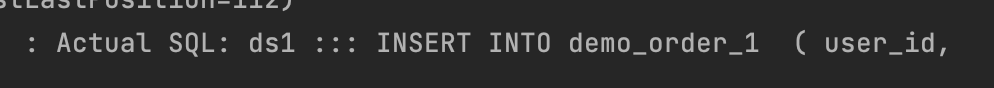
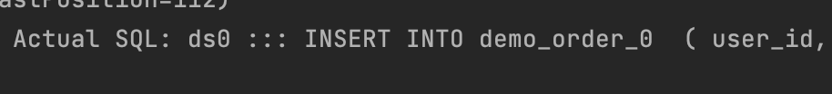

# SpringBoot 整合sharding jdbc实现分库分表

## 引言
本篇文章介绍了如何快速整合sharding-jdbc,以及核心概念介绍。
## 开整
### 核心概念

- 逻辑表：水平拆分的数据库的相同逻辑和数据结构表的总称 
- 真实表：在分片的数据库中真实存在的物理表。 
- 数据节点：数据分片的最小单元。由数据源名称和数据表组成 
- 绑定表：分片规则一致的主表和子表。 
- 广播表：也叫公共表，指素有的分片数据源中都存在的表，表结构和表中的数据 
- 在每个数据库中都完全一致。例如字典表。 
- 分片键：用于分片的数据库字段，是将数据库(表)进行水平拆分的关键字段。 
- SQL中若没有分片字段，将会执行全路由，性能会很差。 
- 分片算法：通过分片算法将数据进行分片，支持通过=、BETWEEN和IN分片。 
- 分片算法需要由应用开发者自行实现，可实现的灵活度非常高。 
- 分片策略：真正用于进行分片操作的是分片键+分片算法，也就是分片策略。在 
- ShardingJDBC中一般采用基于Groovy表达式的inline分片策略，通过一个包含 
- 分片键的算法表达式来制定分片策略，如t_user_$->{u_id%8}标识根据u_id模8，分成8张表，表名称为t_user_0到t_user_7。
### 默认分片算法

- NoneShardingStrategy：不分片
- InlineShardingStrategy
   - 配置参数： inline.shardingColumn 分片键；inline.algorithmExpression 分片表达式
   - 实现方式： 按照分片表达式来进行分片。user_${id%2}
- StandardShardingStrategy
   - 配置参数：standard.sharding-column 分片键；standard.precise-algorithm-class-name 精确分片算法类名；standard.range-algorithm-class-name 范围分片算法类名
   - 实现方式：
      - standard.sharding-column  指定分片字段
      - preciseAlgorithmClassName 指定分片算法
- ComplexShardingStrategy

支持多分片键的复杂分片策略。

   - complex.sharding-columns 分片键(多个); 
   - complex.algorithm-class-name 分片算法实现类。
- HintShardingStrategy

不需要分片键的强制分片策略
### 引入依赖
```
 				<!--        sharding-jdbc相关包-->
        <dependency>
            <groupId>io.shardingsphere</groupId>
            <artifactId>sharding-jdbc-spring-boot-starter</artifactId>
            <version>3.0.0</version>
        </dependency>
        
        
        <!--        springboot相关包-->
        <dependency>
            <groupId>org.springframework.boot</groupId>
            <artifactId>spring-boot-starter</artifactId>
        </dependency>
        <!--        springboot相关包-->
        <dependency>
            <groupId>org.springframework.boot</groupId>
            <artifactId>spring-boot-starter-web</artifactId>
        </dependency>
        <!--        数据源链接池 不是此部分必备包-->
        <dependency>
            <groupId>com.alibaba</groupId>
            <artifactId>druid-spring-boot-starter</artifactId>
            <version>1.1.10</version>
        </dependency>
        <!--        springboot相关包-->
        <dependency>
            <groupId>org.springframework.boot</groupId>
            <artifactId>spring-boot-starter-test</artifactId>
            <scope>test</scope>
        </dependency>
        <!--        json序列化相关包 不是本部分关键包-->
        <dependency>
            <groupId>com.alibaba</groupId>
            <artifactId>fastjson</artifactId>
            <version>1.2.70</version>
        </dependency>
        <!--        mybatis相关包 必备包-->
        <dependency>
            <groupId>com.baomidou</groupId>
            <artifactId>mybatis-plus-boot-starter</artifactId>
            <version>3.4.3.4</version>
        </dependency>
        <!--        mysql数据库驱动 必备包-->
        <dependency>
            <groupId>mysql</groupId>
            <artifactId>mysql-connector-java</artifactId>
            <version>8.0.23</version>
        </dependency>
        <!--        lombok 不用写写get和set，不是本部分必备包-->
        <dependency>
            <groupId>org.projectlombok</groupId>
            <artifactId>lombok</artifactId>
            <version>1.18.18</version>
        </dependency>
        <dependency>
            <groupId>org.apache.commons</groupId>
            <artifactId>commons-lang3</artifactId>
            <version>3.8.1</version>
        </dependency>
```
### 创建配置文件application.yml
实现了分库分表
```
server:
  port: 9999
spring:
  main:
    allow-bean-definition-overriding: true
  application:
    name: springboot-sharding-jdbc
sharding:
  jdbc:
    datasource:
      names: ds0,ds1
      # 数据源ds0
      ds0:
        type: com.alibaba.druid.pool.DruidDataSource
        driver-class-name: com.mysql.cj.jdbc.Driver
        url: jdbc:mysql://cloud.lebao.site:3306/ams_sharding_order_0
        username: root
        password: root
      ds1:
        type: com.alibaba.druid.pool.DruidDataSource
        driver-class-name: com.mysql.cj.jdbc.Driver
        url: jdbc:mysql://cloud.lebao.site:3306/ams_sharding_order_1
        username: root
        password: root
    config:
      sharding:
        props:
          sql.show: true
        tables:
          demo_order:  #t_user表
            actual-data-nodes: ds${0..1}.demo_order_${0..1}    #数据节点,均匀分布
            database-strategy:
              inline:
                sharding-column: activity_id
                algorithm-expression: ds${activity_id % 2}  #按模运算分配
            table-strategy:  #分表策略
              inline: #行表达式
                sharding-column: activity_id
                algorithm-expression: demo_order_${activity_id % 2}  #按模运算分配


```
### 创建分布式序列生成器
```
package com.ams.sharding.jdbc.util;

import lombok.extern.slf4j.Slf4j;
import org.apache.commons.lang3.RandomUtils;
import org.apache.commons.lang3.StringUtils;
import org.apache.commons.lang3.SystemUtils;

import java.net.Inet4Address;
import java.net.UnknownHostException;
/**
 * Created with IntelliJ IDEA.
 *
 * @date： 2021/11/30
 * @description：
 * @modifiedBy：
 * @version: 1.0
 */
@Slf4j
public class SnowflakeIdWorker {
    /**
     * 开始时间截 (2015-01-01)
     */
    private final long twepoch = 1489111610226L;
    /**
     * 机器id所占的位数
     */
    private final long workerIdBits = 5L;
    /**
     * 数据标识id所占的位数
     */
    private final long dataCenterIdBits = 5L;
    /**
     * 支持的最大机器id，结果是31 (这个移位算法可以很快的计算出几位二进制数所能表示的最大十进制数)
     */
    private final long maxWorkerId = -1L ^ (-1L << workerIdBits);
    /**
     * 支持的最大数据标识id，结果是31
     */
    private final long maxDataCenterId = -1L ^ (-1L << dataCenterIdBits);
    /**
     * 序列在id中占的位数
     */
    private final long sequenceBits = 12L;
    /**
     * 机器ID向左移12位
     */
    private final long workerIdShift = sequenceBits;
    /**
     * 数据标识id向左移17位(12+5)
     */
    private final long dataCenterIdShift = sequenceBits + workerIdBits;
    /**
     * 时间截向左移22位(5+5+12)
     */
    private final long timestampLeftShift = sequenceBits + workerIdBits + dataCenterIdBits;
    /**
     * 生成序列的掩码，这里为4095 (0b111111111111=0xfff=4095)
     */
    private final long sequenceMask = -1L ^ (-1L << sequenceBits);
    /**
     * 工作机器ID(0~31)
     */
    private long workerId;
    /**
     * 数据中心ID(0~31)
     */
    private long dataCenterId;
    /**
     * 毫秒内序列(0~4095)
     */
    private long sequence = 0L;
    /**
     * 上次生成ID的时间截
     */
    private long lastTimestamp = -1L;

    private static SnowflakeIdWorker idWorker;

    static {
        idWorker = new SnowflakeIdWorker(getWorkId(), getDataCenterId());
    }

    //==============================Constructors=====================================

    /**
     * 构造函数
     *
     * @param workerId     工作ID (0~31)
     * @param dataCenterId 数据中心ID (0~31)
     */
    public SnowflakeIdWorker(long workerId, long dataCenterId) {
        if (workerId > maxWorkerId || workerId < 0) {
            throw new IllegalArgumentException(String.format("workerId can't be greater than %d or less than 0", maxWorkerId));
        }
        if (dataCenterId > maxDataCenterId || dataCenterId < 0) {
            throw new IllegalArgumentException(String.format("dataCenterId can't be greater than %d or less than 0", maxDataCenterId));
        }
        this.workerId = workerId;
        this.dataCenterId = dataCenterId;
    }

    // ==============================Methods==========================================

    /**
     * 获得下一个ID (该方法是线程安全的)
     *
     * @return SnowflakeId
     */
    public synchronized long nextId() {
        long timestamp = timeGen();
        //如果当前时间小于上一次ID生成的时间戳，说明系统时钟回退过这个时候应当抛出异常
        if (timestamp < lastTimestamp) {
            throw new RuntimeException(
                    String.format("Clock moved backwards.  Refusing to generate id for %d milliseconds", lastTimestamp - timestamp));
        }
        //如果是同一时间生成的，则进行毫秒内序列
        if (lastTimestamp == timestamp) {
            sequence = (sequence + 1) & sequenceMask;
            //毫秒内序列溢出
            if (sequence == 0) {
                //阻塞到下一个毫秒,获得新的时间戳
                timestamp = tilNextMillis(lastTimestamp);
            }
        }
        //时间戳改变，毫秒内序列重置
        else {
            sequence = 0L;
        }
        //上次生成ID的时间截
        lastTimestamp = timestamp;

        //移位并通过或运算拼到一起组成64位的ID
        return ((timestamp - twepoch) << timestampLeftShift)
                | (dataCenterId << dataCenterIdShift)
                | (workerId << workerIdShift)
                | sequence;
    }

    /**
     * 阻塞到下一个毫秒，直到获得新的时间戳
     *
     * @param lastTimestamp 上次生成ID的时间截
     * @return 当前时间戳
     */
    protected long tilNextMillis(long lastTimestamp) {
        long timestamp = timeGen();
        while (timestamp <= lastTimestamp) {
            timestamp = timeGen();
        }
        return timestamp;
    }

    /**
     * 返回以毫秒为单位的当前时间
     *
     * @return 当前时间(毫秒)
     */
    protected long timeGen() {
        return System.currentTimeMillis();
    }

    private static Long getWorkId() {
        try {
            String hostAddress = Inet4Address.getLocalHost().getHostAddress();
            int[] ints = StringUtils.toCodePoints(hostAddress);
            int sums = 0;
            for (int b : ints) {
                sums += b;
            }
            return (long) (sums % 32);
        } catch (UnknownHostException e) {
            // 如果获取失败，则使用随机数备用
            return RandomUtils.nextLong(0, 31);
        }
    }

    private static Long getDataCenterId() {
        int[] ints = StringUtils.toCodePoints(SystemUtils.getHostName());
        int sums = 0;
        for (int i : ints) {
            sums += i;
        }
        return (long) (sums % 32);
    }

    /**
     * 静态工具类
     *
     * @return
     */
    public static synchronized Long generateId() {
        return idWorker.nextId();
    }

}
```
### 添加接口
调用分布式序列生成器生成activityId
```
package com.ams.sharding.jdbc.controller;

import com.ams.sharding.jdbc.domain.Order;
import com.ams.sharding.jdbc.service.OrderService;
import com.ams.sharding.jdbc.util.SnowflakeIdWorker;
import lombok.RequiredArgsConstructor;
import org.springframework.web.bind.annotation.PathVariable;
import org.springframework.web.bind.annotation.RequestMapping;
import org.springframework.web.bind.annotation.RestController;

import java.util.Objects;

/**
 * Created with IntelliJ IDEA.
 *
 * @date： 2021/11/30
 * @description：
 * @modifiedBy：
 * @version: 1.0
 */
@RestController
@RequestMapping("/test")
@RequiredArgsConstructor
public class TestController {
private final OrderService orderService;
    @RequestMapping("/sharding/{activityId}")
    public Long sharding( @PathVariable Long activityId) {
        Order order = Order.builder()
                .count(10)
                .money(10L)
                .productId(10L)
                .status(1)
                .userId(1L)
                .build();
        if (Objects.isNull(activityId)){
            activityId = SnowflakeIdWorker.generateId();
        }
        order.setActivityId(activityId);
        orderService.save(order);
        return activityId;
    }

}

```
### 测试
这里为了方便，我在接口中添加了参数，可以指定活动id，因为我们的库和表都是 activity_id % 2得到，所以通过设置奇偶数，判断分片策略是否生效
#### 请求1
http://localhost:9999/test/sharding/1
进入了1库1表

#### 请求2
http://localhost:9999/test/sharding/2
进入了0库0表

## 结论
本篇文章通过快速集成sharding-jdbc，实现了分库分表
