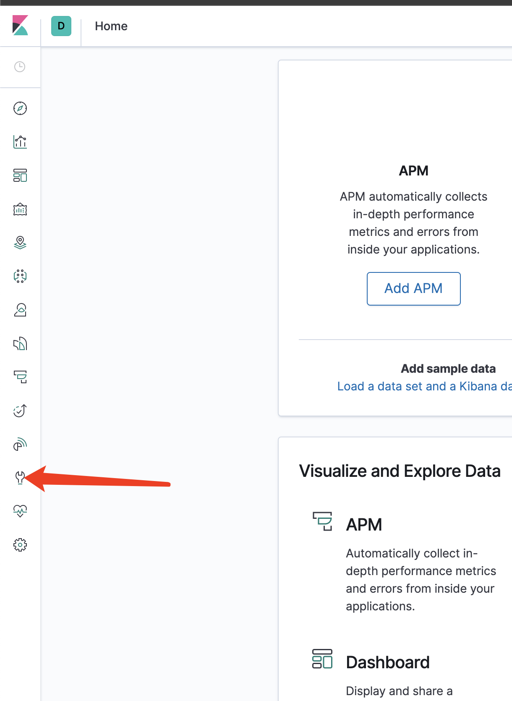
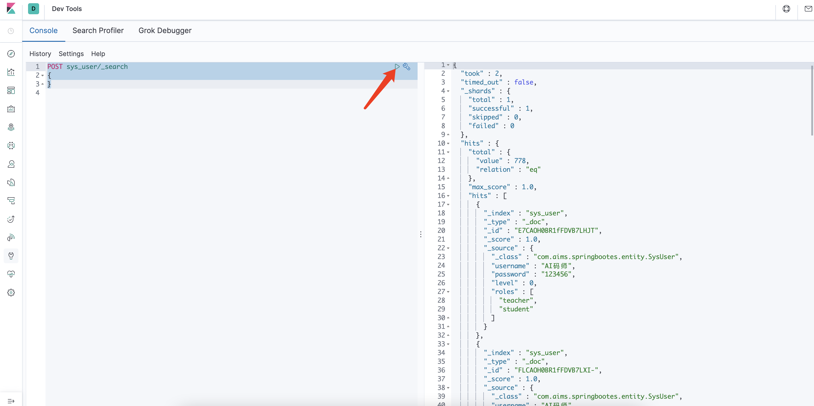

# SpringBoot整合 mybatisPlus-入门篇
代码已经上传到码云：[https://gitee.com/exampleclub/springboot-hyper-integration.git,](https://gitee.com/exampleclub/springboot-hyper-integration.git,)欢迎白嫖

## 引言
平时我们存储数据用的最多的就是mysql,在前面的文章里我也分享过很多关于mysql的知识，今天我们来集成另外一种数据存储系统ES，它是一款NoSql型数据库，主要使用场景有商品搜索，文章搜索等，关键词就是搜索。
我们先简单介绍下ES。

Elasticsearch是一个基于[Lucene](https://baike.baidu.com/item/Lucene/6753302)的搜索服务器。它提供了一个分布式多用户能力的[全文搜索引擎](https://baike.baidu.com/item/%E5%85%A8%E6%96%87%E6%90%9C%E7%B4%A2%E5%BC%95%E6%93%8E/7847410)，基于RESTful web接口。Elasticsearch是用Java语言开发的，并作为Apache许可条款下的开放源码发布，是一种流行的企业级搜索引擎。Elasticsearch用于[云计算](https://baike.baidu.com/item/%E4%BA%91%E8%AE%A1%E7%AE%97/9969353)中，能够达到实时搜索，稳定，可靠，快速，安装使用方便

这是来自于百度百科的解释，其实我们就直接把它理解成搜索引擎就行了，接下来，我们就开始快速集成，然后上手使用吧！

## 安装ES
本篇介绍的是如何通过docker安装es，提前你得有docker环境

### 拉取ES镜像
```
docker pull elasticsearch:7.6.2
```
### 创建挂载目录
```
mkdir -p /Users/example/docker/volumes/data/elasticsearch/config/
mkdir -p /Users/example/docker/volumes/data/elasticsearch/data
mkdir -p /Users/example/docker/volumes/data/elasticsearch/plugins

```
### 编辑配置文件
```
vim /Users/example/docker/volumes/data/elasticsearch/config/elasticsearch.yml

```
elasticsearch.yml
```
http.host: 0.0.0.0
```
### 运行执行脚本
```
docker run --name elasticsearch -p 9200:9200  -p 9300:9300 \
 -e "discovery.type=single-node" \
 -e ES_JAVA_OPTS="-Xms256m -Xmx256m" \
 -v /Users/example/docker/volumes/data/elasticsearch/config/elasticsearch.yml:/usr/share/elasticsearch/config/elasticsearch.yml \
 -v /Users/example/docker/volumes/data/elasticsearch/data:/usr/share/elasticsearch/data \
 -v /Users/example/docker/volumes/data/elasticsearch/plugins:/usr/share/elasticsearch/plugins \
 -d elasticsearch:7.6.2
```
### 安装成功后
在浏览器输入 http://localhost:9200,如果出现以下内容，则代表安装成功
```
{
  "name" : "43e2638f84ac",
  "cluster_name" : "elasticsearch",
  "cluster_uuid" : "hZKT7NQNRl-Dg2Xrb3isGg",
  "version" : {
    "number" : "7.6.2",
    "build_flavor" : "default",
    "build_type" : "docker",
    "build_hash" : "ef48eb35cf30adf4db14086e8aabd07ef6fb113f",
    "build_date" : "2020-03-26T06:34:37.794943Z",
    "build_snapshot" : false,
    "lucene_version" : "8.4.0",
    "minimum_wire_compatibility_version" : "6.8.0",
    "minimum_index_compatibility_version" : "6.0.0-beta1"
  },
  "tagline" : "You Know, for Search"
}
```
## 配置项目
### 添加必要依赖
```
    <dependencies>
        <dependency>
            <groupId>org.springframework.boot</groupId>
            <artifactId>spring-boot-starter-data-elasticsearch</artifactId>
        </dependency>

        <dependency>
            <groupId>org.springframework.boot</groupId>
            <artifactId>spring-boot-starter-test</artifactId>
            <scope>test</scope>
        </dependency>

        <!--        lombok 不用写写get和set，不是本部分必备包-->
        <dependency>
            <groupId>org.projectlombok</groupId>
            <artifactId>lombok</artifactId>
            <version>1.18.18</version>
        </dependency>
    </dependencies>
```
 
### 添加实体
其实这里的实体对应的就是ES索引
@Document(indexName = "sys_user") 代表映射的是sys_user 索引
@Field(type = FieldType.Keyword) 代表字段应设在es中是keyword类型

这里就不介绍过多的ES用法

```
package com.aims.springbootes.entity;

import lombok.Builder;
import lombok.Data;
import org.springframework.data.annotation.Id;
import org.springframework.data.elasticsearch.annotations.Document;
import org.springframework.data.elasticsearch.annotations.Field;
import org.springframework.data.elasticsearch.annotations.FieldType;

import java.io.Serializable;
import java.util.List;

@Document(indexName = "sys_user")   //文档
@Data
@Builder
public class SysUser implements Serializable {
    @Id //主键
    private String id;  //ES中id不能定义为Long
    private String username;
    private String password;
    private int level;
    @Field(type = FieldType.Keyword)
    private List<String> roles;
}
```
### 添加操作es的dao
ElasticsearchRepository 遵循Spring-data的规范，所以操作es，就相当于我们使用jpa去操作数据库一样
```
package com.aims.springbootes.dao;

import com.aims.springbootes.entity.SysUser;
import org.springframework.data.domain.Page;
import org.springframework.data.domain.Pageable;
import org.springframework.data.elasticsearch.repository.ElasticsearchRepository;
import org.springframework.stereotype.Repository;

import java.util.List;

/**
 * 第一种方式，类似于JPA，编写一个ElasticsearchRepository
 *  第一个泛型为Bean的类型
 *  第二个泛型为Bean的主键类型
 */
@Repository
public interface SysUserDao extends ElasticsearchRepository<SysUser,String> {

}
```
### 添加配置信息
```
spring:
    elasticsearch:
      rest:
        uris: http://localhost:9200
```
### 编写test，测试添加数据到ES中
这里通过往ES中塞入1000条数据，我们运行下，但是我们现在不知道有没有插入进去。
```
    @Test
    public void testInsert() {
        List<String> list = new ArrayList<>();
        list.add("teacher");
        list.add("student");
        list.add("admin");
        list.add("leader");
        for (int i = 0; i < 1000; i++) {
            int toIndex = new Random(1).nextInt(4);
            SysUser build = SysUser.builder()
                    .password("123456")
                    .username("示例作者")
                    .level(i)
                    .roles(list.subList(0, toIndex))
                    .build();
            sysUserDao.save(build);
        }
        System.out.printf("结束");
    }
```
在编写一个查询的,来验证是否插入成功
```
    @Test
    public void testFindAll(){
        Iterable<SysUser> all = sysUserDao.findAll();
        all.forEach((sysUser)->{
            System.out.printf(sysUser.getId());
        });
    }
```
到这已经集成了ES，更多Spring-Data语法可以参考JPA的写法，在IDEA中会有很多智能提示，帮助你写的。

## 集成Spring-data-es后的思考
使用spring-data-es 提供的ElasticsearchRepository
只能进行简单的增删改差操作，如果碰到一些稍微复杂的聚合操作，他就很难应付了，所以这里有几个建议：

- 如果只需要做简单增删改查操作，直接继承ElasticsearchRepository即可
- 如果项目中有非常复杂的查询或聚合操纵，可以使用结合ElasticsearchRestTemplate做一些复杂的操作，这个包不需要再引用其他依赖，已经集成在spring-data-es里面了。

## 如何利用客户端快速编写ES 语句
这里我要介绍一款软件 kibana，它和es是老组合了，通过它能够直接连接es，直接在页面编写ES语句，值得一提的是它的语法智能提示简直不要太棒了
### docker安装kibana
#### 拉取镜像
这个一定要和es的版本保持一致，防止api不兼容
```
docker pull kibana:7.6.2
```
#### 创建挂载目录
```
mkdir -p /Users/example/docker/volumes/data/kibana/config/
```
#### 编辑配置文件
`vim /Users/example/docker/volumes/data/kibana/config/kibana.yml
```
#
# ** THIS IS AN AUTO-GENERATED FILE **
#
# Default Kibana configuration for docker target
server.name: kibana
server.host: "0"
elasticsearch.hosts: [ "http://elasticsearch:9200" ]
xpack.monitoring.ui.container.elasticsearch.enabled: true
```
#### 运行启动脚本
当然要先保证es已经启动了，否则kibana无法启动，因为要依赖前者
```
 docker run -d \
  --name=kibana \
  --restart=always \
  --link elasticsearch:elasticsearch \
  -p 5601:5601 \
  -v /Users/example/docker/volumes/data/kibana/config/kibana.yml:/usr/share/kibana/config/kibana.yml \
  kibana:7.6.2
```
等待一两分钟，打开浏览器 http://localhost:5601
如果出现下面这个，就再等一会


点击小扳手，打开客户端


输入查询语句
```
POST sys_user/_search
{
}
```
点击执行按钮，可以看到我们插入的数据


到这里，已经介绍完了如何集成es，以及如何使用kibana 快速编写sql，进行查询，咱们下期再见
