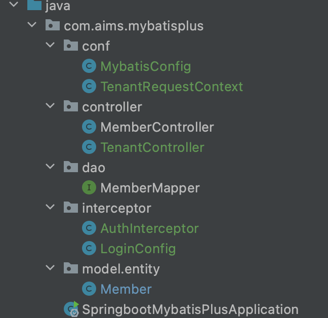
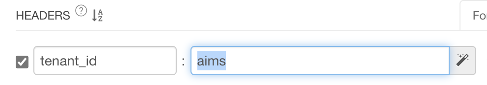

# SpringBoot整合Mybatis 实现多租户

代码已经上传到码云：[https://gitee.com/exampleclub/springboot-hyper-integration.git,](https://gitee.com/exampleclub/springboot-hyper-integration.git,)欢迎白嫖
## 引言
今天我们来聊聊多组户
其实多租户主要讲的是数据隔离，即每个企业或用户都享有自己的独立数据，不和其他人的数据相互掺合，别人也是无法获取我们自己的数据的。
多租户在实现上主要有三种方式：
### 独立数据库
这种方式最简单明了，每个企业或用户在平台上通过独立的数据库来隔离自己的数据，这是在物理上达到了数据的隔离，这也是它的优点所在，但是他的缺点是，为每个企业或用户创建独立的数据库，成本非常大，而且空间的利用率也不高，造成严重的浪费。总结下：

- 优点：数据完全隔离、安全性高
- 缺点：成本高，数据库多，难以维护

### 同一数据库，不同表
这种方式是在逻辑上进行隔离，不同用户的数据都在同一个数据库中，但是使用不同的表来存储不同用户的数据，实现数据的隔离，这种方式相对上面，成本下降了，也同样达到了数据隔离
### 同一数据库，同一张表，通过字段区分
这种方式相对上面两种，成本就更加少了，仅仅通过字段就可以区分不同的数据，这种方式维护简单，成本少，但是进行数据导出和迁移，却是一种大大的麻烦，总结下

- 优点：维护方便、成本低、实现简单，维护的租户数量可以有很多
- 缺点：数据好迁移，数据没有完全做到隔离

通过对比上面三种方式，我们已经清楚了每种实现方案的区别及其他们的优劣势，在本文，我们将通过集成mybatisPlus，实现第三种方式，来实现多租户。

## 环境搭建
基于上一节的环境，我们已经搭集成了mybatisPlus的环境。
现在我们在member表中新增一个字段tenant_id,用来保存租户信息，同样如果你的表中需要维护租户信息，也需要创建同样的一个字段
```
ALTER TABLE  `member` 
ADD COLUMN `tenant_id` varchar(50) CHARACTER SET utf8mb4 COLLATE utf8mb4_bin NULL DEFAULT NULL COMMENT '租户id' AFTER `member_level`,
DROP PRIMARY KEY,
ADD PRIMARY KEY (`id`) USING BTREE;
```
### coding
### 添加请求上下文辅助类
这个类主要是保存当前请求用户的的信息，使用threadlocal来实现，和当前请求线程绑定
```
package com.aims.mybatisplus.conf;

public class TenantRequestContext {
    private static ThreadLocal<String> tenantLocal = new ThreadLocal<>();

    public static void setTenantLocal(String tenantId) {
        tenantLocal.set(tenantId);
    }

    public static String getTenantLocal() {
        return tenantLocal.get();
    }

    public static void remove() {
        tenantLocal.remove();
    }
}

```
### 添加认证拦截器
这个拦截器主要是获取请求头中的租户id，然后放到上下文中，供mybatisPlus获取
```
package com.aims.mybatisplus.interceptor;

import com.aims.mybatisplus.conf.TenantRequestContext;
import com.mysql.cj.util.StringUtils;
import org.springframework.web.servlet.HandlerInterceptor;

import javax.servlet.http.HttpServletRequest;
import javax.servlet.http.HttpServletResponse;

public class AuthInterceptor implements HandlerInterceptor {
    @Override
    public boolean preHandle(HttpServletRequest request, HttpServletResponse response, Object handler) throws Exception {
        String userId = request.getHeader("tenant_id");
        if (!StringUtils.isNullOrEmpty(userId)) {
            TenantRequestContext.setTenantLocal(userId);
            System.out.printf("当前租户ID:"+userId);
        }
        return HandlerInterceptor.super.preHandle(request, response, handler);
    }
}

```
### 配置拦截器
```
package com.aims.mybatisplus.interceptor;


import org.springframework.context.annotation.Configuration;
import org.springframework.web.servlet.config.annotation.InterceptorRegistration;
import org.springframework.web.servlet.config.annotation.InterceptorRegistry;
import org.springframework.web.servlet.config.annotation.WebMvcConfigurer;

@Configuration
public class LoginConfig implements WebMvcConfigurer {
    
    @Override
    public void addInterceptors(InterceptorRegistry registry) {
        //注册拦截器
        InterceptorRegistration registration = registry.addInterceptor(new AuthInterceptor());
        registration.addPathPatterns("/**");                      //所有路径都被拦截
        registration.excludePathPatterns(                         //添加不拦截路径
                                         "你的登陆路径",            //登录
                                         "/**/*.html",            //html静态资源
                                         "/**/*.js",              //js静态资源
                                         "/**/*.css",             //css静态资源
                                         "/**/*.woff",
                                         "/**/*.ttf"
                                         );    
    }
}
```
### 添加mybatisPlus配置类
该类主要是配置mybatisPlus拦截器，用来配租户ID字段，哪些表可以获取租户处理，租户ID从上下文中获取
```
package com.aims.mybatisplus.conf;

import com.baomidou.mybatisplus.autoconfigure.ConfigurationCustomizer;
import com.baomidou.mybatisplus.extension.plugins.MybatisPlusInterceptor;
import com.baomidou.mybatisplus.extension.plugins.handler.TenantLineHandler;
import com.baomidou.mybatisplus.extension.plugins.inner.TenantLineInnerInterceptor;
import net.sf.jsqlparser.expression.LongValue;
import net.sf.jsqlparser.expression.StringValue;
import org.springframework.beans.factory.annotation.Autowired;
import org.springframework.context.annotation.Bean;
import org.springframework.context.annotation.Configuration;
import net.sf.jsqlparser.expression.Expression;
import net.sf.jsqlparser.schema.Column;

@Configuration
public class MybatisConfig {
    @Bean
    public MybatisPlusInterceptor mybatisPlusInterceptor() {
        MybatisPlusInterceptor interceptor = new MybatisPlusInterceptor();
        interceptor.addInnerInterceptor(new TenantLineInnerInterceptor(new TenantLineHandler() {
            @Override
            public Expression getTenantId() {
            // 从上下文中获取
                return new StringValue(TenantRequestContext.getTenantLocal());
            }

            // 这是 default 方法,默认返回 false 表示所有表都需要拼多租户条件
            @Override
            public boolean ignoreTable(String tableName) {
                return !"member".equalsIgnoreCase(tableName);
            }
						// 数据表中对应的租户字段，这里是默认字段
            @Override
            public String getTenantIdColumn() {
                return "tenant_id";
            }
        }));
        return interceptor;
    }
}

```
当前目录结构

## 编写测试接口
### 

注意租户信息需要写在请求头里面的，

```
@RestController
public class TenantController {
    @Autowired
    private MemberMapper memberMapper;
		
    // 测试插入操作
    @RequestMapping("/testTenant")
    public String testTenantId() {
        Member member = new Member();
        member.setMemberName("测试租户ID");
        memberMapper.insert(member);
        return "success";
    }
		
    //测试查询操作
    @RequestMapping("/getCurrentTenantMember")
    public List<Member> getCurrentTenantMember() {
        QueryWrapper<Member> queryWrapper = new QueryWrapper<>();
        return memberMapper.selectList(queryWrapper);
    }
}
```
## 最后
