# 10.Nacos 在客户端实现服务注册的工作原理及源码分析
接下来我会给大家如何从日志入手，找到出发点，然后贯穿整个Nacos 客户端注册源码分析。

## 从日志找到切入点
其实我们看源码，并不是上来就把源码下载下来，然后使劲看，这样不仅效率不高，而且还会懵逼，所以我这里推荐看源码的一种方式就是：从日志入手
启动 nacos/day02/provider,观察控制台打印的日志，倒数第二行
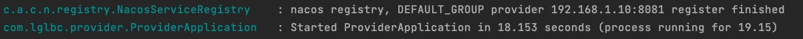
我们会看到nacos打印了这条日志：
```
c.a.c.n.registry.NacosServiceRegistry    : nacos registry, DEFAULT_GROUP provider 192.168.1.10:8081 register finished
```
所以我们可以去这个类里面看看
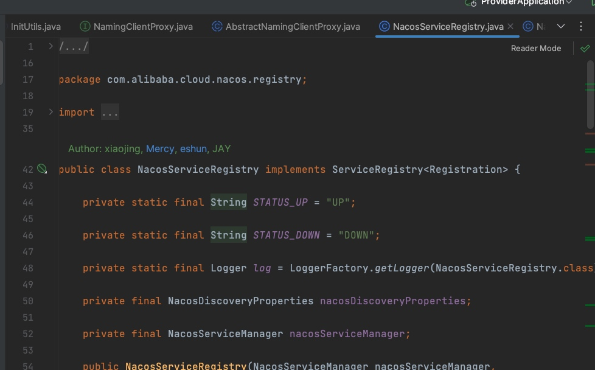
然后，按照日志内容搜索，看看是哪里打印的，于是我们定位到了这段源码
```
	public void register(Registration registration) {

		if (StringUtils.isEmpty(registration.getServiceId())) {
			log.warn("No service to register for nacos client...");
			return;
		}
    // 在这个地方打个断点
		NamingService namingService = namingService();
		String serviceId = registration.getServiceId();
		String group = nacosDiscoveryProperties.getGroup();

		Instance instance = getNacosInstanceFromRegistration(registration);

		try {
			namingService.registerInstance(serviceId, group, instance);
			log.info("nacos registry, {} {} {}:{} register finished", group, serviceId,
					instance.getIp(), instance.getPort());
		}
		catch (Exception e) {
			if (nacosDiscoveryProperties.isFailFast()) {
				log.error("nacos registry, {} register failed...{},", serviceId,
						registration.toString(), e);
				rethrowRuntimeException(e);
			}
			else {
				log.warn("Failfast is false. {} register failed...{},", serviceId,
						registration.toString(), e);
			}
		}
	}
```
所以入口我们已经找到，现在就是通过断点，来观察它的整个调用链

## 通过DEBUG找出整个调用链
在刚才的地方打个断点，然后重新启动项目
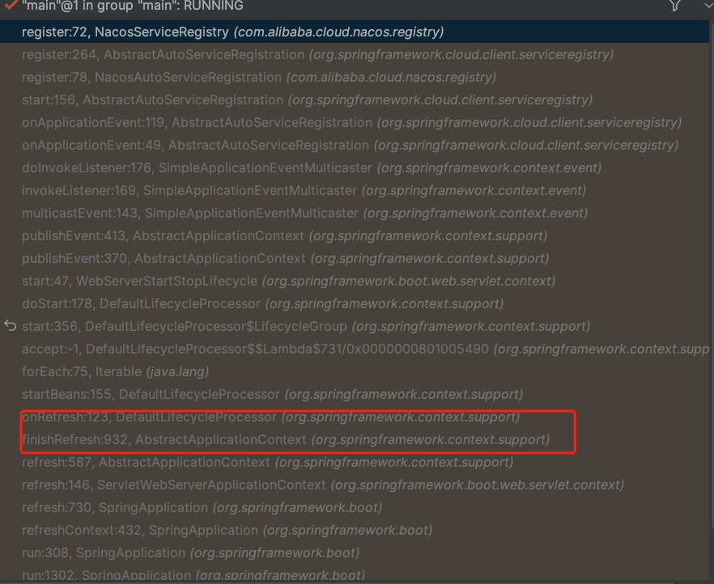
这个是断点的截图。我们可以注意到红框里面的两个方法，不知道大家可还熟悉(如果之前有阅读过Spring源码经验的同学应该会知道)，我们先来看下Spring 初始化的逻辑：
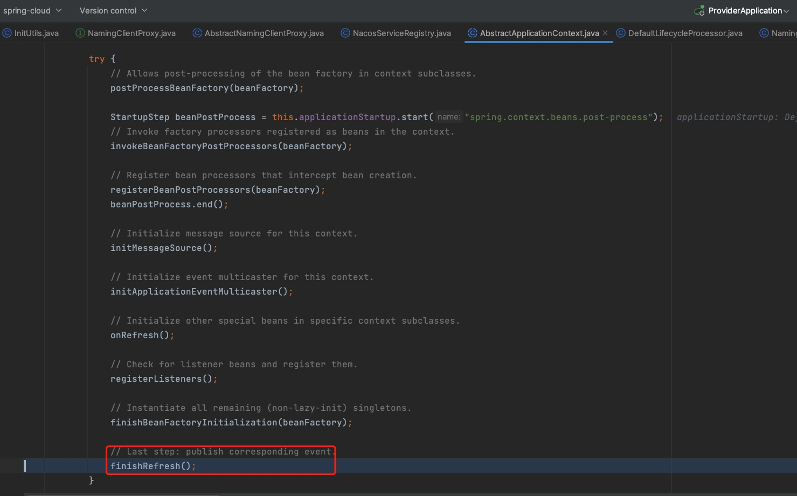
在IOC初始化完成之后，最终调用的就是finishRefresh方法
我们点进去看下里面的实现，发现在最后他在最后发布了一个事件出去，那么如何消费到这个事件呢？
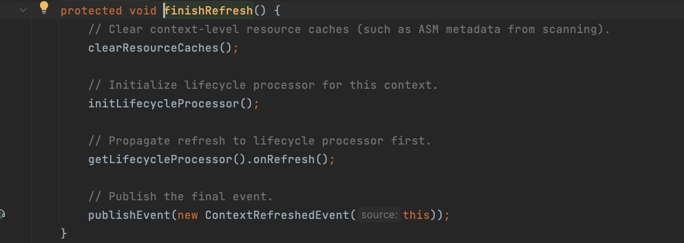

我们如果使用spring的事件发布和消费机制，肯定都知道我们只需要实现ApplicationListener这个接口就可以了，实现onApplicationEvent方法就能拿到事件并执行。
从调用链可以看出来，spring cloud registry提供的AbstractAutoServiceRegistration 就实现了这个接口，并实现了onApplicationEvent方法
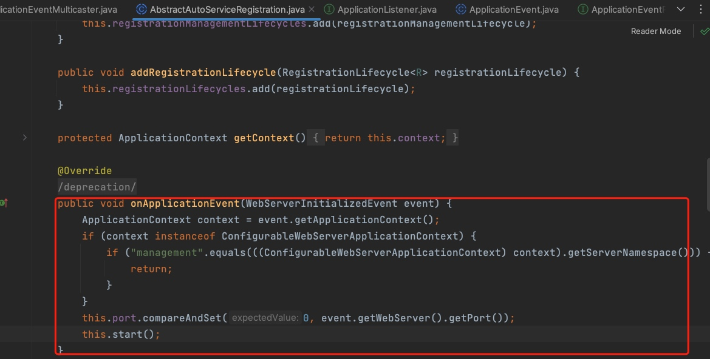

我们继续看start()方法里面做了什么
```
public void start() {
if (!this.running.get()) {
// 省略此次不分析的代码
register();
// 省略此次不分析的代码
}
}

protected void register() {
		this.serviceRegistry.register(getRegistration());
	}
```
看它最终调用this.serviceRegistry.register()方法，这个是spring cloud 提供的接口
，在我们引入的依赖中，目前只有nacos提供，所以点进去会直接跳转到nacos 逻辑，我们接下来会分析nacos客户端注册的逻辑
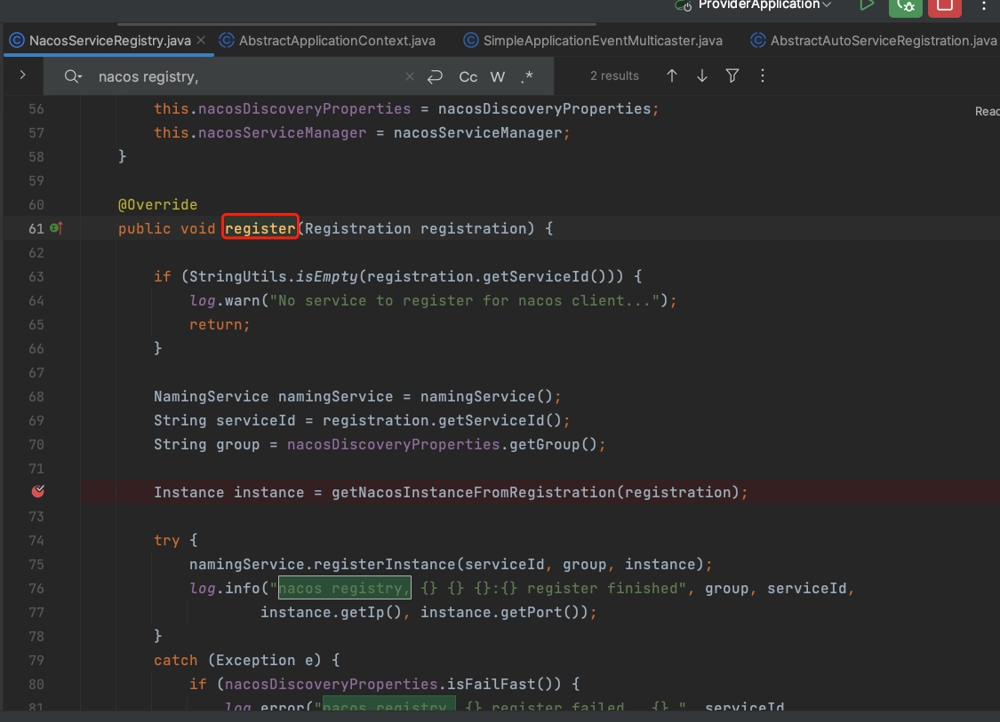
在这里有个知识点：如果想实现自己的注册中心，我们也可以参考nacos去实现ServiceRegistry接口
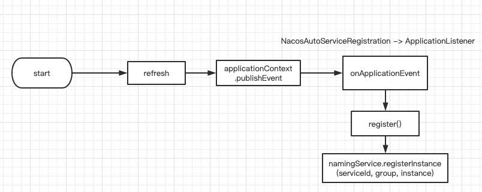


## 注册的工作原理
我们在上面已经分析了，spring cloud是如何自动触发nacos 服务注册，主要就是通过spring 初始化完成之后，发布事件，然后spring cloud监听了此事件，并在回调方法中调用实现了注册中心接口的实现类。
### 注册入口
我们接下来看下。nacos client是怎么将服务注册到注册中心,贴出代码：
```
public void register(Registration registration) {

		if (StringUtils.isEmpty(registration.getServiceId())) {
			log.warn("No service to register for nacos client...");
			return;
		}

		NamingService namingService = namingService();
		String serviceId = registration.getServiceId();
		String group = nacosDiscoveryProperties.getGroup();

		Instance instance = getNacosInstanceFromRegistration(registration);

		try {
			namingService.registerInstance(serviceId, group, instance);
			log.info("nacos registry, {} {} {}:{} register finished", group, serviceId,
					instance.getIp(), instance.getPort());
		}
		catch (Exception e) {
			if (nacosDiscoveryProperties.isFailFast()) {
				log.error("nacos registry, {} register failed...{},", serviceId,
						registration.toString(), e);
				rethrowRuntimeException(e);
			}
			else {
				log.warn("Failfast is false. {} register failed...{},", serviceId,
						registration.toString(), e);
			}
		}
	}
```
这一段主要实现流程如下：
* 获取服务ID和配置文件配置的group
* 根据提供的注册信息封装一个实例
* 调用namingService的方法 进行示例注册

### 调用命名服务的注册方法
#### 注册实例
我们点这个进去,会跳到这里
```
    public void registerInstance(String serviceName, String groupName, Instance instance) throws NacosException {
        NamingUtils.checkInstanceIsLegal(instance);
        clientProxy.registerService(serviceName, groupName, instance);
    }
```
这个主要逻辑是：
* 检查服务实例是否合法
* 调用client代理进行服务注册

那我们接下来看下这个代理会做什么
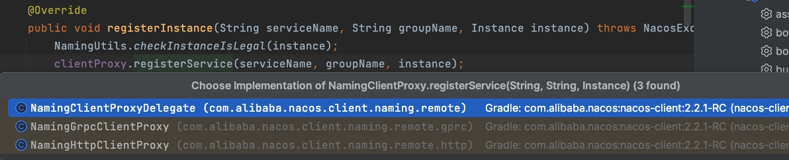
可以看到，代理有多个实现，以我们阅读源码的经验，当出现多个实现时，往往其中会有一个委托代理实现，它本身不做业务实现，只是负责决定用哪个真正的实现，我们可以通过断点验证这一点：
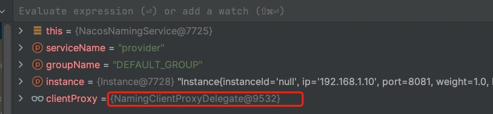
从截图可以看出，确实符合我们的期望
#### 调用远程服务请求注册
```
    public void registerService(String serviceName, String groupName, Instance instance) throws NacosException {
        getExecuteClientProxy(instance).registerService(serviceName, groupName, instance);
    }
    
    private NamingClientProxy getExecuteClientProxy(Instance instance) {
        return instance.isEphemeral() ? grpcClientProxy : httpClientProxy;
    }
```
这段代码其实就一个三元表达式，根据配置选择不同的client，这个配置长这样
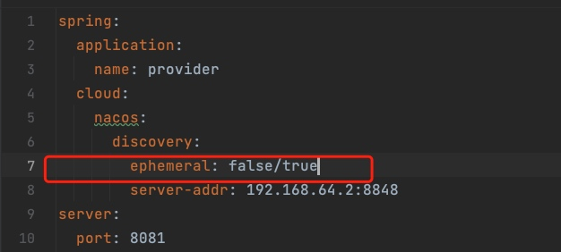
这里面两个client我要给大家解释下，nacos以前老版本，其实并没有grpc client的，只有http client，后面才加上的
* grpcClientProxy： 对于临时实例，使用grpc长连接实现
* httpClientProxy：对于永久实例，使用http连接+心跳检测(这个后面会说)

### grpcClientProxy
```
public void doRegisterService(String serviceName, String groupName, Instance instance) throws NacosException {
        InstanceRequest request = new InstanceRequest(namespaceId, serviceName, groupName,
                NamingRemoteConstants.REGISTER_INSTANCE, instance);
        requestToServer(request, Response.class);
        redoService.instanceRegistered(serviceName, groupName);
    }
    
 private <T extends Response> T requestToServer(AbstractNamingRequest request, Class<T> responseClass)
            throws NacosException {
        try {
            request.putAllHeader(
                    getSecurityHeaders(request.getNamespace(), request.getGroupName(), request.getServiceName()));
            Response response =
                    requestTimeout < 0 ? rpcClient.request(request) : rpcClient.request(request, requestTimeout);
            if (ResponseCode.SUCCESS.getCode() != response.getResultCode()) {
                throw new NacosException(response.getErrorCode(), response.getMessage());
            }
            if (responseClass.isAssignableFrom(response.getClass())) {
                return (T) response;
            }
            NAMING_LOGGER.error("Server return unexpected response '{}', expected response should be '{}'",
                    response.getClass().getName(), responseClass.getName());
        } catch (NacosException e) {
            throw e;
        } catch (Exception e) {
            throw new NacosException(NacosException.SERVER_ERROR, "Request nacos server failed: ", e);
        }
        throw new NacosException(NacosException.SERVER_ERROR, "Server return invalid response");
    }
```
* nacos 在初始化的时候，会初始化一个与nacos服务端建立连接的rpc client
* 通过rpc client 发起一个注册服务的request请求
* 注册完成后返回

### httpClientProxy
```
    public void registerService(String serviceName, String groupName, Instance instance) throws NacosException {
        NAMING_LOGGER.info("[REGISTER-SERVICE] {} registering service {} with instance: {}", namespaceId, serviceName,
                instance);
        String groupedServiceName = NamingUtils.getGroupedName(serviceName, groupName);
        if (instance.isEphemeral()) {
            throw new UnsupportedOperationException(
                    "Do not support register ephemeral instances by HTTP, please use gRPC replaced.");
        }
        final Map<String, String> params = new HashMap<>(32);
        params.put(CommonParams.NAMESPACE_ID, namespaceId);
        params.put(CommonParams.SERVICE_NAME, groupedServiceName);
        params.put(CommonParams.GROUP_NAME, groupName);
        params.put(CommonParams.CLUSTER_NAME, instance.getClusterName());
        params.put(IP_PARAM, instance.getIp());
        params.put(PORT_PARAM, String.valueOf(instance.getPort()));
        params.put(WEIGHT_PARAM, String.valueOf(instance.getWeight()));
        params.put(REGISTER_ENABLE_PARAM, String.valueOf(instance.isEnabled()));
        params.put(HEALTHY_PARAM, String.valueOf(instance.isHealthy()));
        params.put(EPHEMERAL_PARAM, String.valueOf(instance.isEphemeral()));
        params.put(META_PARAM, JacksonUtils.toJson(instance.getMetadata()));
        reqApi(UtilAndComs.nacosUrlInstance, params, HttpMethod.POST);
    }
```
* 如果是临时实例，直接抛出异常，之前版本如果是临时实例，则会添加心跳检测
* 构造服务注册的请求参数
* 构造完成，直接发送http 请求，调用nacos的OPEN API

那么当目前为止客户端注册已经分析完成，最后来一张完整的流程图帮助大家梳理
[在线流程图](https://www.processon.com/view/link/649ee50306e86008b371f2ec)
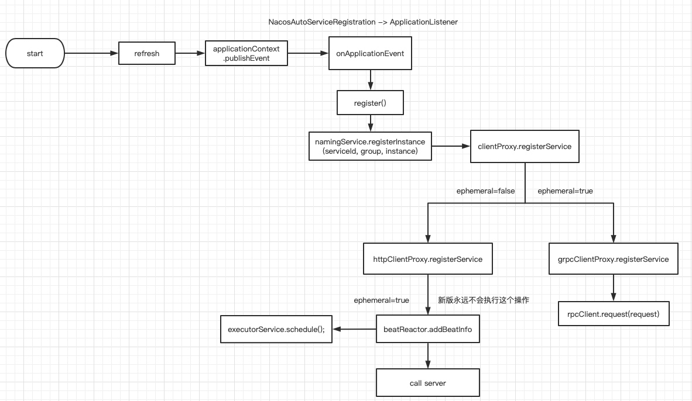
