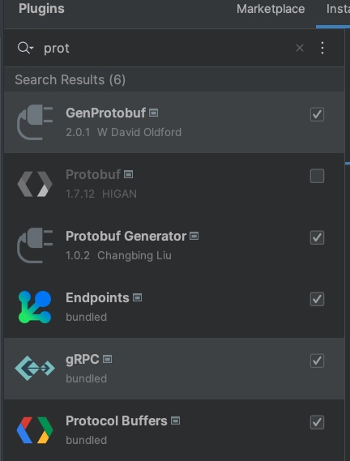
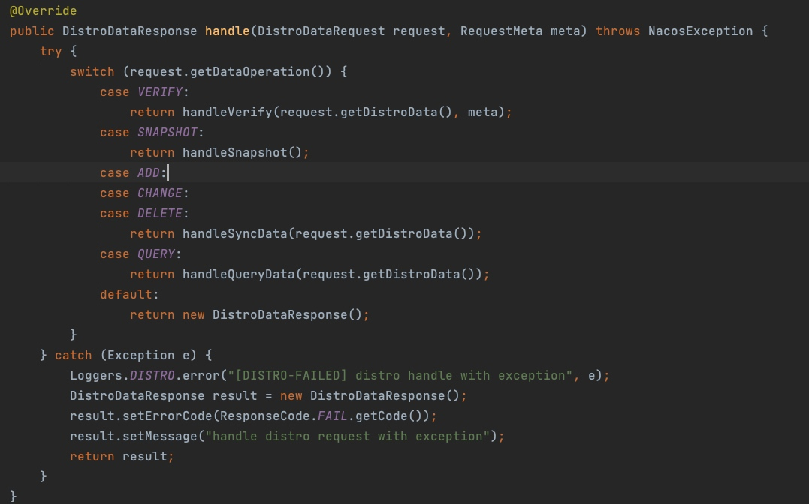
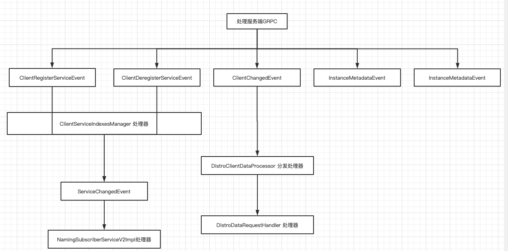

# 11.Nacos 在服务端处理服务注册的工作原理及源码分析

相比研究Nacos客户端注册原理源码实现，服务端相对复杂的多，我们这节课主要带大家阅读服务端注册中心处理及注册信息同步分发的源码及实现原理，与此不相关的内容，将会一带而过。本节课主要以视频为主，文档为辅，可以先看下最后面的两张大图，让大脑对nacos有个清晰的认识
## 准备工作
### 获取源码
```
git clone https://gitee.com/mirrors/Nacos.git
```
### IDEA 导入
导入IDEA之后，需要安装相应的插件


### 修改配置文件，支持mysql连接
```
spring.sql.init.platform=mysql
### Count of DB:
db.num=1
### Connect URL of DB:
db.url.0=jdbc:mysql://192.168.64.2:3306/nacos-config?characterEncoding=utf8&connectTimeout=1000&socketTimeout=3000&autoReconnect=true&useUnicode=true&useSSL=false&serverTimezone=UTC
db.user.0=root
db.password.0=root
```
### 配置集群信息
```
# /Users/example/code/open/nacos/clusters/{端口}/conf/cluster.conf
192.168.64.1:8844
192.168.64.1:8846
192.168.64.1:8848
```
### 添加VM参数，集群启动
```
-Dserver.port=8844 -Dnacos.home=/Users/example/code/open/nacos/clusters/8844
-Dserver.port=8846 -Dnacos.home=/Users/example/code/open/nacos/clusters/8846
-Dserver.port=8848 -Dnacos.home=/Users/example/code/open/nacos/clusters/8848
```
### 运行项目
如果依赖解决没有报错之后，可以直接运行
naming-console-Nacos项目

## 重要组件
### GRPC 请求处理器
#### 用途
该处理主要是用来处理来自客户端的GRPC请求，根据不同的请求类型，分发给不同的处理器，主要包括实例注册请求和注册信息分发请求，其它的在这里不做讨论
#### 主要实现
* InstanceRequestHandler：处理实例注册或取消注册请求
* DistroDataRequestHandler：处理集群注册信息同步的请求
### NotifyCenter 统一通知中心
#### 用途
主要用来发布事件，因为在nacos中几乎所有处理都是基于异步线程处理。会根据不同业务获取不同事件发布器
### SmartSubscriber 订阅处理器
#### 用途
主要用来负责消费NotifyCenter 发布出来的事件，只处理自己支持的事件
#### 主要实现
* NamingSubscriberServiceV2Impl：处理ServiceChangedEvent和ServiceSubscribedEvent,维护本地服务注册信息及推送注册信息给客户端
* DistroClientDataProcessor 处理注册信息分发到其它cluter的(如果存在cluster)及消费其它cluster同步给自己的信息

## 主要流程
### 处理服务端GRPC 注册请求
在客户端与服务建立连接后，客户端发送过来的请求GrpcRequestAcceptor，都会由这个类处理进行统一分发
* 收到客户端请求后，如果是服务注册或服务注销，则进行处理
* 服务注册请求 （REGISTER_INSTANCE）
    * client.addServiceInstance(维护到publishers)
    * 发布事件
        * ClientEvent.ClientChangedEvent
        * ClientOperationEvent.ClientRegisterServiceEvent
        * MetadataEvent.InstanceMetadataEvent
* 服务注销请求
    * removeServiceInstance(从publishers中移除)
    * 发布事件
        * ClientOperationEvent.ClientDeregisterServiceEvent
        * ClientEvent.ClientChangedEvent
        * MetadataEvent.InstanceMetadataEvent
### NamingSubscriberServiceV2Impl 处理器
负责维护本地注册信息变更及推送变更到订阅者
#### 主要订阅事件：
* ServiceEvent.ServiceChangedEvent
* ServiceEvent.ServiceSubscribedEvent
#### 流程
*  发布PushDelayTask 到tasks中（ProcessRunnable消费）
*  ProcessRunnable负责消费后，再创建PushExecuteTask ,发布到 TaskExecuteWorker.queue 中(InnerWorker 消费)
*  InnerWorker 负责消费，执行PushExecuteTask中的run方法
    *  generatePushData
    *  doPushWithCallback
### ClientServiceIndexesManager 处理器
协助负责事件分发
* ClientEvent.ClientDisconnectEvent
    * remove
* ClientOperationEvent.ClientRegisterServiceEvent
    * ServiceEvent.ServiceChangedEvent
* ClientOperationEvent.ClientDeregisterServiceEvent
    * ServiceEvent.ServiceChangedEvent
* ClientOperationEvent.ClientSubscribeServiceEvent
    * ServiceEvent.ServiceSubscribedEvent
* ClientOperationEvent.ClientUnsubscribeServiceEvent
    * remove
### DistroClientDataProcessor 分发处理器
处理注册信息分发到其它cluter的(如果存在cluster)及消费其它cluster同步给自己的信息
#### 主要订阅事件：
* ClientEvent.ClientDisconnectEvent
* ClientEvent.ClientChangedEvent
#### 处理流程
* 如果非集群部署，则跳过处理
* 如果是ClientVerifyFailedEvent 则处理(这里不做讨论)
* 否则，进行同步处理 syncToAllServer
    * distroProtocol.sync(DELETE/CHANGE) 根据不同事件类型进行发送
    * 遍历集群中节点，排除自己，发布DistroDelayTask 到NacosDelayTaskExecuteEngine。tasks (ProcessRunnable 负责消费)
    * ProcessRunnable 消费后，再创建（DistroSyncDeleteTask/DistroSyncChangeTask） 发布到 TaskExecuteWorker.queue 中(InnerWorker 消费)
    * InnerWorker 负责消费，执行Task中的run方法
        * DistroSyncDeleteTask
            * doExecuteWithCallback
            * syncData（DistroDataRequest(DataOperation.DELETE)）
        * DistroSyncChangeTask
            * doExecuteWithCallback
            * syncData（DistroDataRequest(DataOperation.Change)）         
### 处理服务端Disro Sync请求
由上面可以知道，syncData发出的是DistroDataRequests所以我们现在需要去看下 DistroDataRequestHandler如何处理请求

从代码中，可以看出他也是按照不同任务进行分发，我们这里只看删除/添加
* 如果是ADD,CHANGE,DELETE,则执行handleSyncData
* 执行distroProtocol.onReceive
* 调用dataProcessor.processData 处理数据
* 如果是ADD/CHANGE,则调用handlerClientSyncData
    * 维护连接的Client
    * service变更 
        * client.addServiceInstance（维护到publisher）
        * 发布ClientOperationEvent.ClientRegisterServiceEvent
    * service被移除 
        * client.removeServiceInstance(从publisher移除)
        * ClientOperationEvent.ClientDeregisterServiceEvent

## 组件关系梳理
[在线流程图](https://www.processon.com/view/link/649ee50306e86008b371f2ec)


## 源码分析大图

    