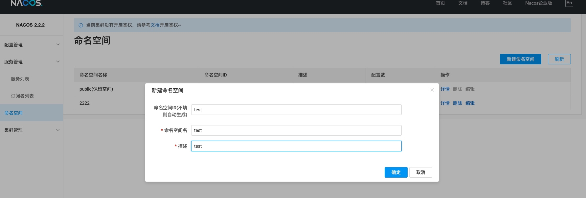
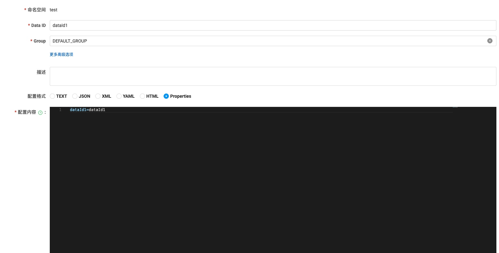
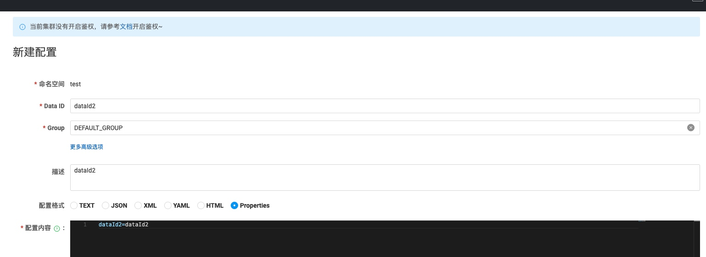
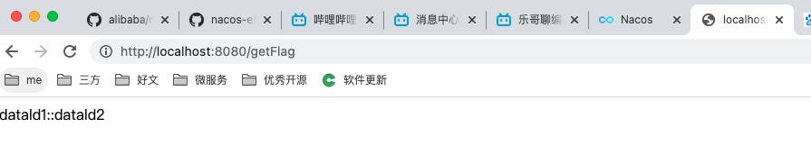

# 12.在Spring Boot中如何使用Nacos配置中心

> 代码 nacos/day03

由于Nacos 暂时 不兼容SpringBoot3.0 配置,所以集成SpringBoot时，暂且用SpringBoot2.7.7
 ## 引入依赖
 ```
 dependencies {
    implementation 'org.springframework.boot:spring-boot-starter-web'
    implementation 'com.alibaba.boot:nacos-config-spring-boot-starter:0.2.12'
}
 ```
 ## 添加配置文件
 配置nacos配置中心地址：application.yaml
 ```
 nacos:
  config:
    serverAddr: 192.168.64.2:8848
    namespace: test
```
## 添加Nacos配置注解
```
# 可以配置多个dataId，引入多个配置
@SpringBootApplication
@NacosPropertySource(dataId = "dataId1", autoRefreshed = true)
@NacosPropertySource(dataId = "dataId2", autoRefreshed = true)
```
## 创建Demo，获取配置
```
@RestController
public class IndexController {
    @NacosValue(value = "${dataId1:}", autoRefreshed = true)
    private String dataId1;
    @NacosValue(value = "${dataId2:}", autoRefreshed = true)
    private String dataId2;

    @GetMapping("/getFlag")
    public String geFlag(){
        return dataId1+"::"+dataId2;
    }
}
```
## 创建命名空间和配置ID
### 创建命名空间

### 创建DataId



## 启动验证

