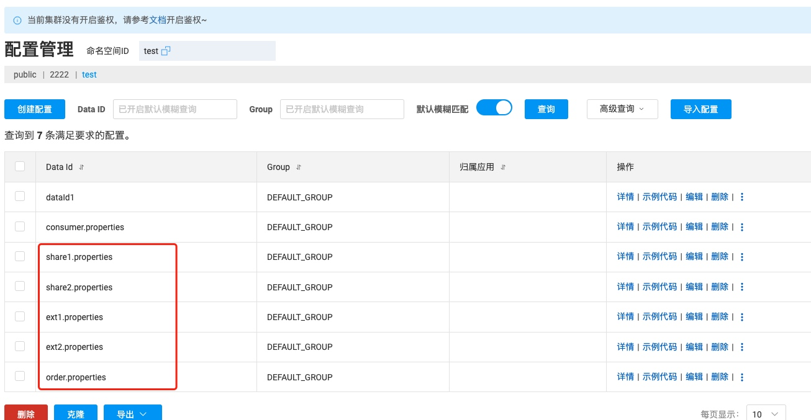

# 14.Nacos 配置加载顺序
> 代码 nacos/day04/order

application -> ext(n,1) -> share(n,1) 
我们可以通过如下代码进行验证
## 创建bootstrap.yaml
```
spring:
  application:
    name: order
  cloud:
    nacos:
      config:
        server-addr: 192.168.64.2:8848
        namespace: test
        file-extension: properties
        sharedConfigs:
          - dataId: share1.properties
            refresh: true
          - dataId: share2.properties
            refresh: true
        ext-config:
          - dataId: ext1.properties
            refresh: true
          - dataId: ext2.properties
            refresh: true
server:
  port: 8081
```
## 添加nacos配置

```
# 配置内容和文件对应
source=order.properties
source=ext1.properties
source=ext2.properties
source=share1.properties
source=share2.properties
```

## 编写测试接口
```
/**
 * @Author 编程学习
 * @Date 2023/5/21
 * @Description
 */
@RestController
@RefreshScope
public class IndexController {

    @Value("${source}")
    private String source;
    @GetMapping("/source")
    public String hello(){
        return source;
    }
}
```
通过修改nacos配置，验证接口返回值
## 核心源码
从源码可以看出首先加载share,其次ext,最后application，和我们验证顺序相同
```
public PropertySource<?> locate(Environment env) {
		nacosConfigProperties.setEnvironment(env);
		ConfigService configService = nacosConfigManager.getConfigService();

		if (null == configService) {
			log.warn("no instance of config service found, can't load config from nacos");
			return null;
		}
		long timeout = nacosConfigProperties.getTimeout();
		nacosPropertySourceBuilder = new NacosPropertySourceBuilder(configService,
				timeout);
		String name = nacosConfigProperties.getName();

		String dataIdPrefix = nacosConfigProperties.getPrefix();
		if (StringUtils.isEmpty(dataIdPrefix)) {
			dataIdPrefix = name;
		}

		if (StringUtils.isEmpty(dataIdPrefix)) {
			dataIdPrefix = env.getProperty("spring.application.name");
		}

		CompositePropertySource composite = new CompositePropertySource(
				NACOS_PROPERTY_SOURCE_NAME);

		loadSharedConfiguration(composite);
		loadExtConfiguration(composite);
		loadApplicationConfiguration(composite, dataIdPrefix, nacosConfigProperties, env);
		return composite;
	}
```

