# 15.Nacos 如何实现配置加载 源码分析
## 找到切入点
看过我之前视频的同学应该都知道我阅读源码的方法，首先我们需要寻找切入点，那么从哪里找呢？
一般我们可以直接从控制台日志打印入手：
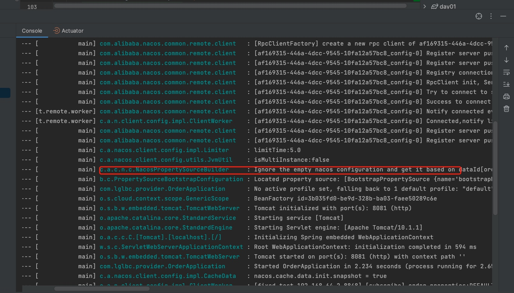
通过观察控制台日志的打印，我们注意到这一行是和Nacos相关的，那么先直接定位到这个类
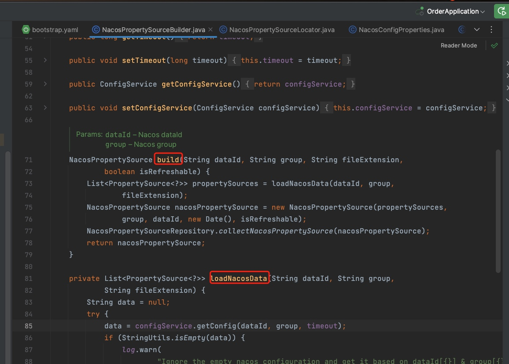
进入这个类之后，我们在这两个方法的地方添加断点，重新启动项目
## 寻找加载的时机
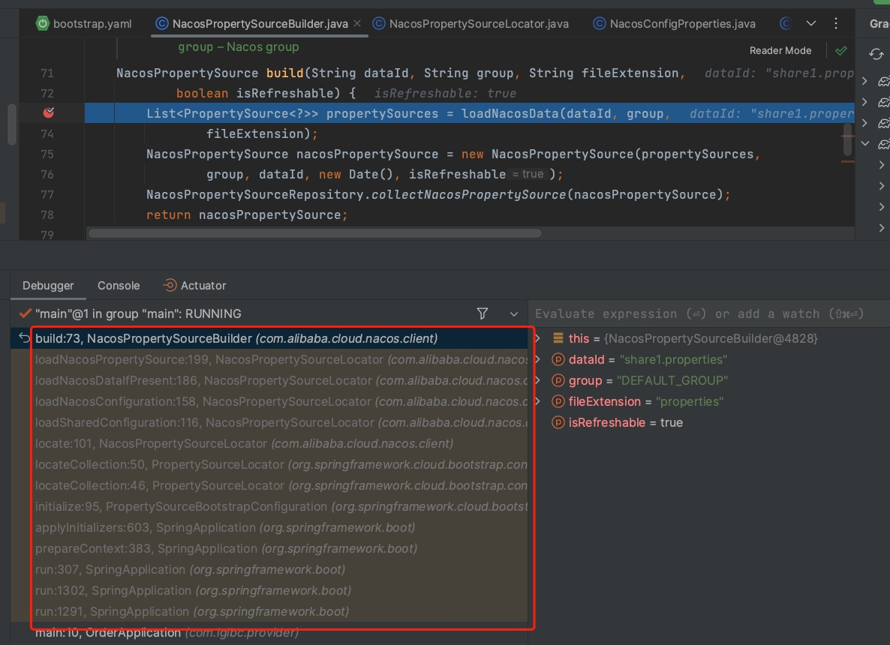
通过断点调试，我们可以看到如下的调用链，我们选择倒数第四个点进去会发现进入到SpringBoot的初始化部分(大家如果看过SpringBoot源码应该不会陌生)
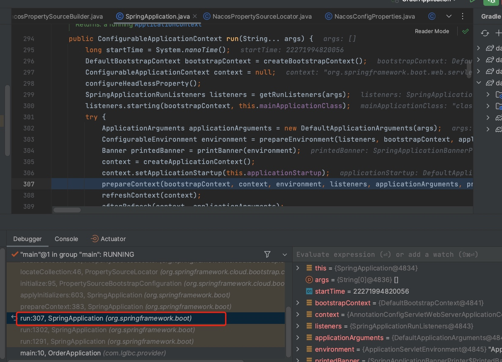
在这个阶段，他会执行所有继承了ApplicationContextInitializer实现类的initialize方法，
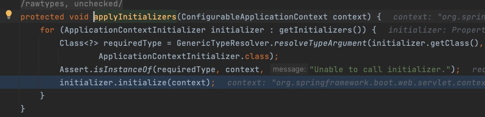
刚好spring cloud 也创建了一个实现类
    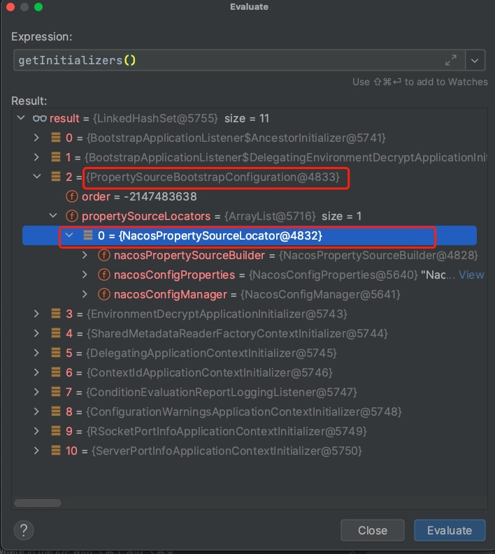
那我们直接进入到这个类的initialize方法，看下cloud做了什么操作：
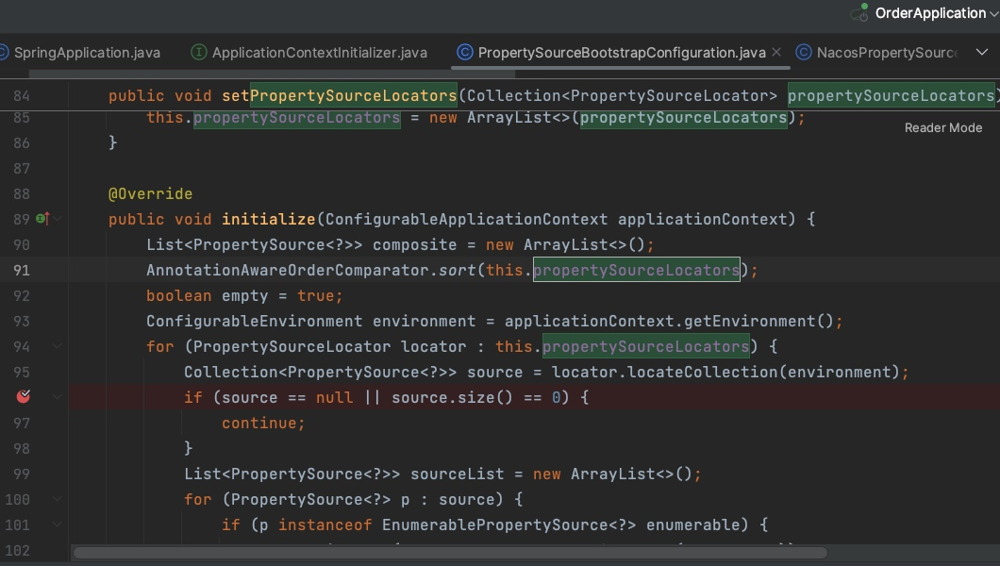
cloud在这里首先去加载了PropertySourceLocator，我们发现只有nacos实现了这个Locator
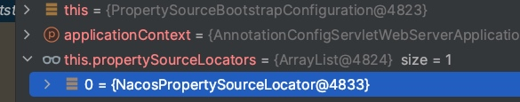
我们继续往下看，这里有一个遍历：拿到所有的locator，依次执行locateCollection方法，那我们就继续点进去看下nacos都做了什么？

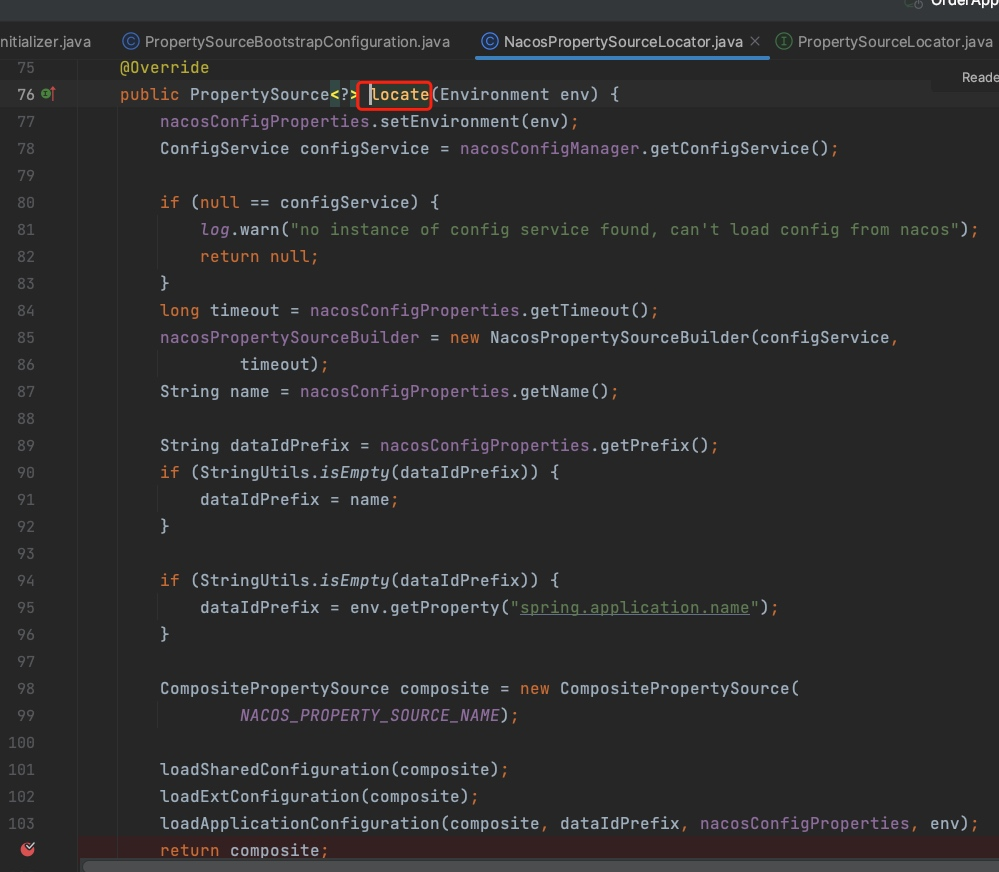
我们点进去之后，最后会调用nacos locate方法，那我们接下来看看nacos是怎么加载远程配置的
## Nacos 如何加载远程配置
我们先看下这个configService，提前说明下这个configService 就是获取远程配置的类，我们点进去看下，他有两个实现类，中间那个忽略，是低版本的nacos
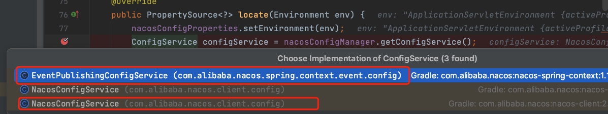
我们这一部分重点看NacosConfigService
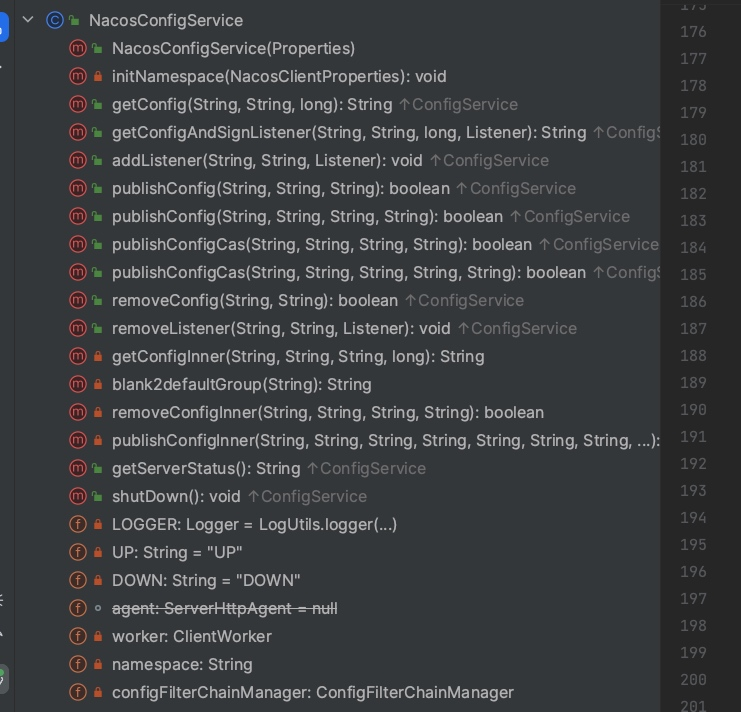

我们看到这里有众多方法，都是和发布或获取配置相关，这里的方法，我们稍后介绍，我们回到主线逻辑

* 初始化configService
* 获取dataIdPrefix
    * 从 spring.cloud.nacos.config.prefix 获取，如果没有继续往下走
    * 从 spring.cloud.nacos.config.name 获取，如果没有继续往下走
    * 从 spring.application.name 获取，这个用户如果没有配置，springboot会默认设置成application
* 创建聚合类，用来维护application、share和ext级别的配置,先加载的会被后面的覆盖，这也验证了我们在上节课的内容
* loadSharedConfiguration 
    * loadNacosDataIfPresent(share_dataId, group, extensiton)
* loadExtConfiguration
    * loadNacosDataIfPresent(ext_dataId, group, extensiton)
* loadApplicationConfiguration
    * loadNacosDataIfPresent(加载不带后缀的)
    * loadNacosDataIfPresent(加载带后缀的)
    * loadNacosDataIfPresent(加载带激活标识的dataId，ru pro,test,dev)

在构造好dataId和group之后，nacos就会直接调用configService.getConfi()加载nacos服务端数据
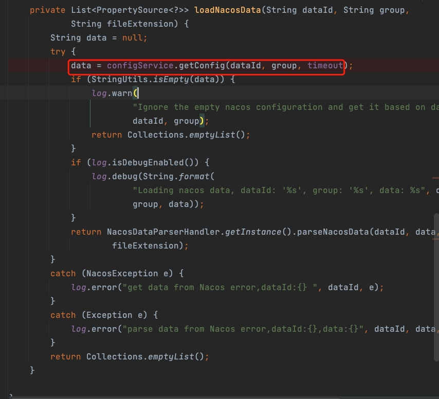最终会调用getConfigInner

### Nacos 如何获取远程配置
```
private String getConfigInner(String tenant, String dataId, String group, long timeoutMs) throws NacosException {
        group = blank2defaultGroup(group);
        ParamUtils.checkKeyParam(dataId, group);
        ConfigResponse cr = new ConfigResponse();
        
        cr.setDataId(dataId);
        cr.setTenant(tenant);
        cr.setGroup(group);

        String content = LocalConfigInfoProcessor.getFailover(worker.getAgentName(), dataId, group, tenant);
        if (content != null) {
            LOGGER.warn("[{}] [get-config] get failover ok, dataId={}, group={}, tenant={}, config={}",
                    worker.getAgentName(), dataId, group, tenant, ContentUtils.truncateContent(content));
            cr.setContent(content);
            String encryptedDataKey = LocalEncryptedDataKeyProcessor
                    .getEncryptDataKeyFailover(agent.getName(), dataId, group, tenant);
            cr.setEncryptedDataKey(encryptedDataKey);
            configFilterChainManager.doFilter(null, cr);
            content = cr.getContent();
            return content;
        }
        ConfigResponse response = worker.getServerConfig(dataId, group, tenant, timeoutMs, false);
        cr.setContent(response.getContent());
        cr.setEncryptedDataKey(response.getEncryptedDataKey());
        configFilterChainManager.doFilter(null, cr);
        content = cr.getContent();
        
        return content;
        content = LocalConfigInfoProcessor.getSnapshot(worker.getAgentName(), dataId, group, tenant);
        if (content != null) {
            LOGGER.warn("[{}] [get-config] get snapshot ok, dataId={}, group={}, tenant={}, config={}",
                    worker.getAgentName(), dataId, group, tenant, ContentUtils.truncateContent(content));
        }
        cr.setContent(content);
        String encryptedDataKey = LocalEncryptedDataKeyProcessor
                .getEncryptDataKeySnapshot(agent.getName(), dataId, group, tenant);
        cr.setEncryptedDataKey(encryptedDataKey);
        configFilterChainManager.doFilter(null, cr);
        content = cr.getContent();
        return content;
    }
``` 
* 如果本地有failover则优先获取本地failover配置，有可能服务端已经宕机
* 如果failover内容不存在，则通过rpcClient获取远程配置

### Nacos 如何将配置加载到spring boot中
在拿到所有远程配置以后，cloud需要 将这些属性回调到spring boot的环境变量中，我们回到主线逻辑 org.springframework.cloud.bootstrap.config.PropertySourceBootstrapConfiguration#initialize

```
		if (!empty) {
			MutablePropertySources propertySources = environment.getPropertySources();
			String logConfig = environment.resolvePlaceholders("${logging.config:}");
			LogFile logFile = LogFile.get(environment);
			for (PropertySource<?> p : environment.getPropertySources()) {
				if (p.getName().startsWith(BOOTSTRAP_PROPERTY_SOURCE_NAME)) {
					propertySources.remove(p.getName());
				}
			}
			insertPropertySources(propertySources, composite);
			reinitializeLoggingSystem(environment, logConfig, logFile);
			setLogLevels(applicationContext, environment);
			handleIncludedProfiles(environment);
		}
```
从断点可以看出，nacos处理完成后，composite中已经有6个数据来源，分别从order,order.properties,ext2.properties,ext1.properties,share2.properties,share1.properties,
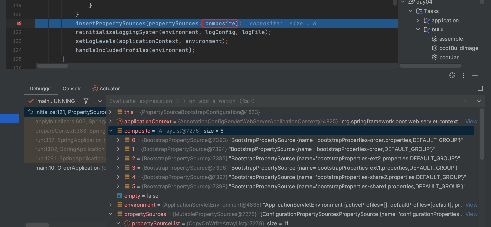
	⁃	在经过insertPropertySources方法之后，nacos的数据源会被添加到propertySources中，这是spring提供的，在refresh阶段，这些配置都会刷到spring中，经过placholder解析器后，这些占位符修饰的变量就会被替换为配置的值。

