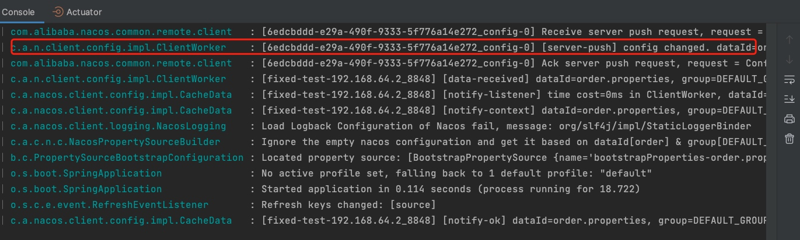
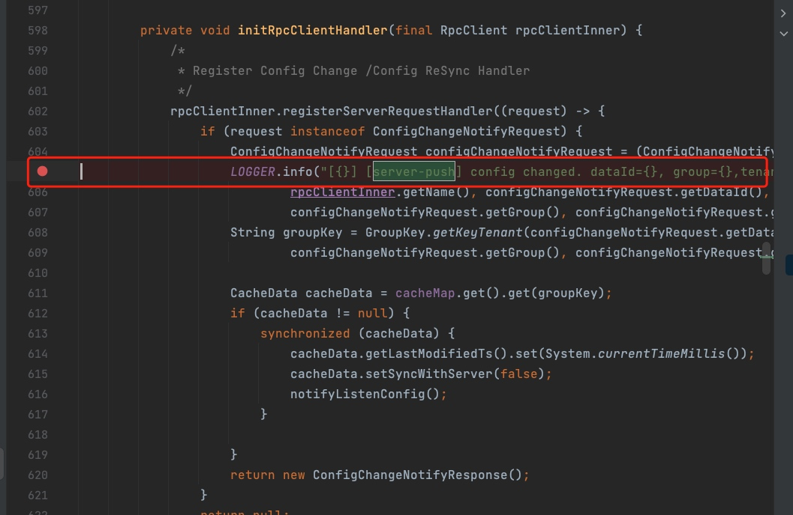
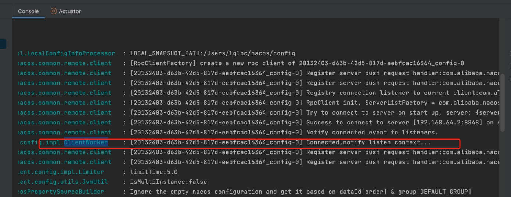
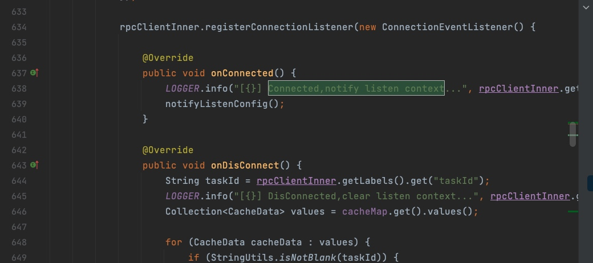
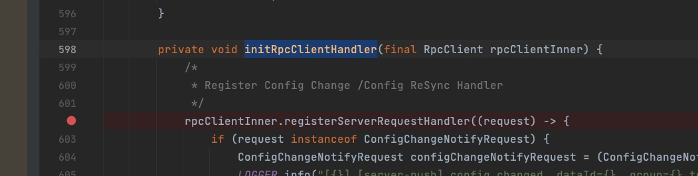
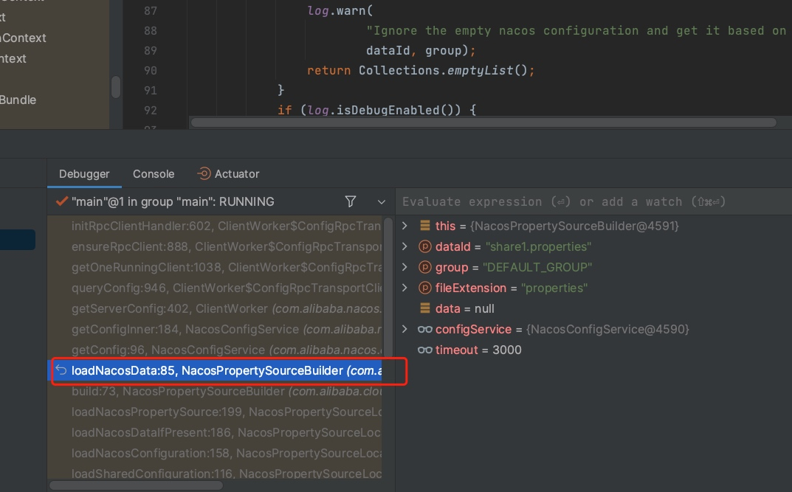
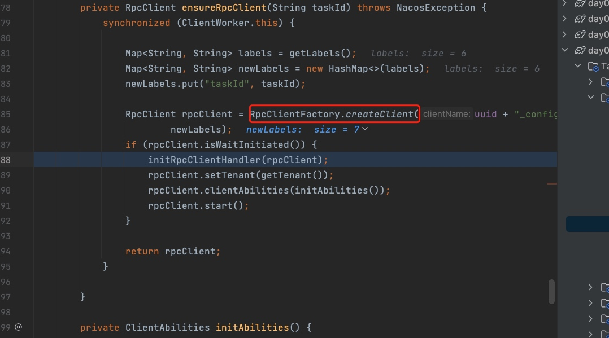
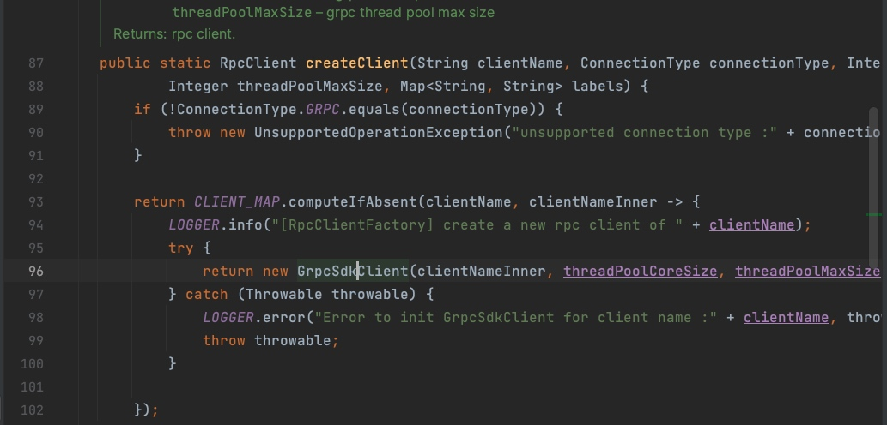
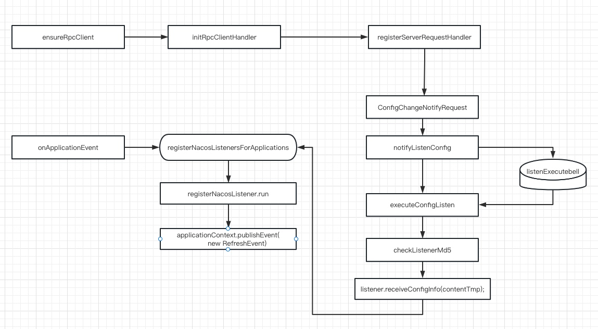

# 16.Nacos 配置动态监听实现原理
上节课我们学了Nacos 实现配置加载的源码部分，那么这节课我们继续学习Nacos是如何监听服务端的配置变更 源码部分，首先我们还是从控制台打印的日志找到切入点：
## 找切入点
我们启动项目后，然后清空控制台，在nacos服务端修改配置，观察控制台打印

我们看第二行，因为这一行能够找到具体的类，我们进入到这个类，然后搜索server-push(日志中出现的关键词,可以看到这个地方是个会掉，从名字可以看出是处理服务端的配置变更请求，接下来我们重启项目，观察下这个是什么时候注册进来的。

## nacos 客户端监听初始化的入口

重启项目后，我们看到了ClientWorker,找到这个类，搜索对应的日志关键词
        
我们在这个方法的入口打个断点。

可以看到，这个其实是在我们第一次调用loadNacosData初始化的，注册了serverRequestHandler和connectListener，我们往前倒一个方法，

可以看到这里做了如下内容：
* 创建一个client
* initRpcClientHandler 进行一些事件的注册

我们重点看下creat client做了什么

可以看出来，nacos配置中心客户端和nacos注册中心客户端一样，也是创建了一个grpc client，建立了一个长连接。

整体流程梳理

