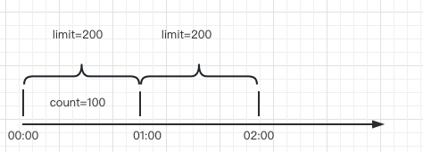
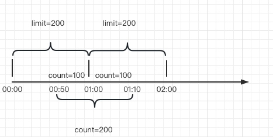
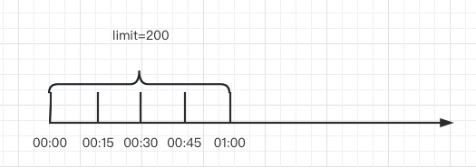
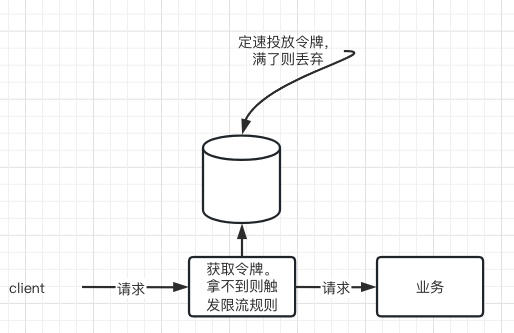
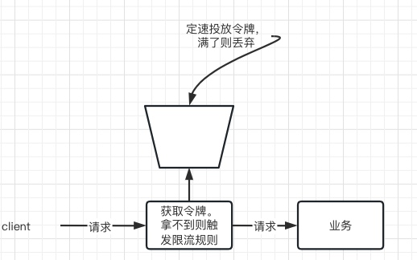

# 17.限流必知：常见的限流算法

## 固定窗口(计数器)算法（Fixed Window Algorithm）
该算法将时间分为固定的窗口，例如每秒、每分钟或每小时等。在每个窗口内，设定一个固定的请求限制数。如果窗口内的请求数超过了限制数，那么多余的请求将被丢弃或延迟处理

这种算法简单直观，但在窗口切换时可能会出现突发流量。

## 滑动窗口算法（Sliding Window Algorithm）
该算法是固定窗口算法的改进版。它将时间划分为连续的、重叠的窗口，并在每个窗口内设置请求限制数。滑动窗口算法可以更好地应对突发流量，因为它能够根据时间的流逝自动调整窗口。

## 令牌桶算法（Token Bucket Algorithm）
该算法基于一个令牌桶的概念。令牌桶以固定的速率生成令牌，并存储在桶中。每个令牌表示一个请求的许可。当有请求到达时，需要从桶中获取一个令牌，如果桶中没有足够的令牌，则请求被限流。令牌桶算法可以处理突发流量，并允许一定程度的突破，只要令牌桶中有足够的令牌。

## 漏桶算法（Leaky Bucket Algorithm）
该算法类似于令牌桶算法，但它以固定的速率从桶中漏水。当有请求到达时，如果桶中有足够的空间容纳该请求，它将被接受并放入桶中，否则请求将被丢弃。漏桶算法对请求进行均匀的处理，并能够平滑限制请求速率。

