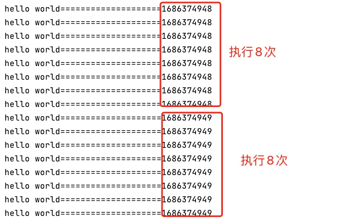
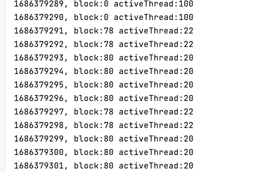
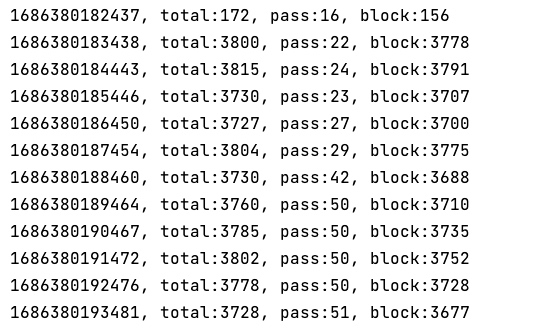
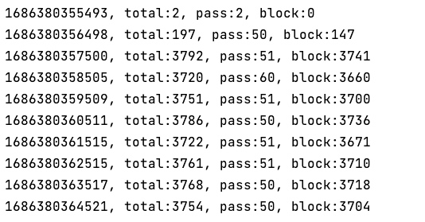

# 19.Sentinel 限流 快速入门
> 代码 sentinel/day05
## 快速演示
### 引入依赖
```
implementation "com.alibaba.csp:sentinel-core:1.8.6"
```
### 定义规则
HelloWorld 资源只能每秒被调用8次
```
    private static void initFlowRules(){
        List<FlowRule> rules = new ArrayList<>();
        FlowRule rule = new FlowRule();
        rule.setResource("HelloWorld");
        rule.setGrade(RuleConstant.FLOW_GRADE_QPS);
        // Set limit QPS to 20.
        rule.setCount(8);
        rules.add(rule);
        FlowRuleManager.loadRules(rules);
    }
```
### 编写测试demo
```
    public static void main(String[] args) {
    // 配置规则.
        initFlowRules();
        Test test = new Test();
        int i = 0;
        while (true) {
            try (Entry entry = SphU.entry("HelloWorld")) {
                // 被保护的逻辑
                System.out.println("hello world====================" + System.currentTimeMillis() / 1000);
            } catch (BlockException ex) {
                // 处理被流控的逻辑
            }
        }
    }
```
### 验证
从运行结果来看，确实每秒只允许调用8次，符合我们的限流配置


## 参数介绍


| 字段            | 说明                                                             | 默认值                     |
|-----------------|------------------------------------------------------------------|----------------------------|
| resource        | 资源名，资源名是限流规则的作用对象                                |                            |
| count           | 限流阈值	                                                        |                            |
| grade           | 限流阈值类型，QPS 或线程数模式	                                   | QPS 模式                   |
| limitApp        | 流控针对的调用来源	                                              | default，代表不区分调用来源 |
| strategy        | 调用关系限流策略：直接、链路、关联	                                 | 根据资源本身（直接）         |
| controlBehavior | 流控效果（直接拒绝 / 排队等待 / 慢启动模式），不支持按调用关系限流	 | 直接拒绝
                  
## 扩展演示
### 基于并发线程流控
Sentinel线程数限流不负责创建和管理线程池，而是简单统计当前请求上下文的线程个数，如果超出阈值，新的请求会被立即拒绝。
#### 测试代码
```
public static void main(String[] args) throws Exception {
        tick();
        initFlowRule();

        for (int i = 0; i < threadCount; i++) {
            Thread entryThread = new Thread(new Runnable() {
                @Override
                public void run() {
                    while (true) {
                        Entry methodA = null;
                        try {
                            TimeUnit.MILLISECONDS.sleep(5);
                            methodA = SphU.entry("methodA");
                            activeThread.incrementAndGet();
//                            Entry methodB = SphU.entry("methodB");
                            TimeUnit.MILLISECONDS.sleep(methodBRunningTime);
//                            methodB.exit();
//                            pass.addAndGet(1);
                        } catch (BlockException e1) {
                            block.incrementAndGet();
                            try {
                                TimeUnit.MILLISECONDS.sleep(methodBRunningTime);
                            } catch (InterruptedException e) {
                                throw new RuntimeException(e);
                            }
                        } catch (Exception e2) {
                            // biz exception
                        } finally {
                            if (methodA != null) {
                                methodA.exit();
                                activeThread.decrementAndGet();
                            }else{
                                block.decrementAndGet();
                            }
                        }
                    }
                }
            });
            entryThread.setName("working thread");
            entryThread.start();
        }
    }
```
限流规则
```
    private static void initFlowRule() {
        List<FlowRule> rules = new ArrayList<FlowRule>();
        FlowRule rule1 = new FlowRule();
        rule1.setResource("methodA");
        // set limit concurrent thread for 'methodA' to 20
        rule1.setCount(20);
        rule1.setGrade(RuleConstant.FLOW_GRADE_THREAD);
        rule1.setLimitApp("default");

        rules.add(rule1);
        FlowRuleManager.loadRules(rules);
    }
```
#### 测试验证


### 基于QPS 流控
qps流控可以设置四种流控行为
#### 直接拒绝
默认流控行为，触发后，直接抛出FlowException 异常,第一个案例就是

#### 冷启动(WARM_UP)
该方式主要用于系统长期处于低水位的情况下，当流量突然增加时，直接把系统拉升到高水位可能瞬间把系统压垮。通过"冷启动"，让通过的流量缓慢增加，在一定时间内逐渐增加到阈值上限，给冷系统一个预热的时间，避免冷系统被压垮的情况

##### 测试代码
```
public static void main(String[] args) throws Exception {
        initFlowRule();
        // trigger Sentinel internal init
        Entry entry = null;
        try {
            entry = SphU.entry(KEY);
        } catch (Exception e) {
        } finally {
            if (entry != null) {
                entry.exit();
            }
        }

        Thread timer = new Thread(new TimerTask());
        timer.setName("sentinel-timer-task");
        timer.start();

        //first make the system run on a very low condition
        for (int i = 0; i < 3; i++) {
            Thread t = new Thread(new WarmUpTask());
            t.setName("sentinel-warmup-task");
            t.start();
        }
        Thread.sleep(20000);

        for (int i = 0; i < threadCount; i++) {
            Thread t = new Thread(new RunTask());
            t.setName("sentinel-run-task");
            t.start();
        }
    }
```
限流规则
```
    private static void initFlowRule() {
        List<FlowRule> rules = new ArrayList<FlowRule>();
        FlowRule rule1 = new FlowRule();
        rule1.setResource(KEY);
        rule1.setCount(50);
        rule1.setGrade(RuleConstant.FLOW_GRADE_QPS);
        rule1.setLimitApp("default");
        rule1.setControlBehavior(RuleConstant.CONTROL_BEHAVIOR_WARM_UP);
        rule1.setWarmUpPeriodSec(10);

        rules.add(rule1);
        FlowRuleManager.loadRules(rules);
    }
```
##### 验证
使用warm up

使用默认方式


#### 匀速器
这种方式严格控制了请求通过的间隔时间，也即是让请求以均匀的速度通过，对应的是漏桶算法
```
    private static void initPaceFlowRule() {
        List<FlowRule> rules = new ArrayList<FlowRule>();
        FlowRule rule1 = new FlowRule();
        rule1.setResource(KEY);
        rule1.setCount(count);
        rule1.setGrade(RuleConstant.FLOW_GRADE_QPS);
        rule1.setLimitApp("default");
        rule1.setControlBehavior(RuleConstant.CONTROL_BEHAVIOR_RATE_LIMITER);
        rule1.setMaxQueueingTimeMs(5 * 1000);
        rules.add(rule1);
        FlowRuleManager.loadRules(rules);
    }
```