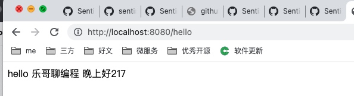
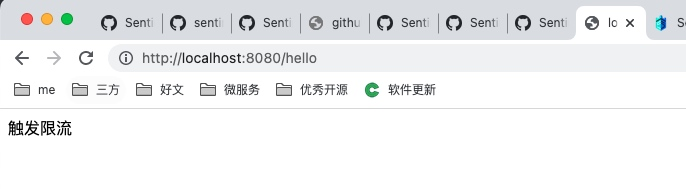

# 21.Spring Cloud 整合Sentinel
> 代码 sentinel/day06
## 引入依赖
```
dependencies {
    implementation 'org.springframework.boot:spring-boot-starter-web'
    implementation 'com.alibaba.cloud:spring-cloud-starter-alibaba-sentinel'
}
```

## 硬编码加载流控规则
### 编写流控规则
QPS=2
```
/**
 * @Author 编程学习
 * @Date 2023/6/10
 * @Description
 */
public class FlowFunction implements InitFunc {
    @Override
    public void init() throws Exception {
        List<FlowRule> rules = new ArrayList<>();
            FlowRule rule = new FlowRule();
        rule.setResource("hello");
        rule.setGrade(RuleConstant.FLOW_GRADE_QPS);
        // Set limit QPS to 2.
        rule.setCount(2);
        rules.add(rule);
        FlowRuleManager.loadRules(rules);
    }
}
```
### 配置SPI，加载自定义流控规则
* 在resouces下创建文件夹 META-INF/services
* 在创建com.alibaba.csp.sentinel.init.InitFunc 文件内容为：流控规则全类名:com.example.FlowFunction

## 编写测试接口
接口中申明了资源：hello
```
/**
 * @Author 编程学习
 * @Date 2023/6/10
 * @Description
 */
@RestController
public class HelloController {
    @SentinelResource(value = "hello")
    @GetMapping("/hello")
    public String hello() throws InterruptedException {
        int millis = new Random().nextInt(150, 300);
        Thread.sleep(millis);
        return "hello 编程学习 晚上好"+millis;
    }
}
```
## 访问接口验证
连续请求接口：http://localhost:8080/hello

