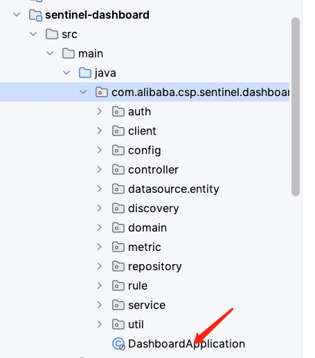
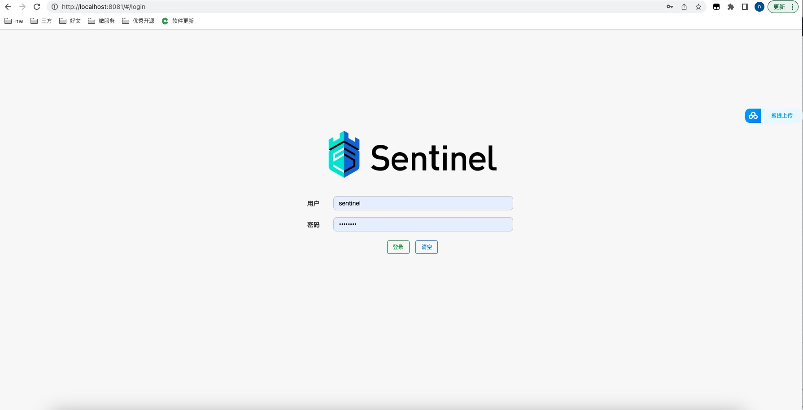
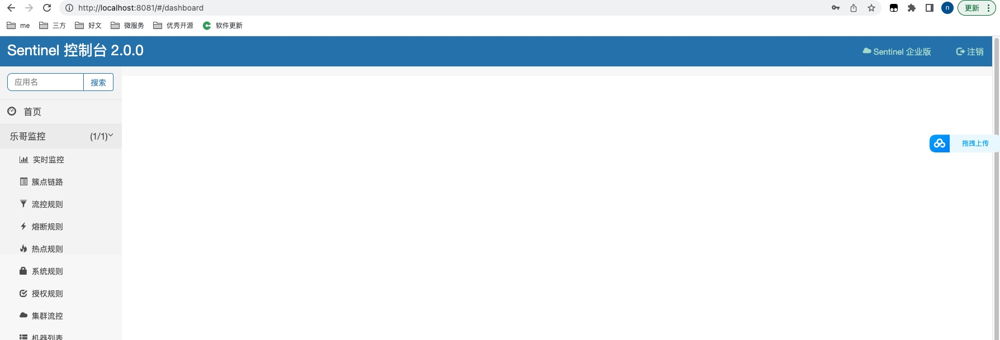
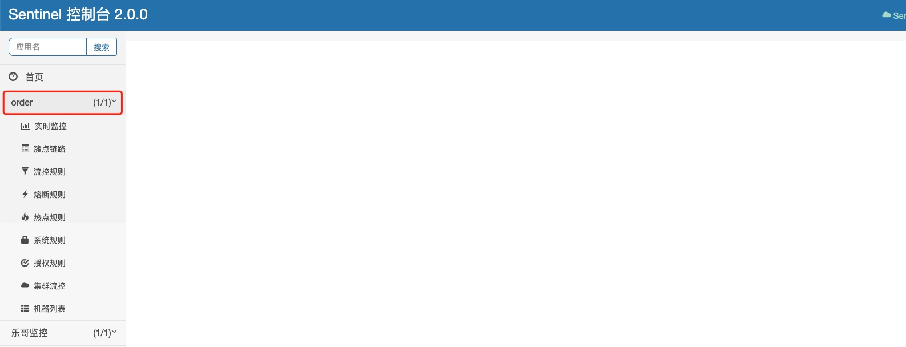
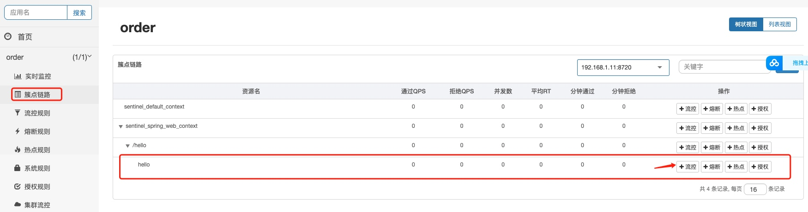
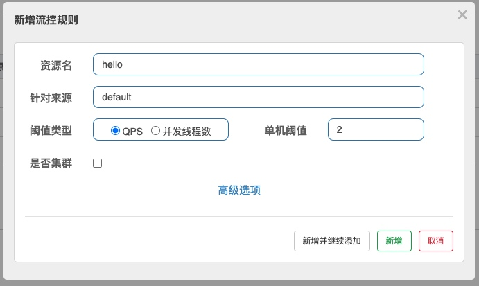
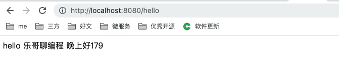
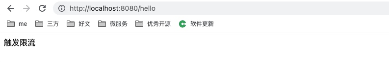
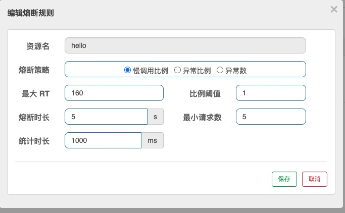
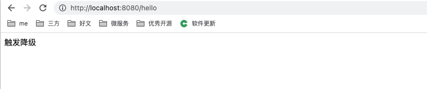

# 22.Spring Cloud 整合Sentinel Dashboard

> 代码 sentinel/day06
通过将服务连接dashboard，我们那可以将流控规则全部移到dashboard进行动态配置

## 搭建Sentinel环境
### 下载sentinel dashboard源码
```
git clone https://github.com/alibaba/Sentinel.git
```
### 启动sentinel dashboard
启动项目之前，添加vm参数：
```
-Dproject.name=example_sentinel -Dcsp.sentinel.dashboard.server=127.0.0.1:8089 -Dserver.port=8089
```

### 访问控制台
http://localhost:8081 sentinel:sentinel


目前只能看到sentinel自己，我们接下来配置我们的服务，请求一次接口
## 服务连接sentinel dashboard
```
spring:
  application:
    name: order
  cloud:
    sentinel:
      transport:
        dashboard: 127.0.0.1:8089
```
## 启动项目
访问接口 http://localhost:8080/hlello
再刷新sentinel 页面


可以看到服务已经注册到dashboard中
我们接下来在页面中操作流控和降级
## dashboard中演示流控和降级

### 流控演示
设置qps=2

    


### 熔断演示



