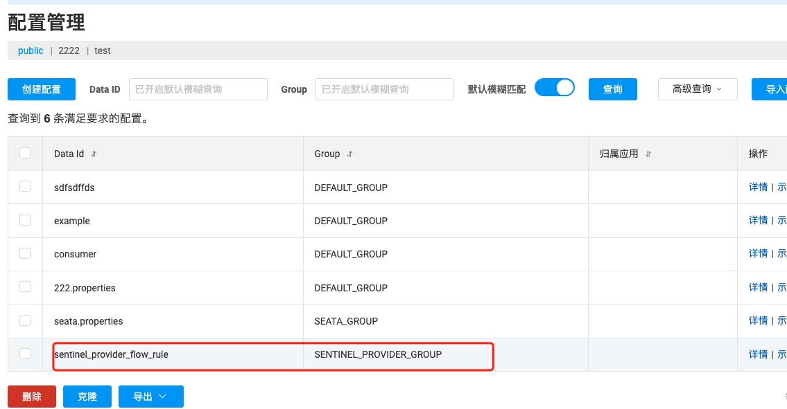
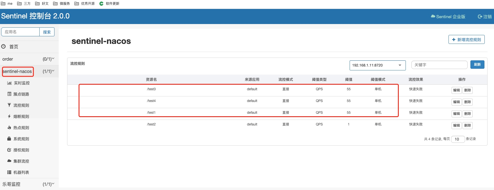

# 23.Sentinel 从Nacos获取流控规则
## 引入依赖
```
dependencies {
    implementation 'org.springframework.boot:spring-boot-starter-web'
    implementation 'com.alibaba.cloud:spring-cloud-starter-alibaba-sentinel'
    implementation 'com.alibaba.cloud:spring-cloud-alibaba-sentinel-datasource'
    implementation 'com.alibaba.csp:sentinel-datasource-nacos'
}
```
## 配置sentinel
从nacos dataId=sentinel_provider_flow_rule 和group-id: SENTINEL_PROVIDER_GROUP 中获取流控规则。
```
spring:
  application:
    name: sentinel-nacos
  cloud:
    sentinel:
      transport:
        dashboard: 127.0.0.1:8081
      datasource:
        flow_ds:
          nacos:
            server-addr: 192.168.64.2:8848
            data-id: sentinel_provider_flow_rule
            data-type: json
            group-id: SENTINEL_PROVIDER_GROUP
            rule-type: flow
```
## nacos中配置流控规则
data-id: sentinel_provider_flow_rule
data-type: json
group-id: SENTINEL_PROVIDER_GROUP
```
[
  {
    "resource": "/test1",
    "controlBehavior": 0,
    "count": 55,
    "grade": 1,
    "limitApp": "default",
    "strategy": 0
  },

  {
    "resource": "/test2",
    "controlBehavior": 0,
    "count": 1,
    "grade": 1,
    "limitApp": "default",
    "strategy": 0
  },
  {
    "resource": "/test3",
    "controlBehavior": 0,
    "count": 55,
    "grade": 1,
    "limitApp": "default",
    "strategy": 0
  },

  {
    "resource": "/test4",
    "controlBehavior": 0,
    "count": 55,
    "grade": 1,
    "limitApp": "default",
    "strategy": 0
  }
]
```


## 启动dashboard和项目

可以看到流控规则，已经从nacos同步到sentinel
那么现在还有一个问题就是，在sentinel中修改的规则无法同步到nacos中，这个我将在下一节为大家介绍。