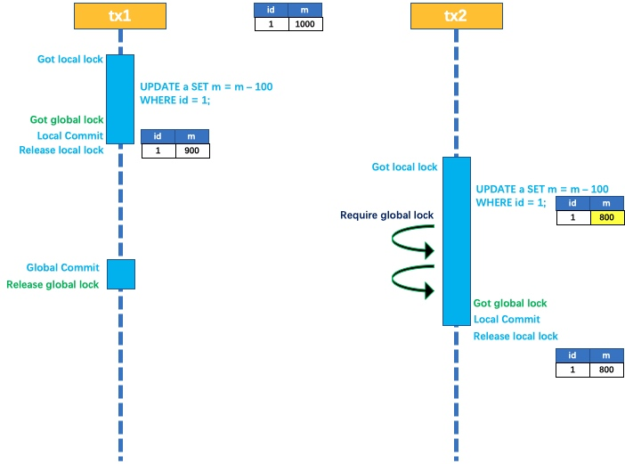
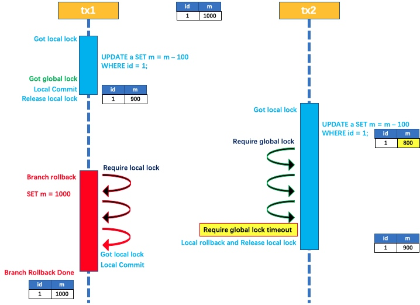
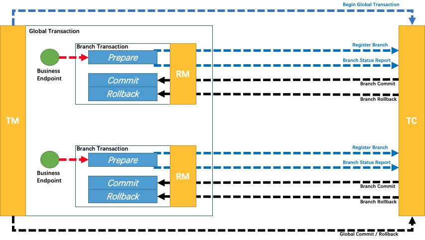

# 25. Seata 介绍及四种模式优缺点
## 什么是seata
Seata（Simple Extensible Autonomous Transaction Architecture）是一个开源的分布式事务解决方案，旨在解决分布式系统中的事务一致性问题。它为开发者提供了一种简单而可扩展的方式来管理和协调分布式事务。

Seata主要解决的问题是在分布式环境中多个服务之间的事务一致性。在传统的单体应用中，事务管理相对较为简单，可以使用本地数据库事务来确保数据的一致性。但在分布式系统中，涉及多个服务的操作，需要保证所有操作要么全部成功，要么全部回滚，以确保数据的一致性。
## 核心组件
### Transaction Coordinator（TC）
负责全局事务的协调和管理。它协调各个参与者的事务操作，并最终决定全局事务的提交或回滚。

### Resource Manager（RM）
负责管理本地事务的资源，如数据库、消息队列等。它与TC进行通信，并执行TC指令来保证本地事务的一致性。

### Transaction Manager（TM）
负责全局事务的启动、提交和回滚。它与TC和RM进行交互，并控制全局事务的执行流程。

过这些组件和协议，Seata能够提供分布式事务的管理和协调能力，帮助开发者简化分布式系统中的事务处理，并确保数据的一致性。
## 四种事务模式
Seata提供了四种不同的事务模式，每种模式都有其优点和缺点。下面是对这四种模式的简要描述：
### AT（Automatic Transaction）模式
AT模式是Seata的默认事务模式。它通过在分布式事务的根节点上加锁来保证全局事务的一致性。
#### 实例说明
两个全局事务 tx1 和 tx2，分别对 a 表的 m 字段进行更新操作，m 的初始值 1000。
tx1 先开始，开启本地事务，拿到本地锁，更新操作 m = 1000 - 100 = 900。本地事务提交前，先拿到该记录的 全局锁 ，本地提交释放本地锁。 tx2 后开始，开启本地事务，拿到本地锁，更新操作 m = 900 - 100 = 800。本地事务提交前，尝试拿该记录的 全局锁 ，tx1 全局提交前，该记录的全局锁被 tx1 持有，tx2 需要重试等待 全局锁 。

tx1 二阶段全局提交，释放 全局锁 。tx2 拿到 全局锁 提交本地事务。

如果 tx1 的二阶段全局回滚，则 tx1 需要重新获取该数据的本地锁，进行反向补偿的更新操作，实现分支的回滚。

此时，如果 tx2 仍在等待该数据的 全局锁，同时持有本地锁，则 tx1 的分支回滚会失败。分支的回滚会一直重试，直到 tx2 的 全局锁 等锁超时，放弃 全局锁 并回滚本地事务释放本地锁，tx1 的分支回滚最终成功。

因为整个过程 全局锁 在 tx1 结束前一直是被 tx1 持有的，所以不会发生 脏写 的问题。

#### 整体流程
* 一阶段
    * 解析 SQL：得到 SQL 的类型（UPDATE），表（product），条件（where name = 'TXC'）等相关的信息。
    * 查询前镜像：根据解析得到的条件信息，生成查询语句，定位数据。
    * 执行业务 SQL
    * 查询后镜像
    * 插入回滚日志 UNDO_LOG
* 二阶段-回滚
    * 收到 TC 的分支回滚请求，开启一个本地事务，执行如下操作。
    * 通过 XID 和 Branch ID 查找到相应的 UNDO LOG 记录。
    * 数据校验：拿 UNDO LOG 中的后镜与当前数据进行比较，如果有不同，说明数据被当前全局事务之外的动作做了修改
    * 根据 UNDO LOG 中的前镜像和业务 SQL 的相关信息生成并执行回滚的语句
* 二阶段-提交
    * 收到 TC 的分支提交请求，把请求放入一个异步任务的队列中，马上返回提交成功的结果给 TC
    * 异步任务阶段的分支提交请求将异步和批量地删除相应 UNDO LOG 记录

#### 优缺点
* 优点
    * 无侵入性：应用程序无需修改代码就可以使用该模式，对现有系统的集成较为简单。
    * 开发便利：事务的提交和回滚由Seata自动处理，开发人员无需编写额外的代码。
* 缺点
    * 锁竞争：在全局事务提交之前，会锁住资源，可能导致性能瓶颈和并发度下降。
    * 存在事务悬挂的风险：如果全局事务未能成功提交，本地事务可能会一直悬挂。

### TCC（Try-Confirm-Cancel）模式
TCC模式通过明确的Try、Confirm和Cancel三个阶段来实现分布式事务的一致性。在每个参与者上执行自定义的业务逻辑

#### 整体流程
* 一阶段 prepare 行为：调用 自定义 的 prepare 逻辑。
* 二阶段 commit 行为：调用 自定义 的 commit 逻辑。
* 二阶段 rollback 行为：调用 自定义 的 rollback 逻辑。

#### 优缺点
* 优点
    * 高灵活性：可以根据业务需求自定义每个事务阶段的逻辑。
    * 没有锁竞争：每个事务阶段都可以通过乐观锁或其他方式来控制并发访问。
* 缺点
    * 开发复杂：实现TCC模式需要编写和维护三个阶段的逻辑代码（Try、Confirm、Cancel）。
    * 跨服务调用复杂：在跨服务调用的情况下，需要确保所有涉及的服务都支持TCC模式。
### SAGA模式
SAGA模式将分布式事务拆分为一系列的本地事务，每个本地事务都有一个与之关联的补偿操作。通过异步执行和补偿操作来实现分布式事务的一致性。
#### 优缺点
* 优点
    * 异步协调：每个本地事务都可以异步执行，不会阻塞整个全局事务的执行。
    * 容错性：可以通过补偿操作来回滚或修复发生错误的事务。
* 缺点
    * 一致性难以保证：由于事务的异步性质，可能存在不一致的状态，需要开发人员手动处理
    * 开发复杂：实现SAGA模式需要编写和维护每个阶段的逻辑代码，包括正常执行和补偿操作。

### XA（eXtended Architecture）模式
在Seata中，当使用XA模式时，Seata作为全局事务协调器（Transaction Coordinator，TC），协调各个参与者（如数据库、消息队列等）的事务操作。Seata与各个参与者的资源管理器（Resource Manager，RM）进行通信，并通过XA协议来实现分布式事务的提交或回滚。

#### 工作过程
* 全局事务的启动：当一个全局事务开始时，Seata会创建一个全局事务上下文，并生成一个全局事务ID。
* 分支事务的注册：在全局事务中，每个参与者（如数据库）作为一个分支事务，将其本地事务与全局事务关联，并向Seata注册该分支事务。
* 事务的执行：在全局事务的执行过程中，参与者按照Seata的指令执行本地事务操作，包括读取、写入等。
* 事务的提交：当全局事务执行完成时，Seata会向各个参与者发送事务提交请求。
* 两阶段提交：参与者接收到事务提交请求后，会根据XA协议执行两阶段提交操作。在第一阶段，参与者会准备提交，并将准备状态反馈给Seata。在第二阶段，Seata根据所有参与者的反馈决定是否提交或回滚全局事务。
* 事务的结束：一旦Seata决定提交或回滚全局事务，会通知各个参与者执行最终的提交或回滚操作，并最终结束全局事务。

#### 优缺点
* 优点
    * 数据库级事务：使用XA协议支持分布式事务，确保所有参与的数据库都具有原子性。
    * 强一致性：XA模式保证了全局事务的强一致性，符合ACID特性。
* 缺点
    * 性能影响：由于需要在多个数据库之间协调事务，XA模式可能会对性能产生一定的影响。
    * 资源占用：XA模式需要占用更多的系统资源来实现全局事务的管理。