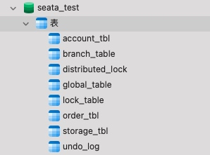
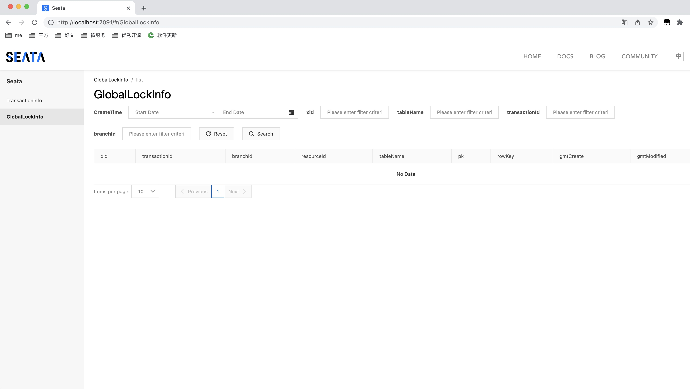
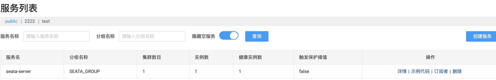
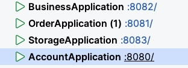
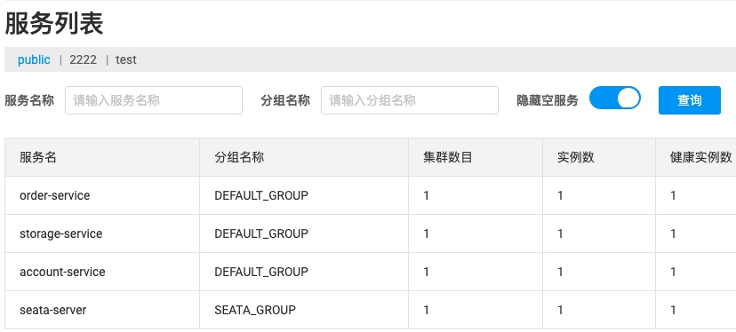
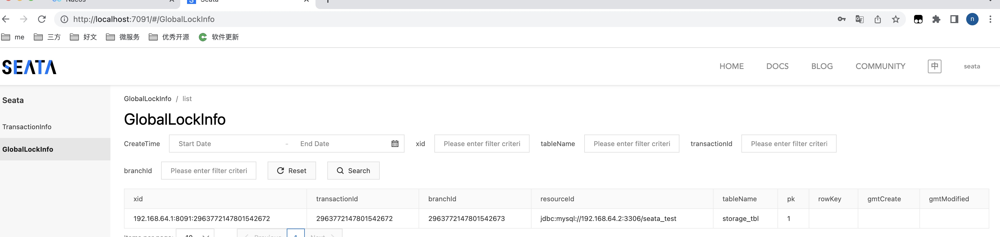

# 26.Spring Cloud 集成Seata 1.6.1
> 代码位置 seata

## 安装seata-server
### 下载jar包
```
https://github.com/seata/seata/releases/download/v1.6.1/seata-server-1.6.1.tar.gz
```
### 修改配置文件
主要修改将nacos作为注册中心和配置中心
```
conf/application.yml

server:
  port: 7091

spring:
  application:
    name: seata-server

logging:
  config: classpath:logback-spring.xml
  file:
    path: ${user.home}/logs/seata
  extend:
    logstash-appender:
      destination: 127.0.0.1:4560
    kafka-appender:
      bootstrap-servers: 127.0.0.1:9092
      topic: logback_to_logstash

console:
  user:
    username: seata
    password: seata

seata:
  config:
    # support: nacos 、 consul 、 apollo 、 zk  、 etcd3
    type: nacos
    nacos:
      server-addr: 192.168.64.2:8848
      namespace:
      group: SEATA_GROUP
      username:
      password:
      context-path:
      ##if use MSE Nacos with auth, mutex with username/password attribute
      #access-key:
      #secret-key:
      data-id: seata.properties
  registry:
    # support: nacos 、 eureka 、 redis 、 zk  、 consul 、 etcd3 、 sofa
    type: nacos
    preferred-networks: 30.240.*
    nacos:
      application: seata-server
      server-addr: 192.168.64.2:8848
      group: SEATA_GROUP
      namespace:
      cluster: default
      username:
      password:
      context-path:
      ##if use MSE Nacos with auth, mutex with username/password attribute
      #access-key:
      #secret-key:
  server:
    service-port: 8091 #If not configured, the default is '${server.port} + 1000'
    max-commit-retry-timeout: -1
    max-rollback-retry-timeout: -1
    rollback-retry-timeout-unlock-enable: false
    enable-check-auth: true
    enable-parallel-request-handle: true
    retry-dead-threshold: 130000
    xaer-nota-retry-timeout: 60000
    enableParallelRequestHandle: true
    recovery:
      committing-retry-period: 1000
      async-committing-retry-period: 1000
      rollbacking-retry-period: 1000
      timeout-retry-period: 1000
    undo:
      log-save-days: 7
      log-delete-period: 86400000
    session:
      branch-async-queue-size: 5000 #branch async remove queue size
      enable-branch-async-remove: false #enable to asynchronous remove branchSession
  store:
    # support: file 、 db 、 redis
    mode: db
    session:
      mode: db
    lock:
      mode: db
    db:
      datasource: druid
      db-type: mysql
      driver-class-name: com.mysql.jdbc.Driver
      url: jdbc:mysql://192.168.64.2:3306/seata_test?rewriteBatchedStatements=true
      user: mysql
      password: mysql
      min-conn: 10
      max-conn: 100
      global-table: global_table
      branch-table: branch_table
      lock-table: lock_table
      distributed-lock-table: distributed_lock
      query-limit: 1000
      max-wait: 5000
#  server:
#    service-port: 8091 #If not configured, the default is '${server.port} + 1000'
  security:
    secretKey: SeataSecretKey0c382ef121d778043159209298fd40bf3850a017
    tokenValidityInMilliseconds: 1800000
    ignore:
      urls: /,/**/*.css,/**/*.js,/**/*.html,/**/*.map,/**/*.svg,/**/*.png,/**/*.ico,/console-fe/public/**,/api/v1/auth/login
```
### nacos中添加seata.properties
dataId=seata.properties
group=SEATA_GROUP
内容如下
```
service.vgroupMapping.order-service-tx-group=default
service.vgroupMapping.account-service-tx-group=default
service.vgroupMapping.business-service-tx-group=default
service.vgroupMapping.storage-service-tx-group=default
```
### 创建表结构


### 启动server
```
./bin/seata-server.sh
```
### 打开seata控制台
http://localhost:7091

### 打开nacos控制台
seata-server 注册成功，接下来搭建demo项目

## 演示项目搭建
### 通用依赖
```
# business-service不需要引入mysql相关配置 
dependencies {
    implementation 'org.springframework.boot:spring-boot-starter-web'
    implementation 'com.alibaba.cloud:spring-cloud-starter-alibaba-seata'
    implementation 'com.alibaba.cloud:spring-cloud-starter-alibaba-nacos-discovery'
    implementation 'com.baomidou:mybatis-plus-boot-starter:3.5.3.1'
    implementation 'mysql:mysql-connector-java'
}
```
### 通用seata配置

```
seata:
  enabled: true
  application-id: ${spring.application.name}

  tx-service-group: ${spring.application.name}-tx-group
  config:
    type: nacos

    nacos:
      serverAddr: 192.168.64.2:8848
      dataId: "seata.properties"
      group: SEATA_GROUP
#      username: 'nacos'
#      password: 'nacos'
  registry:
    type: nacos
    nacos:
      application: seata-server
      group: SEATA_GROUP
      server-addr: 192.168.64.2:8848
#      username: 'nacos'
#      password: 'nacos'
```
### 搭建account service
#### 配置mapper
```
/**
 * @Author 编程学习
 * @Date 2023/6/17
 * @Description
 */
@Mapper
public interface AccountMapper {
    @Update("update account_tbl set money = money - #{money} where user_id = #{userId} and money>=#{money}")
    boolean update(@Param("money") int money, @Param("userId") String userId);
}
```
#### 暴露API
```
/**
 * @Author 编程学习
 * @Date 2023/6/17
 * @Description
 */
	@PostMapping(value = "/account")
	public String account(String userId, int money) {
		boolean result = accountMapper.update(money,userId);
		return result ? "success" : "failed";
	}
```
#### 配置application.yaml
```
server:
  port: 8080
spring:
  cloud:
    nacos:
      discovery:
        server-addr: 192.168.64.2:8848
  application:
    name: account-service
  main:
    allow-bean-definition-overriding: true
  datasource:
    name: storageDataSource
    #    druid don't support GraalVM now because of there is CGlib proxy
    #    type: com.alibaba.druid.pool.DruidDataSource
    driver-class-name: com.mysql.cj.jdbc.Driver
    url: jdbc:mysql://192.168.64.2:3306/seata_test?useSSL=false&serverTimezone=UTC
    username: root
    password: root
```
### 搭建storage-service
#### 配置mapper
```
/**
 * @Author 编程学习
 * @Date 2023/6/17
 * @Description
 */
@Mapper
public interface StorageMapper {
    @Update("update storage_tbl set count = count - #{count} where code = #{code} and count>=#{count}")
    boolean update(@Param("count") int count, @Param("code") String code);
}
```
#### 暴露API
```
/**
 * @Author 编程学习
 * @Date 2023/6/17
 * @Description
 */
	@PostMapping(value = "/storage/{code}/{count}")
	public boolean storage(@PathVariable("code") String code, @PathVariable("count") int count) {
		return storageMapper.update(count,code);
	}
```
#### 配置application.yaml
```
server:
  port: 8083
spring:
  cloud:
    nacos:
      discovery:
        server-addr: 192.168.64.2:8848
  application:
    name: storage-service
  main:
    allow-bean-definition-overriding: true
  datasource:
    name: storageDataSource
    #    druid don't support GraalVM now because of there is CGlib proxy
    #    type: com.alibaba.druid.pool.DruidDataSource
    driver-class-name: com.mysql.cj.jdbc.Driver
    url: jdbc:mysql://192.168.64.2:3306/seata_test?useSSL=false&serverTimezone=UTC
    username: root
    password: root
```
### 搭建order-service
#### 配置mapper
```
@Mapper
public interface OrderMapper extends BaseMapper<Order> {

}
```
#### 暴露API
```
    @PostMapping(value = "/order")
    public boolean order(String userId, String code, int count) {
        int orderMoney = count * 2;
        Order order = new Order();
        order.setCount(count);
        order.setCode(code);
        order.setUserId(userId);
        order.setMoney(orderMoney);
        if ("failed".equals(callAccountService(userId, order.getMoney()))) {
            return false;
        }
        orderMapper.insert(order);
        return true;
    }
```
#### 配置application.yaml
```
server:
  port: 8081
spring:
  cloud:
    nacos:
      discovery:
        server-addr: 192.168.64.2:8848
  application:
    name: order-service
  main:
    allow-bean-definition-overriding: true
  datasource:
    name: storageDataSource
    #    druid don't support GraalVM now because of there is CGlib proxy
    #    type: com.alibaba.druid.pool.DruidDataSource
    driver-class-name: com.mysql.cj.jdbc.Driver
    url: jdbc:mysql://192.168.64.2:3306/seata_test?useSSL=false&serverTimezone=UTC
    username: root
    password: root
```
### 搭建business-service
#### 引入open feign
```
/**
 * @Author 编程学习
 * @Date 2023/6/17
 * @Description
 */


@FeignClient("order-service")
public interface OrderService {

    @PostMapping(path = "/order")
    boolean order(@RequestParam("userId") String userId,
                 @RequestParam("code") String code,
                 @RequestParam("count") int count);

}

@FeignClient("storage-service")
public interface StorageService {

    @PostMapping(path = "/storage/{code}/{count}")
    boolean storage(@PathVariable("code") String userId,
                   @PathVariable("count") int count);

}
```
#### 创建API
```
@RestController
public class HomeController {
	@Autowired
	private StorageService storageService;
	@Autowired
	private OrderService orderService;
	@GetMapping(value = "/buy/{userId}")
	@GlobalTransactional(timeoutMills = 300000, name = "spring-cloud-demo-tx")
	public String account(@PathVariable("userId") String userId, @RequestParam("code") String code, @RequestParam("count") int count) throws InterruptedException {
		boolean storageResult = storageService.storage(code, count);
		if (!storageResult) {
			return "库存扣减失败";
		}
		boolean orderResult = orderService.order(userId, code, count);
		if (orderResult) {
			return "下单成功";
		}
		Thread.sleep(10000);
		throw new RuntimeException("下单失败,所有数据回滚...");
	}
}
```
### 启动项目


### 演示
调用接口：
http://127.0.0.1:8082/buy/001?code=JD_001&count=50
第一次下单成功
第二次下单失败，并回滚库存

