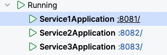
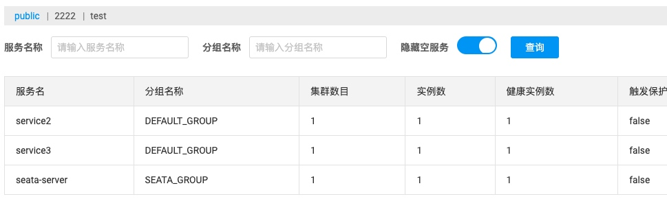

# 28.OpenFeign快速入门
## 什么是OpenFeign
OpenFeign是一个用于构建声明性、模板化HTTP客户端的Java库。它是一个开源项目，最初由Netflix开发，并在Spring Cloud项目中得到广泛使用。

使用OpenFeign，你可以通过编写接口来定义服务的API，然后OpenFeign会基于这些接口自动生成具体的HTTP请求。你可以在接口方法上使用注解来配置请求的细节，例如URL路径、HTTP方法、请求头、请求体等。OpenFeign还支持请求和响应的拦截器，用于执行额外的处理逻辑。

## 快速上手
### 引入依赖
```
dependencies {
    implementation 'org.springframework.boot:spring-boot-starter-web'
    implementation 'org.springframework.cloud:spring-cloud-starter-openfeign'
    implementation 'org.springframework.cloud:spring-cloud-starter-loadbalancer'
    implementation 'com.alibaba.cloud:spring-cloud-starter-alibaba-nacos-discovery'
}
```
### 创建三个服务
#### Service1

```
@SpringBootApplication
@EnableFeignClients
@EnableDiscoveryClient(autoRegister = false)
public class Service1Application {
    public static void main(String[] args) {
        SpringApplication.run(Service1Application.class, args);
    }
    @LoadBalanced
    @Bean
    public RestTemplate restTemplate() {
        return new RestTemplate();
    }
}

/**
 * @Author 编程学习
 * @Date 2023/6/17
 * @Description
 */
@RestController
public class IndexController {
    @Autowired
    private Service3Feign service3Feign;
    @Autowired
    private Service2Feign service2Feign;
    @GetMapping("/service1")
    public String service1(String name) {
        return "service1 回复:"+name +service3Feign.service3(name) + service2Feign.service2(name);
    }
}

# 配置
server:
  port: 8081
spring:
  application:
    name: service1
  cloud:
    nacos:
      discovery:
        #        ephemeral: false
        server-addr: 192.168.64.2:8848
        namingRequestTimeout: 10000000
```

#### Service2

```
/**
 * @Author 编程学习
 * @Date 2023/6/17
 * @Description
 */
@SpringBootApplication
public class Service2Application {
    public static void main(String[] args) {
        SpringApplication.run(Service2Application.class, args);
    }
}
/**
 * @Author 编程学习
 * @Date 2023/6/17
 * @Description
 */
@RestController
public class IndexController {
    @GetMapping("/service2")
    public String service2(String name) {
        return "service2 回复:"+name;
    }
}

# 配置
server:
  port: 8082
spring:
  application:
    name: service2
  cloud:
    nacos:
      discovery:
        #        ephemeral: false
        server-addr: 192.168.64.2:8848
        namingRequestTimeout: 10000000
```
#### Service3
```

/**
 * @Author 编程学习
 * @Date 2023/6/17
 * @Description
 */
@SpringBootApplication
public class Service3Application {
    public static void main(String[] args) {
        SpringApplication.run(Service3Application.class, args);
    }
}
/**
 * @Author 编程学习
 * @Date 2023/6/17
 * @Description
 */
@RestController
public class IndexController {
    @GetMapping("/service3")
    public String service3(String name) {
        return "service3 回复:"+name;
    }
}
# 配置
server:
  port: 8083
spring:
  application:
    name: service3
  cloud:
    nacos:
      discovery:
        #        ephemeral: false
        server-addr: 192.168.64.2:8848
        namingRequestTimeout: 10000000
```
### 启动三个服务，请求service1的接口




