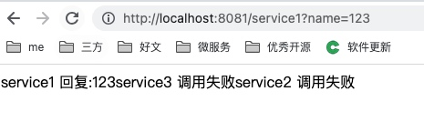

# 29.OpenFeign 高级用法
## 添加断路器 CircuitBreaker
### 引入依赖
```
    implementation 'org.springframework.cloud:spring-cloud-starter-circuitbreaker-resilience4j'
```
### 启用断路器
```
spring:
    openfeign:
      circuitbreaker:
        enabled: true
```
### 创建fallback
```
@Component
class Service2FeignFallback implements Service2Feign {

    @Override
    public String service2(String name) {
        return "service2 调用失败";
    }
}
```
### feignClient 添加fallback
```
/**
 * @Author 编程学习
 * @Date 2023/6/17
 * @Description
 */
@FeignClient(name = "service2", fallback = Service2FeignFallback.class)
public interface Service2Feign {
    @GetMapping("/service2")
    public String service2(@RequestParam("name") String name);
}
```
### 验证
关闭service3和service2
调用接口

## 配置拦截器
在这里可以统一配置一些逻辑，如添加token和请求头信息
```
@Configuration
public class FeignRequestInterceptor implements RequestInterceptor {

    @Override
    public void apply(RequestTemplate template) {
        template.header(HttpHeaders.AUTHORIZATION, "tokenVal");
    }
}
```