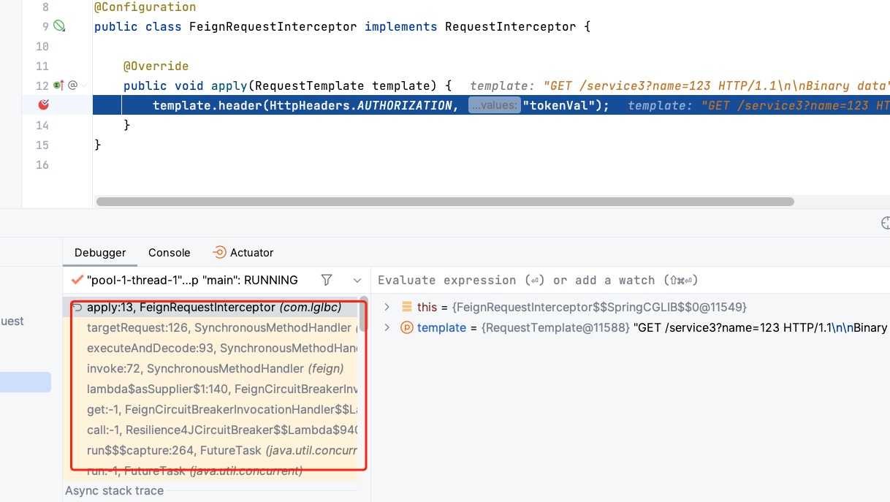
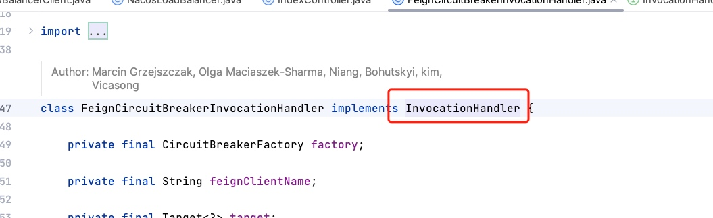
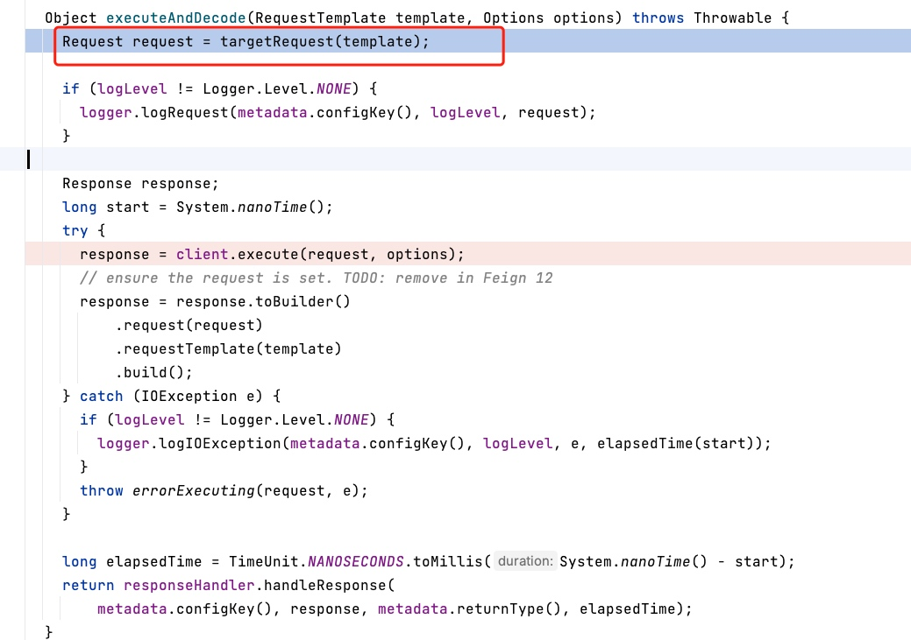
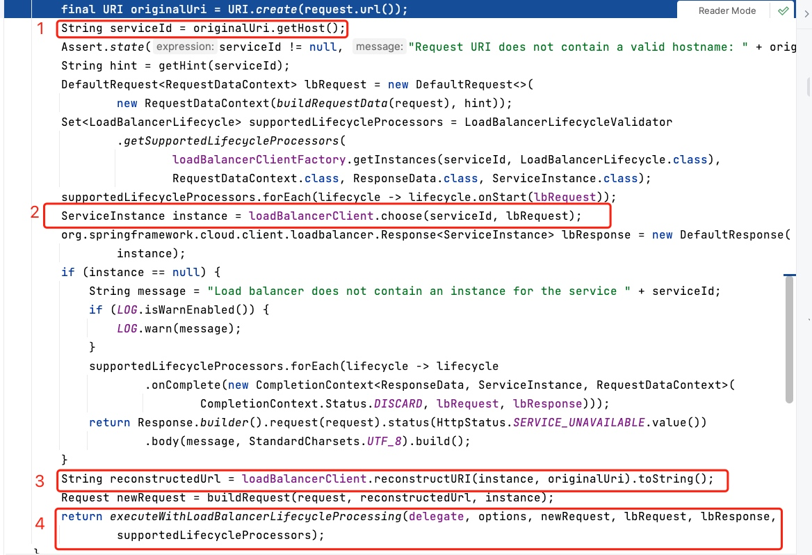
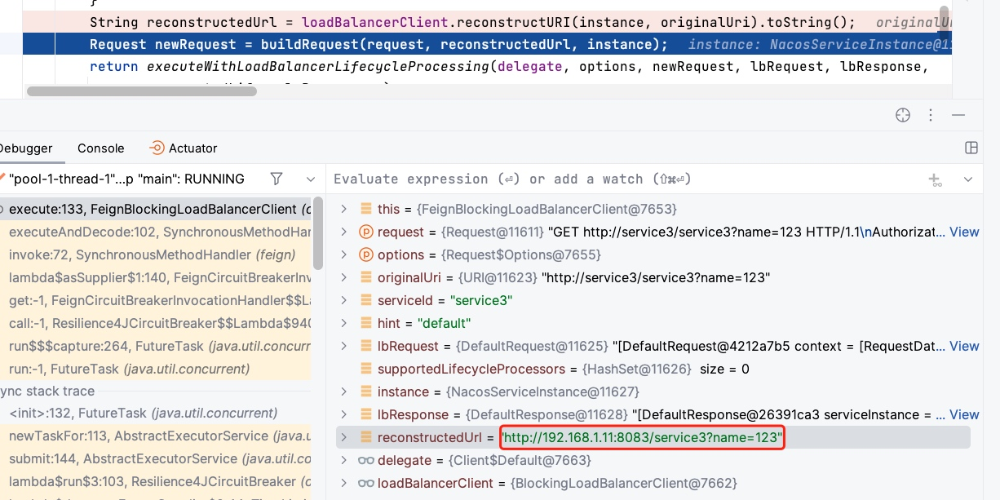

# 30.OpenFeign+LoadBalence 实现原理及源码解读
首先我们大概梳理下，OpenFeign结合LoadBalence的调用过程
## 梳理过程
* OpenFeign 为每个FeignClient都实现了一个统一的代理
* 当程序调用FeignClient时，其实调用的是代理
* 代理收到请求时，第一步要做的就是，解析URl
* 如果URL时http开头，那么直接调用，如果是服务名，则需要从注册中心获取实例，然后通过负载均衡获取服务实例(客户端负载均衡)
* 拿到实例之后进行调用

## 找到切入点 
大概是这样的过程，那么我们如何找到切入点呢，还记得我们在高级用法的时候，我们用过一个拦截器，我们可以尝试在这个拦截器的地方打断点，因为发起请求的时候肯定会经过这个拦截器

## 代理实现
断点进来了，我们也看到了这个调用链，我们点到第六个，进入到这个类，

发现它实现了InvokerHandler接口，大家是不是很熟悉，没错，它就是实现Java动态代理的接口，所以也验证了我们前面的假设，那么我们继续进入第三行：

## 替换服务名，组装url
这里大概是这样的过程
* 封装请求体(如经过拦截器处理)
* 通过client调用execut，发起请求
* 获得响应内容

那么我们看一下client.execute(request, options);这里面做了什么

* 获取serviceId（如我们配置的service3）
* 根据负载均衡器选择一个可用的服务实例
* 重新组装url,将服务名替换成真正的服务ID地址
* 发起请求，得到响应内容

