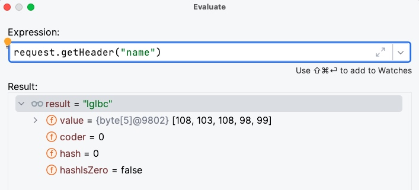
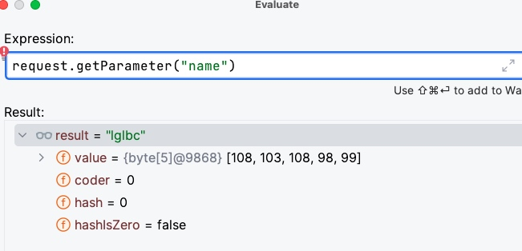

# 34.Gateway filetes 常用手法
## AddRequestHeader
### 功能
在转发到目标服务时，添加请求头信息
### 使用
```
    gateway:
      routes:
        - id: "service1"
          uri: lb://gateway-service1
          predicates:
            - Query=name,example
          filters:
            - StripPrefix=1
            - AddRequestHeader=name, example
```


## AddRequestParameter
### 功能
添加请求参数
### 使用
```
    gateway:
      routes:
        - id: "service1"
          uri: lb://gateway-service1
          predicates:
            - Query=name,example
          filters:
            - StripPrefix=1
            - AddRequestParameter=name, example
```

## RemoveJsonAttributesResponseBody
### 功能
移除返回json数据中指定的key
### 使用 

```
    gateway:
      routes:
        - id: "service1"
          uri: lb://gateway-service1
          predicates:
            - Query=name,example
          filters:
            - StripPrefix=1
            - RemoveJsonAttributesResponseBody=name
        - id: "service2"
          uri: lb://gateway-service2
          predicates:
            - Query=name,ams
          filters:
            - StripPrefix=1
            - RemoveJsonAttributesResponseBody=name
```