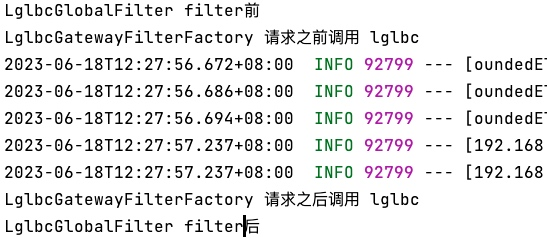

# 35.自定义global filter 和 gateway filter
global filter 作用于所有路由
gateway filter 作用于单个路由
## 自定义 gateway filter
自定义 gateway filterx需要继承 AbstractGatewayFilterFactory
### 创建gateway filter
```
package com.example.filter;
/**
 * @Author 编程学习
 * @Date 2023/6/18
 * @Description
 */
@Service
public class SampleGatewayFilterFactory extends AbstractGatewayFilterFactory<SampleGatewayFilterFactory.SampleConfig> {
    @Override
    public GatewayFilter apply(SampleConfig config) {
        return (((exchange, chain) -> {
            System.out.println("SampleGatewayFilterFactory 请求之前调用 "+config.getName());
         return chain.filter(exchange).then(Mono.fromRunnable(()->{
                 System.out.println("SampleGatewayFilterFactory 请求之后调用 "+config.getName());
         }));
        }));
    }
    public static class SampleConfig {
        private String name;

        public String getName() {
            return name;
        }

        public void setName(String name) {
            this.name = name;
        }
    }

    public SampleGatewayFilterFactory() {
        super(SampleConfig.class);
    }
}
```
### 应用gateway filter
- name: Sample 这个时固定写法，取得是gatewayfilter的前缀SampleGatewayFilterFactory-> Sample
```
    gateway:
      routes:
        - id: "service1"
          uri: lb://gateway-service1
          predicates:
            - Query=name,example
          filters:
            - StripPrefix=1
            - RemoveJsonAttributesResponseBody=name
            - name: Sample
              args:
                name: example
```
## 自定义global filter
我们后面在整合部分可以在这里处理统一权限处理或token处理
### 创建global filter
```
/**
 * @Author 编程学习
 * @Date 2023/6/18
 * @Description
 */
@Service
public class SampleGlobalFilter implements GlobalFilter, Ordered {
    @Override
    public Mono<Void> filter(ServerWebExchange exchange, GatewayFilterChain chain) {
        System.out.println("SampleGlobalFilter filter前");
        return chain.filter(exchange).then(Mono.fromRunnable(()->{
            System.out.println("SampleGlobalFilter filter后");
        }));
    }

    @Override
    public int getOrder() {
        return 0;
    }
}
```



