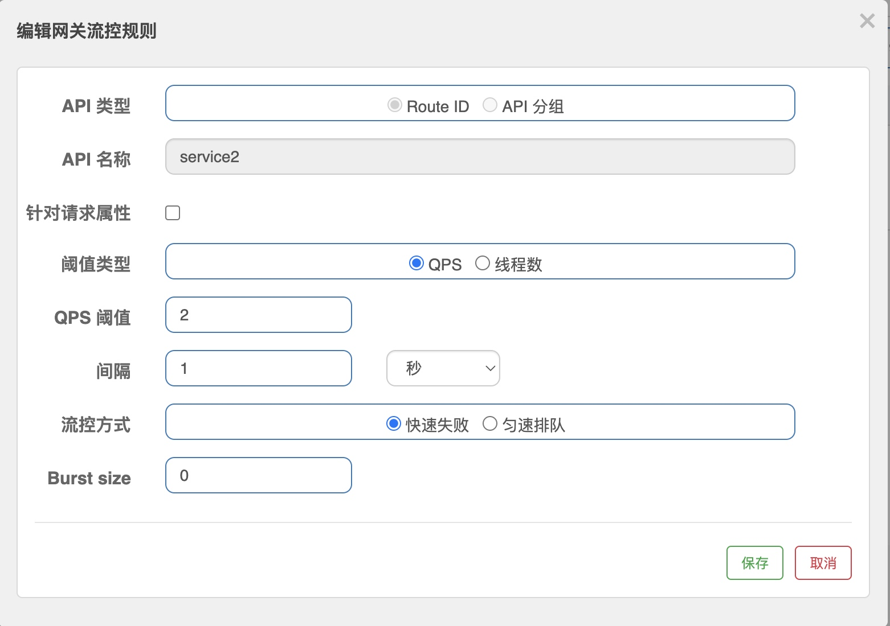
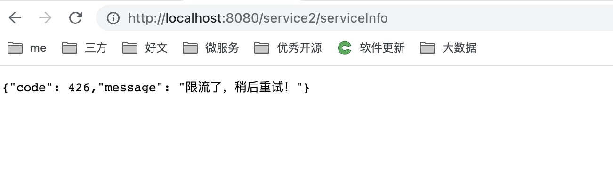

# 36.Gateway 整合 Sentinel
## 引入依赖
```
dependencies {
    implementation 'org.springframework.cloud:spring-cloud-starter-gateway'
    implementation 'org.springframework.cloud:spring-cloud-starter-loadbalancer'
    implementation 'com.alibaba.cloud:spring-cloud-starter-alibaba-nacos-discovery'
    implementation 'com.alibaba.cloud:spring-cloud-starter-alibaba-sentinel'
    implementation 'com.alibaba.cloud:spring-cloud-alibaba-sentinel-gateway'
}
```
## 修改配置
```
spring:
  application:
    name: gateway-sentinel-server
    # sentinel看板相关配置
  cloud:
    sentinel:
      transport:
        dashboard: 127.0.0.1:8089
      #配置限流之后的响应内容
      scg:
        fallback:
          # 两种模式：一种是response返回文字提示信息，一种是redirect，重定向跳转，需要同时配置redirect(跳转的uri)
          mode: response
          # 响应的状态
          response-status: 426
          # 响应体
          response-body: '{"code": 503,"message": "限流了，稍后重试！"}'
```
## 演示
需要注意的时，针对网关配置流控和降级规则，只能针对route ID和API分组设置
### 配置流控规则


### 请求service2
快速请求，触发限流

