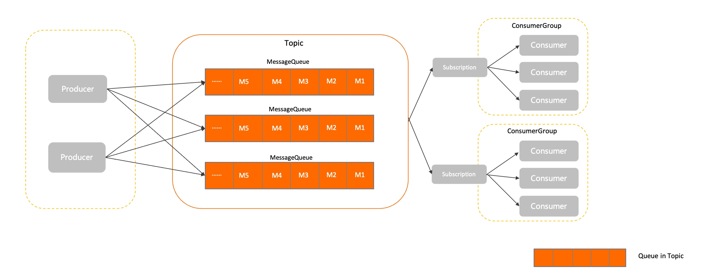

# 37.RocketMQ5.0 快速介绍
## 简介
RocketMQ 是一款开源的分布式消息队列系统，最初由阿里巴巴集团开发并于2012年发布。它是基于高可用性、高性能和可扩展性的目标设计的，用于处理大规模数据的实时消息传递。

## RocketMQ 的领域模型

### Producer（生产者）
Producer 是消息的发送方，负责将消息发送到 RocketMQ 中的 Broker。Producer 将消息发送到指定的 Topic，可以同步或异步地发送消息。一个 Producer 可以发送多个消息到不同的 Topic。

### Consumer（消费者）
Consumer 是消息的接收方，用于订阅并消费 Producer 发送到 Broker 的消息。Consumer 可以以不同的方式进行消息的消费，如顺序消费和并发消费。消费者可以以消费者组（Consumer Group）的形式组织，每个消费者组可以有多个 Consumer 实例。

### Topic（主题）
Topic 是消息的分类标签，用于区分不同类型的消息。Producer 发送消息时需要指定发送到哪个 Topic，而 Consumer 订阅消息时也需要指定订阅哪个 Topic。消息发送到指定 Topic 后，RocketMQ 将根据订阅关系将消息分发给订阅该 Topic 的 Consumer。

### Broker（消息中间件）
Broker 是消息队列的中间件服务器，负责存储和传递消息。Broker 接收 Producer 发送的消息，并将其存储在内部的存储引擎中。然后，Broker 根据订阅关系将消息推送给订阅了相应 Topic 的 Consumer。

### Message（消息）
Message 是 RocketMQ 中的基本单元，它由 Topic 和消息内容组成。消息内容可以是任意形式的数据，如字符串、JSON、二进制等。Producer 发送消息时，需要创建一个 Message，并指定要发送到的 Topic。

### Tag（标签）
Tag 是对消息的额外标记，用于对消息进行细分和过滤。可以根据消息的不同特征给消息设置不同的标签，Consumer 在订阅消息时可以选择订阅某个特定标签的消息。