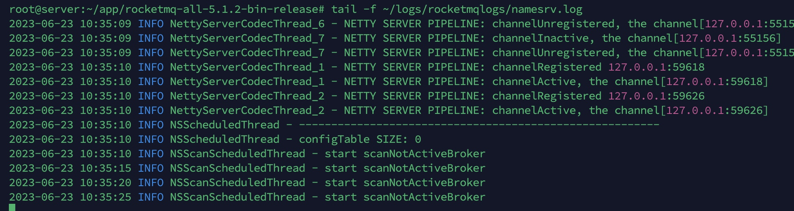
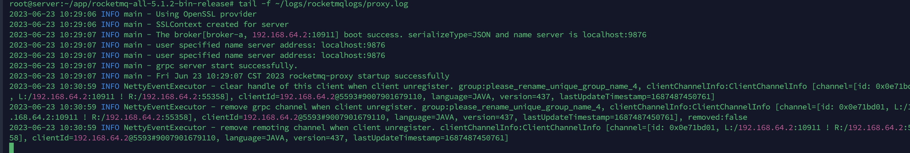
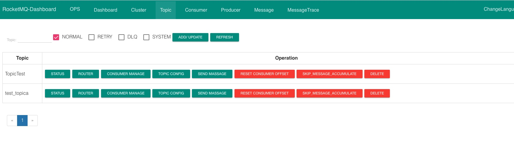
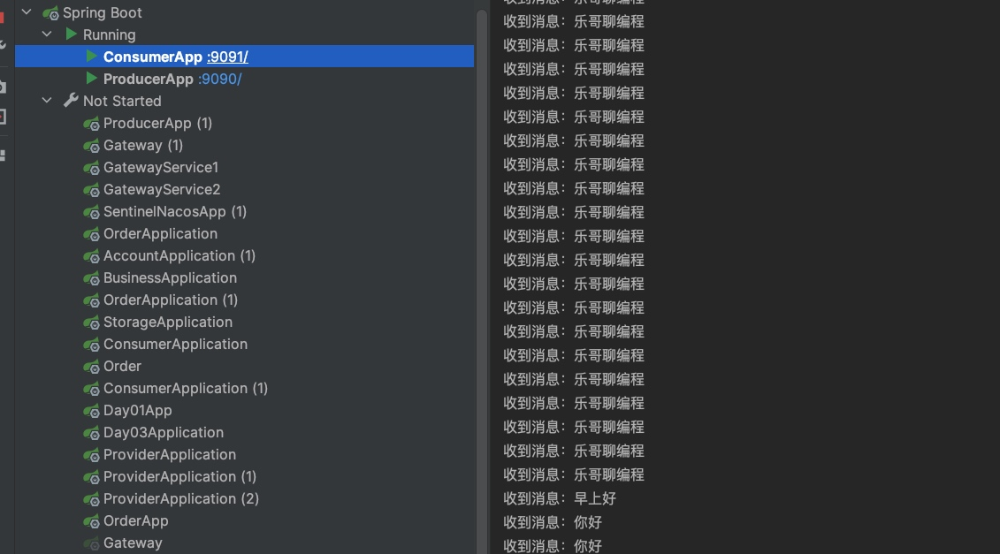

# 38.RocketMQ 5.0安装与整合Spring Cloud Alibaba
## rocketmq 安装
### 下载
```
wget https://dlcdn.apache.org/rocketmq/5.1.2/rocketmq-all-5.1.2-bin-release.zip
```
### 启动
* 启动NameServe
```
nohup sh bin/mqnamesrv &
```
* 验证
```
tail -f ~/logs/rocketmqlogs/namesrv.log
```


* 启动broker
```
nohup sh bin/mqbroker -n localhost:9876 --enable-proxy &
```
* 验证
```
tail -f ~/logs/rocketmqlogs/proxy.log 
```


## 使用工具验证
```
$ export NAMESRV_ADDR=localhost:9876
$ sh bin/tools.sh org.apache.rocketmq.example.quickstart.Producer
 SendResult [sendStatus=SEND_OK, msgId= ...

$ sh bin/tools.sh org.apache.rocketmq.example.quickstart.Consumer
 ConsumeMessageThread_%d Receive New Messages: [MessageExt...
```
## 安装dashboard
```
docker run -d --name rocketmq-dashboard -e "JAVA_OPTS=-Drocketmq.namesrv.addr=192.168.64.2:9876" -p 9877:8080 -t apacherocketmq/rocketmq-dashboard:latest
```

## 整合Spring Cloud Alibaba
### 引入依赖
```
dependencies {
    implementation 'org.springframework.boot:spring-boot-starter-web'
    implementation 'com.alibaba.cloud:spring-cloud-starter-stream-rocketmq'
}
```
### 搭建项目
#### 生产者
##### 发送消息
```
/**
 * @Author 编程学习
 * @Date 2023/6/23
 * @Description
 */
@RestController
public class TestController {
    @Autowired
    private StreamBridge streamBridge;

    @RequestMapping("/testSendMsg")
    public String send(String msg){
        Map<String, Object> headers = new HashMap<>();
        headers.put(MessageConst.PROPERTY_TAGS, "tagStr");
        Message<String> message = MessageBuilder.createMessage(msg, new MessageHeaders(headers));
        streamBridge.send("producer-out-0",message);
        return JSON.toJSONString(message);
    }
}
```
##### 配置MQ
```
server:
  port: 9090
spring:
  application:
    name: rocketmq-broadcast-producer-example
  cloud:
    stream:
      rocketmq:
        binder:
          name-server: 192.168.64.2:9876
        bindings:
          producer-out-0:
            producer:
              group: output_1
      bindings:
        producer-out-0:
          destination: test_topica
```
#### 消费者
##### 消费数据
```
package com.example.rocketmq;

import com.alibaba.fastjson.JSON;
import org.springframework.boot.SpringApplication;
import org.springframework.boot.autoconfigure.SpringBootApplication;
import org.springframework.context.annotation.Bean;
import org.springframework.messaging.Message;

import java.util.function.Consumer;

/**
 * @Author 编程学习
 * @Date 2023/6/23
 * @Description
 */
@SpringBootApplication
public class ConsumerApp {
    public static void main(String[] args) {
        SpringApplication.run(ConsumerApp.class, args);
    }

    @Bean
    public Consumer<Message<String>> consumer() {
        return msg -> {
            System.out.println("收到消息："+msg.getPayload());
        };
    }
}
```  
##### 配置MQ
```
server:
  port: 9091
spring:
  application:
    name: rocketmq-broadcast-consumer1-example
  cloud:
    stream:
      function:
        definition: consumer;
      rocketmq:
        binder:
          name-server: 192.168.64.2:9876
      bindings:
        consumer-in-0:
          destination: test_topica
          group: test-consumer
```
### 演示
调用接口： http://localhost:9090/testSendMsg?msg=%E4%BD%A0%E5%A5%BD 发送消息，打开consumer的控制台，
前提是你已经在dashboard创建好了名为：test_topica的topic

