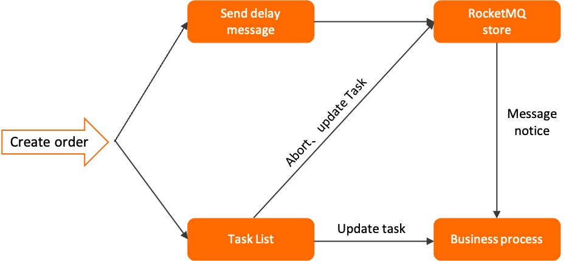
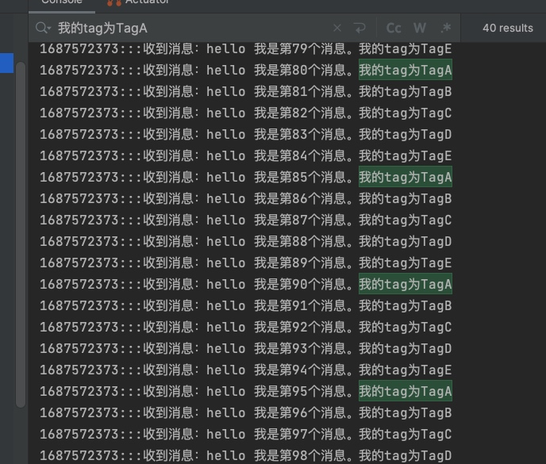
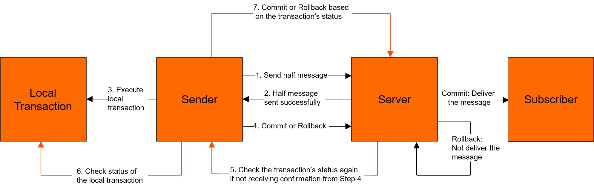
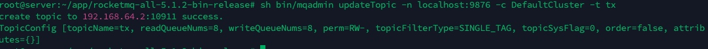
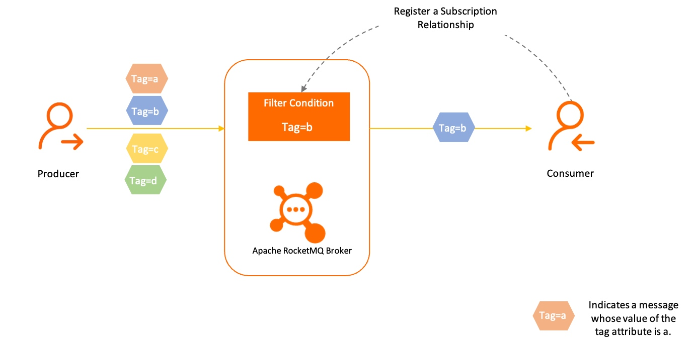
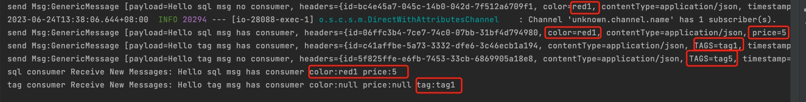

# 39.RocketMQ 5.0 功能特性演示
## 普通消息
### 定义
普通消息为 Apache RocketMQ 中最基础的消息，区别于有特性的顺序消息、定时/延时消息和事务消息。
### 应用场景
普通消息一般应用于微服务解耦、事件驱动、数据集成等场景，这些场景大多数要求数据传输通道具有可靠传输的能力，且对消息的处理时机、处理顺序没有特别要求
### 使用限制
普通消息仅支持使用MessageType为Normal主题，即普通消息只能发送至类型为普通消息的主题中，发送的消息的类型必须和主题的类型一致。
### 使用示例
这个在第二节演示的就是这种，就不重复演示了，

## 定时/延迟消息
### 定义
定时/延迟消息是 Apache RocketMQ 提供的一种高级消息类型，消息被发送至服务端后，在指定时间后才能被消费者消费。通过设置一定的定时时间可以实现分布式场景的延时调度触发效果。
### 应用场景
在分布式定时调度触发、任务超时处理等场景，需要实现精准、可靠的定时事件触发。使用 Apache RocketMQ 的定时消息可以简化定时调度任务的开发逻辑，实现高性能、可扩展、高可靠的定时触发能力。


### 应用限制
* messageDelayLevel = "1s 5s 10s 30s 1m 2m 3m 4m 5m 6m 7m 8m 9m 10m 20m 30m 1h 2h"不支持自定义修改(商业版可以定制)

### 代码演示
#### 生产端修改
```
    @RequestMapping("/sendDelayMsg")
    public String sendDelayMsg(String msg){
//      messageDelayLevel = "1s 5s 10s 30s 1m 2m 3m 4m 5m 6m 7m 8m 9m 10m 20m 30m 1h 2h";
        Map<String, Object> headers = new HashMap<>();
        headers.put(MessageConst.PROPERTY_KEYS, UUID.randomUUID().toString());
        headers.put(MessageConst.PROPERTY_ORIGIN_MESSAGE_ID, UUID.randomUUID().toString());
        // 设置延时等级1~10
        headers.put(MessageConst.PROPERTY_DELAY_TIME_LEVEL, 4);
        Message<String> message = new GenericMessage(msg, headers);
        System.out.println("消息将在30s后被客户端消费："+System.currentTimeMillis()/1000);
        streamBridge.send("producer-out-0",message);
        return JSON.toJSONString(message);
    }
```
#### 消费端修改
```
    @Bean
    public Consumer<Message<String>> consumer() {
        return msg -> {
            System.out.println(System.currentTimeMillis()/1000+ ":::收到消息："+msg.getPayload());
        };
    }
```
## 顺序消息
### 定义
顺序消息（FIFO消息）是消息队列RocketMQ版提供的一种严格按照顺序来发布和消费的消息类型。
顺序消息分为两类：
* 全局顺序：对于指定的一个Topic，所有消息按照严格的先入先出FIFO（First In First Out）的顺序进行发布和消费。
* 分区顺序：对于指定的一个Topic，所有消息根据Sharding Key进行区块分区。同一个分区内的消息按照严格的FIFO顺序进行发布和消费。Sharding Key是顺序消息中用来区分不同分区的关键字段，和普通消息的Key是完全不同的概念。
### 应用场景
在有序事件处理、撮合交易、数据实时增量同步等场景下，异构系统间需要维持强一致的状态同步，上游的事件变更需要按照顺序传递到下游进行处理。在这类场景下使用 Apache RocketMQ 的顺序消息可以有效保证数据传输的顺序性。
### 代码示例
#### 生产端修改
##### 配置QueueSelector
```
@Component
public class OrderlyMessageQueueSelector implements MessageQueueSelector {
   private static final Logger log = LoggerFactory
         .getLogger(OrderlyMessageQueueSelector.class);
   @Override
   public MessageQueue select(List<MessageQueue> mqs, Message msg, Object arg) {
      Integer id = (Integer) ((MessageHeaders) arg).get(MessageConst.PROPERTY_ORIGIN_MESSAGE_ID);
      int index = id % Constant.tags.length % mqs.size();
      log.info("select index:{}", index);
      return mqs.get(index);
   }
}
```
##### 发送端口
```
    @RequestMapping("sendOrderMsg")
    public String sendOrderMsg() {
        for (int i = 0; i < 100; i++) {
            String key = "KEY" + i;
            Map<String, Object> headers = new HashMap<>();
            headers.put(MessageConst.PROPERTY_KEYS, key);
            headers.put(MessageConst.PROPERTY_TAGS, Constant.tags[i % Constant.tags.length]);
            headers.put(MessageConst.PROPERTY_ORIGIN_MESSAGE_ID, i);
            Message<String> msg = new GenericMessage(String.format("hello 我是第%s个消息。我的tag为%s",i, Constant.tags[i % Constant.tags.length]), headers);
            streamBridge.send("producer-out-0", msg);
        }
        return "success";
    }
```
##### 配置文件修改
```
server:
  port: 9090
spring:
  application:
    name: rocketmq-broadcast-producer-example
  cloud:
    stream:
      rocketmq:
        binder:
          name-server: 192.168.64.2:9876
        bindings:
          producer-out-0:
            producer:
              group: output_1
              messageQueueSelector: orderlyMessageQueueSelector
          testDelay-out-0:
            producer:
              group: output_1
```
#### 消费端
 只需修改配置文件，进行顺序小消费
 ```
 server:
  port: 9091
spring:
  application:
    name: rocketmq-broadcast-consumer1-example
  cloud:
    stream:
      function:
        definition: consumer;
      rocketmq:
        binder:
          name-server: 192.168.64.2:9876
      bindings:
        consumer-in-0:
          destination: test_topica
          group: test-consumer
          push:
            orderly: true
```
### 演示
请求api http://localhost:9090/sendOrderMsg 发送消息


## 事务消息
### 定义
可以被认为是一个两阶段的提交消息实现，以确保分布式系统的最终一致性。 事务性消息确保本地事务的执行和消息的发送可以原子地执行。
### 应用场景
* 分布式事务的诉求
* 传统XA事务方案：性能不足
* 基于普通消息方案：一致性保障困难
### 事务消息处理流程

1. 生产者将消息发送至Apache RocketMQ服务端。
2. Apache RocketMQ服务端将消息持久化成功之后，向生产者返回Ack确认消息已经发送成功，此时消息被标记为"暂不能投递"，这种状态下的消息即为半事务消息。
3. 生产者开始执行本地事务逻辑。
4. 生产者根据本地事务执行结果向服务端提交二次确认结果（Commit或是Rollback），服务端收到确认结果后处理逻辑如下：
5. 二次确认结果为Commit：服务端将半事务消息标记为可投递，并投递给消费者。
6. 二次确认结果为Rollback：服务端将回滚事务，不会将半事务消息投递给消费者。
7. 在断网或者是生产者应用重启的特殊情况下，若服务端未收到发送者提交的二次确认结果，或服务端收到的二次确认结果为Unknown未知状态，经过固定时间后，服务端将对消息生产者即生产者集群中任一生产者实例发起消息回查。 说明 服务端回查的间隔时间和最大回查次数，请参见参数限制。
8. 生产者收到消息回查后，需要检查对应消息的本地事务执行的最终结果。
9. 生产者根据检查到的本地事务的最终状态再次提交二次确认，服务端仍按照步骤4对半事务消息进行处理。

### 代码示例
#### 创建事务监听器
```
@Component("myTransactionListener")
public class TransactionListenerImpl implements TransactionListener {

	@Override
	public LocalTransactionState executeLocalTransaction(Message msg, Object arg) {
		Object num = msg.getProperty("test");

		if ("1".equals(num)) {
			System.out.println("executer: " + new String(msg.getBody()) + " unknown");
			return LocalTransactionState.UNKNOW;
		}
		else if ("2".equals(num)) {
			System.out.println("executer: " + new String(msg.getBody()) + " rollback");
			return LocalTransactionState.ROLLBACK_MESSAGE;
		}
		System.out.println("executer: " + new String(msg.getBody()) + " commit");
		return LocalTransactionState.COMMIT_MESSAGE;
	}

	@Override
	public LocalTransactionState checkLocalTransaction(MessageExt msg) {
		System.out.println("check: " + new String(msg.getBody()));
		return LocalTransactionState.COMMIT_MESSAGE;
	}

}
```
#### 配置事务监听器
```
server:
  port: 28088
spring:
  application:
    name: rocketmq-tx-example
  cloud:
    stream:
      function:
        definition: consumer;
      rocketmq:
        binder:
          name-server: 192.168.64.2:9876
        bindings:
          producer-out-0:
            producer:
              group: output_1
              transactionListener: myTransactionListener
              producerType: Trans
      bindings:
        producer-out-0:
          destination: tx
        consumer-in-0:
          destination: tx
          group: tx-group
```
#### 消费端示例
```
    @Bean
    public Consumer<Message<String>> consumer() {
        return msg -> {
            Object arg = msg.getHeaders();
            System.out.println(Thread.currentThread().getName() + " Receive New Messages: " + msg.getPayload() + " ARG:"
                    + arg.toString());
        };
    }
```
#### 生产端口
```
    @RequestMapping("sendTxMsg")
    public String sendOrderMsg(int num) {
        MessageBuilder builder = MessageBuilder.withPayload("Hello Tx msg ");
        builder.setHeader("test", String.valueOf(num))
                .setHeader(MessageHeaders.CONTENT_TYPE, MimeTypeUtils.APPLICATION_JSON);
        builder.setHeader(RocketMQConst.USER_TRANSACTIONAL_ARGS, "binder");
        Message<String> msg = builder.build();
        System.out.println("send Msg:" + msg.toString());
        streamBridge.send("producer-out-0", msg);
        return "success";
    }
```
#### 创建tx topic
```
sh bin/mqadmin updateTopic -n localhost:9876 -c DefaultCluster -t tx
```

#### 演示
请求接口
* http://localhost:28088/sendTxMsg?num=1
* http://localhost:28088/sendTxMsg?num=2
* http://localhost:28088/sendTxMsg?num=3
观察事务提交状态

## SQL 和 Tag 过滤
### 定义
过滤的含义指的是将符合条件的消息投递给消费者，而不是将匹配到的消息过滤掉。
Apache RocketMQ 的消息过滤功能通过生产者和消费者对消息的属性、标签进行定义，并在 Apache RocketMQ 服务端根据过滤条件进行筛选匹配，将符合条件的消息投递给消费者进行消费。



### 场景
Apache RocketMQ 作为发布订阅模型的消息中间件广泛应用于上下游业务集成场景。在实际业务场景中，同一个主题下的消息往往会被多个不同的下游业务方处理，各下游的处理逻辑不同，只关注自身逻辑需要的消息子集。
### 代码示例
#### 发送消息
```
@RequestMapping("sendSqlMsg")
    public String sendOrderMsg() {
        MessageBuilder builder = MessageBuilder.withPayload("Hello sql msg no consumer");
        builder.setHeader(Constant.colorHeaderKey, "red1")
                .setHeader(MessageHeaders.CONTENT_TYPE, MimeTypeUtils.APPLICATION_JSON);
        Message<String> msg = builder.build();
        System.out.println("send Msg:" + msg.toString());
        streamBridge.send("producer-out-0", msg);

        builder = MessageBuilder.withPayload("Hello sql msg has consumer");
        builder.setHeader(Constant.colorHeaderKey, "red1")
                .setHeader(Constant.priceHeaderKey,"5")
                .setHeader(MessageHeaders.CONTENT_TYPE, MimeTypeUtils.APPLICATION_JSON);
        msg = builder.build();
        System.out.println("send Msg:" + msg.toString());
        streamBridge.send("producer-out-0", msg);

        builder = MessageBuilder.withPayload("Hello tag msg has consumer");
        builder.setHeader(MessageConst.PROPERTY_TAGS, "tag1")
                .setHeader(MessageHeaders.CONTENT_TYPE, MimeTypeUtils.APPLICATION_JSON);
        msg = builder.build();
        System.out.println("send Msg:" + msg.toString());
        streamBridge.send("producer-out-0", msg);


        builder = MessageBuilder.withPayload("Hello tag msg no consumer");
        builder.setHeader(MessageConst.PROPERTY_TAGS, "tag5")
                .setHeader(MessageHeaders.CONTENT_TYPE, MimeTypeUtils.APPLICATION_JSON);
        msg = builder.build();
        System.out.println("send Msg:" + msg.toString());
        streamBridge.send("producer-out-0", msg);
        return "success";
    }
```
#### 修改配置文件
```
spring:
  application:
    name: rocketmq-sql-example
  cloud:
    stream:
      function:
        definition: sqlConsumer;tagConsumer;
      rocketmq:
        binder:
          name-server: 192.168.64.2:9876
        bindings:
          sqlConsumer-in-0:
            consumer:
              # tag: {@code tag1||tag2||tag3 }; sql: {@code 'color'='blue' AND 'price'>100 } .
              subscription: sql:(color in ('red1','red4') and price>3)
          tagConsumer-in-0:
            consumer:
              # tag: {@code tag1||tag2||tag3 }; sql: {@code 'color'='blue' AND 'price'>100 } .
              subscription: tag1||tag2
      bindings:
        producer-out-0:
          destination: sql
        sqlConsumer-in-0:
          destination: sql
          group: sql-group
        tagConsumer-in-0:
          destination: sql
          group: tag-group
```
#### 修改broker，支持SQL
```
brokerClusterName = DefaultCluster
brokerName = broker-a
brokerId = 0
deleteWhen = 04
fileReservedTime = 48
brokerRole = ASYNC_MASTER
flushDiskType = ASYNC_FLUSH
enablePropertyFilter=true
```
#### 配置消费函数
```
    @Bean
    public Consumer<Message<String>> sqlConsumer() {
        return msg -> {
            Object arg = msg.getHeaders();
            System.out.println("sql consumer Receive New Messages: " + msg.getPayload() + " color:"
                    + msg.getHeaders().get(Constant.colorHeaderKey)+" price:"+msg.getHeaders().get(Constant.priceHeaderKey));
        };
    }
    @Bean
    public Consumer<Message<String>> tagConsumer() {
        return msg -> {
            Object arg = msg.getHeaders();
            System.out.println("tag consumer Receive New Messages: " + msg.getPayload() + " color:"
                    + msg.getHeaders().get(Constant.colorHeaderKey)+" price:"+msg.getHeaders().get(Constant.priceHeaderKey)+" tag:"+msg.getHeaders().get("ROCKET_TAGS"));
        };
    }
```
### 演示
调用接口：http://localhost:28088/sendSqlMsg

## 广播消息
### 定义
 广播会发送消息给所有消费者。
### 应用场景 
如果你想同一消费组下所有消费者接收到同一个topic下的消息，广播消费非常适合此场景。
### 代码示例
见视频演示
