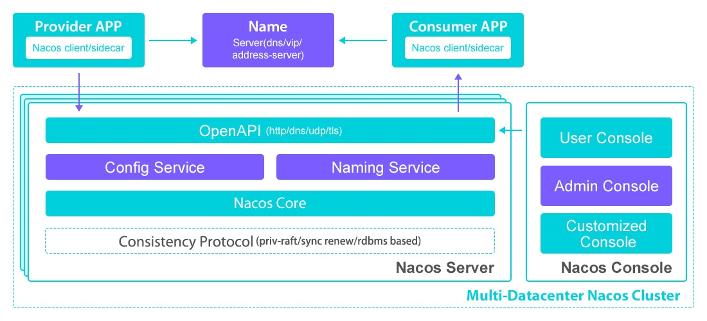
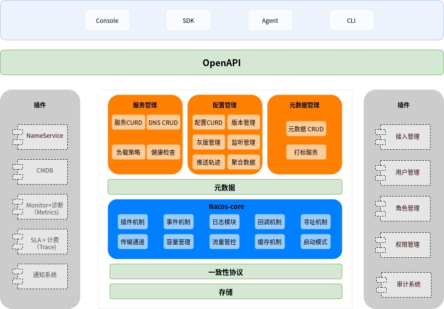

# 5.什么是nacos
Nacos（全称为"Naming and Configuration Service"）是阿里巴巴开源的一个动态服务发现、配置管理和服务元数据的平台。它提供了一个简单而强大的方式来帮助开发人员在云原生环境中进行服务注册、发现和配置管理。

## Nacos核心功能

### 服务发现和注册
Nacos允许应用程序在注册中心中注册自身的服务实例。其他应用程序可以查询该注册中心以发现可用的服务实例。这种服务发现和注册机制为微服务架构提供了基础设施支持。

### 动态配置管理
Nacos提供了一个中心化的配置管理系统，可以帮助开发人员管理应用程序的配置信息。通过Nacos，您可以动态地修改应用程序的配置，无需重新部署或重启应用程序。这对于在运行时动态调整配置非常有用。

### 服务路由和负载均衡
Nacos可以作为一个服务网关，通过提供动态路由和负载均衡的能力来帮助应用程序实现服务间的通信。它可以根据实际情况自动调整路由规则和负载均衡策略，以确保高可用性和性能。

### 服务健康监测
Nacos提供了服务实例的健康检查机制，可以定期检查服务是否可用，并将不可用的实例从注册中心中剔除，以保证服务的稳定性和可用性。

### 服务元数据管理
Nacos允许开发人员为服务实例添加自定义的元数据信息，例如版本号、标签等，以便更好地管理和描述服务。

Nacos是一个非常灵活和易于使用的平台，适用于各种云原生和微服务架构的应用程序。它支持多种开发语言和运行环境，包括Java、Go、Python等。此外，Nacos还提供了丰富的API和命令行工具，方便开发人员集成和使用。

总的来说，Nacos为构建可靠、可扩展和可管理的云原生应用程序提供了一种可靠的解决方案，使开发人员能够更好地管理和协调微服务架构中的各个组件。

## Nacos 架构

### 命名服务（Naming Service）
命名服务是Nacos的核心组件，负责服务注册和发现。它维护着服务实例的注册表，并提供服务发现的功能，以便应用程序可以动态地发现和调用其他服务。命名服务接收服务实例的注册请求，将实例的元数据信息（如IP地址、端口号、健康状态等）存储在注册表中，并提供查询接口供服务消费者使用。Nacos支持多种注册方式，包括基于主机名和IP地址的注册、基于DNS的注册和基于Kubernetes的注册。

### 配置服务（Configuration Service）
配置服务负责应用程序的动态配置管理。它提供一个中心化的配置存储和管理系统，允许开发人员将应用程序的配置信息存储在Nacos中，并在运行时动态地获取和修改配置。配置服务支持多种配置格式，如Properties、YAML和JSON等，开发人员可以使用API或控制台进行配置的读取、写入和监听。配置服务还提供了配置发布、回滚和版本管理等功能，使配置的修改具备历史可追溯性。

### 元数据服务（Metadata Service）
元数据服务负责管理服务实例的元数据信息。它允许开发人员为服务实例添加自定义的元数据，如版本号、标签、描述等。这些元数据可以用于服务的描述和管理，并在服务发现、路由和负载均衡等方面发挥作用。元数据服务与命名服务和配置服务紧密集成，共同构建起Nacos的核心功能。

