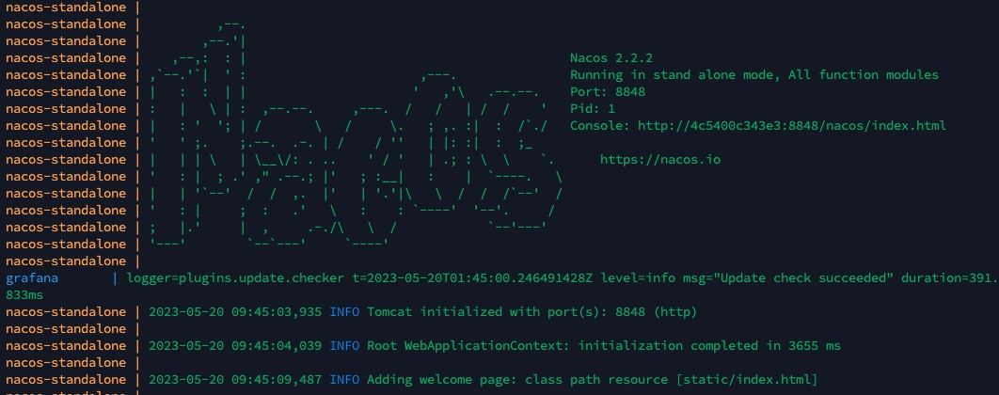
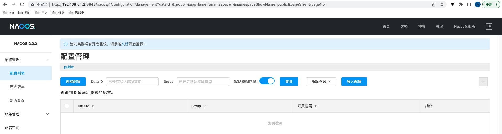

# 6.Nacos 快速入门
版本：2.2.2
## 快速安装
本次使用docker方式，所以你首先需要有docker和docker-compose环境，没有请自行安装，本节不做介绍
* 下载nacos-docker yaml
```
git clone https://github.com/nacos-group/nacos-docker.git
# 如果下载失败，可以从我的资料包中拷贝
```
* 启动nacos
```
docker-compose -f example/standalone-derby.yaml up
```

* 访问控制台
http://192.168.64.2:8848/nacos
看到如下页面代表安装成功，不过这次使用的derby数据库单机部署，在高可用部署章节我们将介绍如何使用mysql+集群部署

## Nacos的OpenAPI基本使用
### 注册服务
```
curl -X POST 'http://192.168.64.2:8848/nacos/v1/ns/instance?serviceName=com.example.testService&ip=20.18.7.10&port=8080'
```
### 服务发现
```
curl -X GET 'http://192.168.64.2:8848/nacos/v1/ns/instance/list?serviceName=com.example.testService'
```
### 发布配置
```
curl -X POST "http://192.168.64.2:8848/nacos/v1/cs/configs?dataId=example&group=test&content=example"
```
### 获取配置
```
curl -X GET "http://192.168.64.2:8848/nacos/v1/cs/configs?dataId=example&group=test"

```
## 唯一性
命名空间+DataID+Group