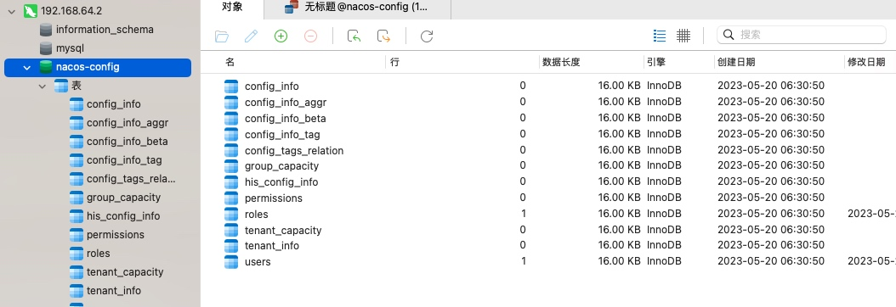
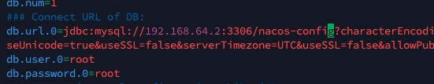
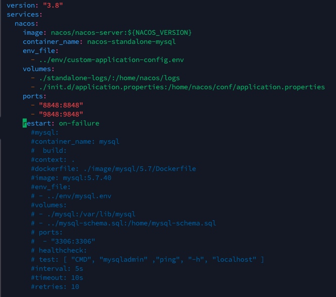
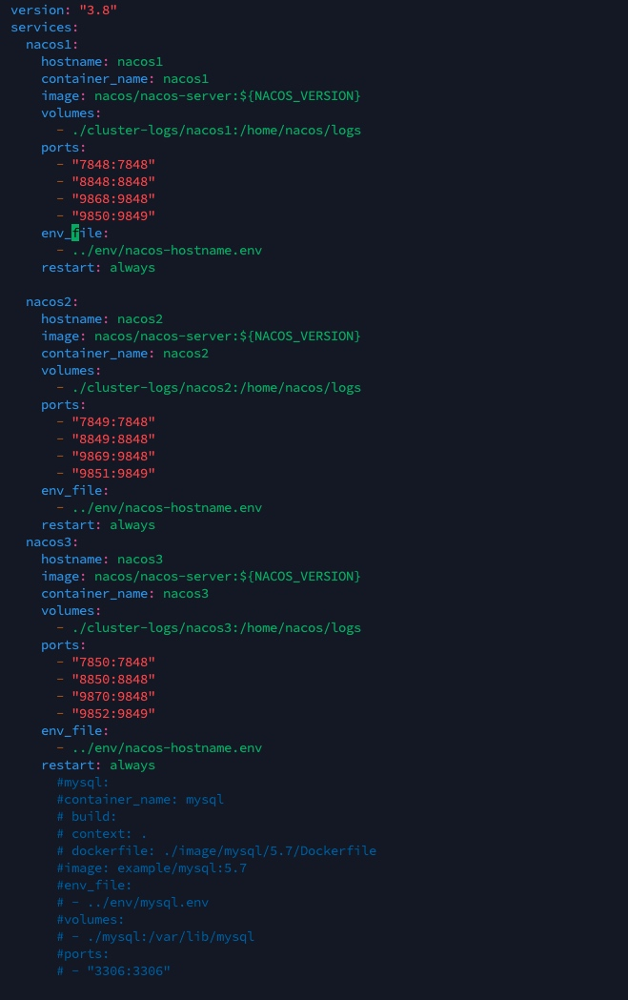
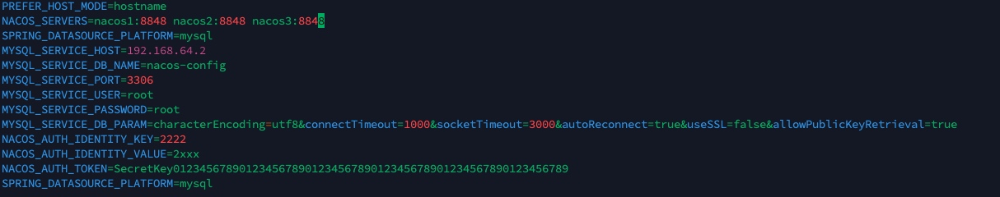
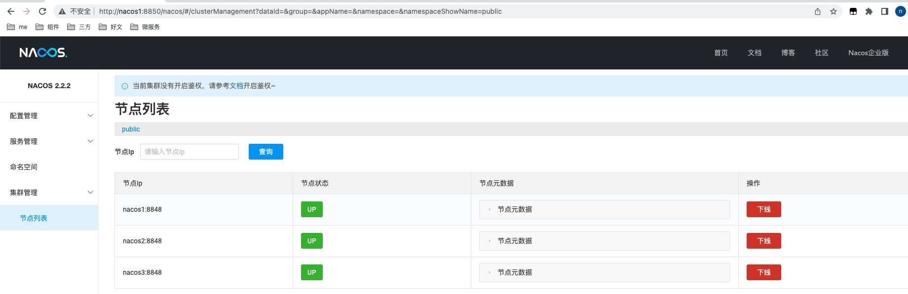

# 7.Nacos 高可用部署
快速入门章节，我们为了能够快速体验Nacos，所以进行单机部署，并且使用derby做数据库，这节课我们进行高可用部署。
其实如果我们使用了Docker，那么只需要基于上节课clone下来的docker项目就可以直接操作了

## 单机部署使用MySQL
* 下载nacos-docker yaml
```
git clone https://github.com/nacos-group/nacos-docker.git
# 如果下载失败，可以从我的资料包中拷贝
```
### 安装Mysql
```
docker run -itd --name mysql -p 3306:3306 -e MYSQL_ROOT_PASSWORD=root mysql:5.7

```
### 预先导入nacos数据库

下载地址：https://raw.githubusercontent.com/alibaba/nacos/develop/distribution/conf/mysql-schema.sql
如果下不下来可以从我资料库拷贝

建好的数据库如下：

### 修改默认的数据库和密码
```
# vim example/init.d/application.properties
```


### 从官方提供的yaml中移除mysql组件，使用自己安装的
```
vim example/standalone-mysql-5.7.yaml
```


###  单机模式启动nacos
```
docker-compose -f example/standalone-mysql-5.7.yaml up
```
    
## 集群模式部署nacos
 ### 移除mysql
 ```
 vim example/cluster-hostname.yaml
 ```
 

 ### 修改env
 ```
 vim env/nacos-hostname.env
 ```


### 启动集群模式
```
docker-compose -f example/cluster-hostname.yaml up -d
```
### 打开控制台验证

