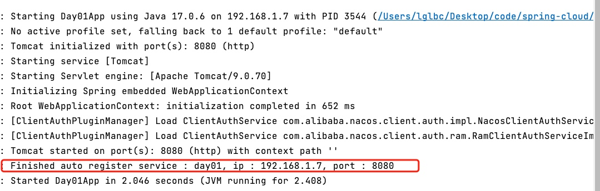
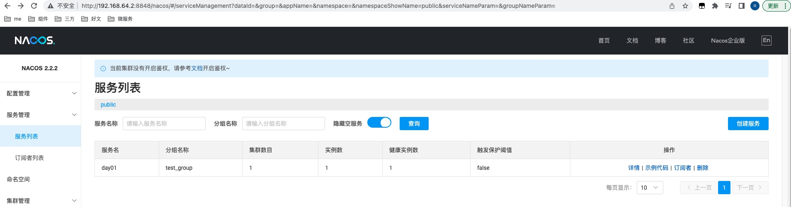
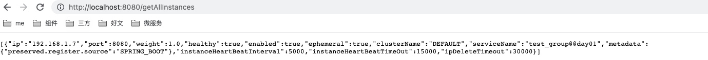
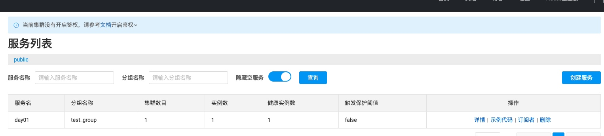

# 8.在Spring Boot中如何使用Nacos 注册中心
> 代码 nacos/day01

由于Nacos 暂时 不支持SpringBoot3.0 自动注册,所以集成SpringBoot时，暂且用SpringBoot2.7.7
 ## 引入依赖
 ```
 dependencies {
    implementation 'org.springframework.boot:spring-boot-starter'
    implementation 'org.springframework.boot:spring-boot-starter-web'
    implementation 'com.alibaba.boot:nacos-discovery-spring-boot-starter:0.2.12'
}
 ```
 ## 添加配置文件
 ```
nacos:
  discovery:
    serverAddr: 192.168.64.2:8848
    autoRegister: true
    register:
      groupName: test_group
      serviceName: day01
spring:
  application:
    name: day01
server:
  port: 8080
 ```
## 创建一个API 获取服务实例和注册服务实例
```
package cpm.example.day01;

import com.alibaba.nacos.api.annotation.NacosInjected;
import com.alibaba.nacos.api.exception.NacosException;
import com.alibaba.nacos.api.naming.NamingService;
import com.alibaba.nacos.api.naming.pojo.Instance;
import org.springframework.beans.factory.annotation.Value;
import org.springframework.web.bind.annotation.GetMapping;
import org.springframework.web.bind.annotation.RequestMapping;
import org.springframework.web.bind.annotation.RequestParam;
import org.springframework.web.bind.annotation.RestController;

import java.util.List;

/**
 * @Author 编程学习
 * @Date 2023/5/21
 * @Description
 */
@RestController("/")
public class IndexController {
    @Value("${server.port}")
    private int port;
    @Value("${spring.application.name}")
    private String app;
    @NacosInjected
    private NamingService namingService;

    @GetMapping("/getAllInstances")
    public List<Instance> getAllInstances() throws NacosException {
        return namingService.getAllInstances("day01", "test_group");
    }

    @RequestMapping("/createService")
    public List<Instance> createService() throws Exception {
        namingService.registerInstance(app, "test_group","127.0.0.1",port);
        return getAllInstances();
    }
}
``` 
## 启动服务
打印日志如下，说明服务注册成功


 打开控制台
 

 ## 验证服务获取
 
 ## 关闭自动注册，使用手动注册服务
 ```
 nacos:
  discovery:
    serverAddr: 192.168.64.2:8848
    autoRegister: false
    register:
      groupName: test_group
      serviceName: day01
spring:
  application:
    name: day01
server:
  port: 8080
 ```
 ## 调用接口
 Get http://localhost:8080/createService
 打开控制台，也能注册成功
 
