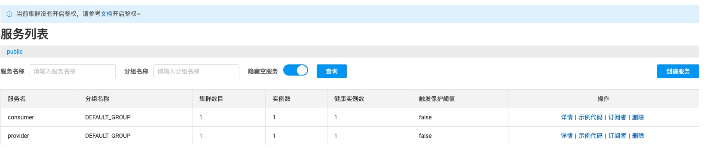

# 9.在Spring Cloud中如何使用Nacos 注册中心
> 代码 nacos/day02

## 引入依赖
### 父项目
```
plugins {
    id 'java'
    id 'org.springframework.boot' version '3.0.0'
    id 'io.spring.dependency-management' version '1.1.0'
}
ext {
    set('springCloudVersion', "2022.0.0")
    set('springCloudAlibabaVersion', "2022.0.0.0-RC1")
    set('springBootVersion', "3.0.0")
}
subprojects {
    //dependency-management 插件
    apply plugin: 'io.spring.dependency-management'
    dependencyManagement {
        imports {
            //spring bom helps us to declare dependencies without specifying version numbers.
            mavenBom "org.springframework.cloud:spring-cloud-dependencies:${springCloudVersion}"
            mavenBom "org.springframework.boot:spring-boot-dependencies:${springBootVersion}"
            mavenBom "com.alibaba.cloud:spring-cloud-alibaba-dependencies:${springCloudAlibabaVersion}"
        }
    }
    jar {
        manifest.attributes provider: 'gradle'
    }
}
dependencies {
    implementation 'org.springframework.boot:spring-boot-starter'
}
```
### prodiver
只需要引入nacos discovery
```
dependencies {
    implementation 'org.springframework.boot:spring-boot-starter-web'
    implementation 'com.alibaba.cloud:spring-cloud-starter-alibaba-nacos-discovery'
}
```
### consumer
除了nacos discovery，还需要引入负载均衡器
```
dependencies {
    implementation 'org.springframework.boot:spring-boot-starter-web'
    implementation 'com.alibaba.cloud:spring-cloud-starter-alibaba-nacos-discovery'
    implementation 'org.springframework.cloud:spring-cloud-starter-loadbalancer'
}
```
## prodiver 配置
### 配置文件
```
spring.application.name=provider
server.port=8081
spring.cloud.nacos.discovery.server-addr=192.168.64.2:8848
```
###  启用服务发现
```
@SpringBootApplication
@EnableDiscoveryClient
public class ProviderApplication {
    public static void main(String[] args) {
        SpringApplication.run(ProviderApplication.class, args);
    }
}
```
### 暴露服务接口
```
/**
 * @Author 编程学习
 * @Date 2023/5/21
 * @Description
 */
@RestController
public class IndexController {
    @GetMapping("/hello/{name}")
    public String hello(@PathVariable String name){
        return "hello:"+name+",我是provider";
    }
}
```
## consumer 配置
### 配置文件
```
spring.application.name=consumer
server.port=8081
spring.cloud.nacos.discovery.server-addr=192.168.64.2:8848
```
###  启用服务发现&注册restTemplate
```
@SpringBootApplication
@EnableDiscoveryClient
public class ProviderApplication {
    @LoadBalanced
    @Bean
    public RestTemplate restTemplate() {
        return new RestTemplate();
    }
    public static void main(String[] args) {
        SpringApplication.run(ProviderApplication.class, args);
    }
}
```
### 创建测试接口
```
/**
 * @Author 编程学习
 * @Date 2023/5/21
 * @Description
 */
@RestController
public class TestController {
    @Autowired
    private RestTemplate restTemplate;
    @GetMapping("/callProvider")
    public String callProvider(@RequestParam("name") String name){
        return restTemplate.getForObject("http://provider/hello/" + name, String.class);
    }
}
```
## 测试
启动两个服务，观察nacos控制台是否成功注册


浏览器访问:http://localhost:8080/callProvider?name=编程学习
