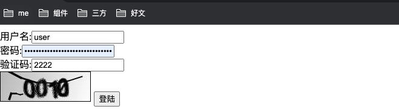
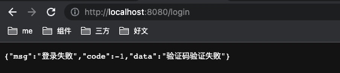

# 10.使用过滤器方式实现验证码功能
> 代码：security/day05

我们在前面章节通过自定义认证器实现了验证码功能，这节课我们将会使用过滤器来实现验证码功能。

其实实现逻辑和上节课通过过滤器实现json格式登录一样，需要继承UsernamePasswordAuthenticationFilter，所以文档这块主要记录下代码实现，所有代码主要是基于上次实现验证码的项目：

## 代码实现
### 创建验证码过滤器
```
public class KaptchaFilter extends UsernamePasswordAuthenticationFilter {
    @Override
    public Authentication attemptAuthentication(HttpServletRequest request, HttpServletResponse response) throws AuthenticationException {
        String kaptchaCode = (String) request.getSession().getAttribute("KAPTCHA_CODE");
        String inputKaptcha = request.getParameter("kaptcha");
        if (!StrUtil.equals(kaptchaCode, inputKaptcha)) {
            throw new InternalAuthenticationServiceException("验证码验证失败");
        }
        return super.attemptAuthentication(request, response);
    }
}
```
### 配置验证码过滤器
```
  @Bean
    public KaptchaFilter kaptchaFilter(){
        KaptchaFilter kaptchaFilter = new KaptchaFilter();
        kaptchaFilter.setAuthenticationManager(authenticationManager());
        kaptchaFilter.setAuthenticationFailureHandler(new AuthenticationFailureHandler() {
            @Override
            public void onAuthenticationFailure(HttpServletRequest request, HttpServletResponse response, AuthenticationException exception) throws IOException, ServletException {
                Map<String,Object> result = new HashMap<>();
                result.put("code",-1);
                result.put("msg","登录失败");
                result.put("data",exception.getMessage());
                writeResp(result,response);
            }
        });
        kaptchaFilter.setAuthenticationSuccessHandler(new AuthenticationSuccessHandler() {
            @Override
            public void onAuthenticationSuccess(HttpServletRequest request, HttpServletResponse response, Authentication authentication) throws IOException, ServletException {
                Map<String,Object> result = new HashMap<>();
                result.put("code",-1);
                result.put("msg","登录成功");
                result.put("data",authentication);
                writeResp(result,response);
            }
        });
        return kaptchaFilter;
    }
```
### 配置SecurityFilterChain
```
    @Bean
    public SecurityFilterChain securityFilterChain(HttpSecurity http) throws Exception {
        http.authorizeHttpRequests((auth) ->{
            try {
                auth.antMatchers("/kaptcha").permitAll()
                        .anyRequest().authenticated()
                        .and().formLogin()
                        .loginPage("/login.html")
                        .loginProcessingUrl("/login")
                        .failureForwardUrl("/login.html")
                        .permitAll()
                        .and()
                        .addFilterAt(kaptchaFilter(), UsernamePasswordAuthenticationFilter.class)
                        .csrf().disable();
            }
            catch (Exception e){
            }
        });
        return http.build();
    }
```

## 验证登录


