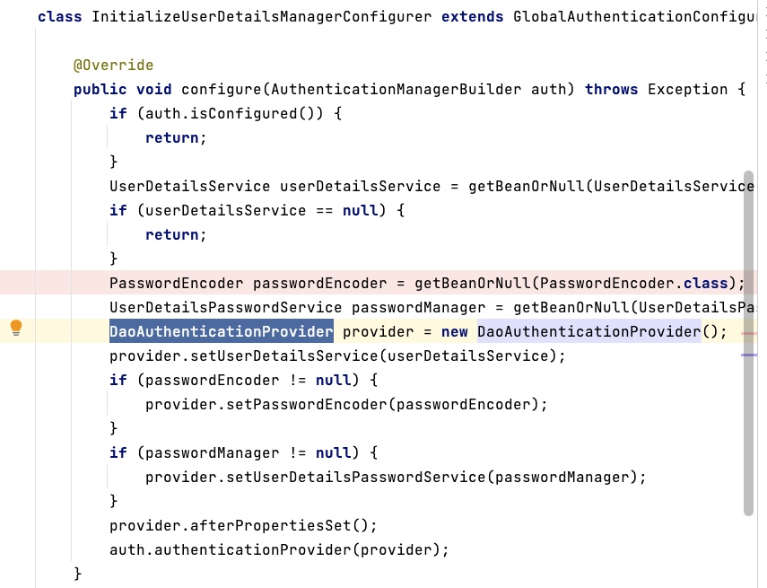
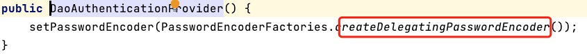
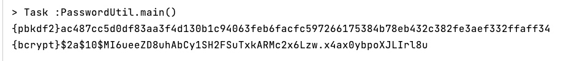
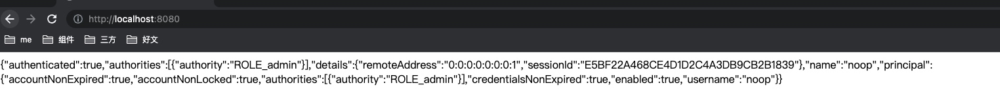
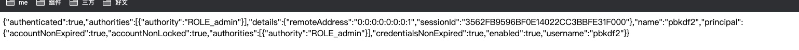
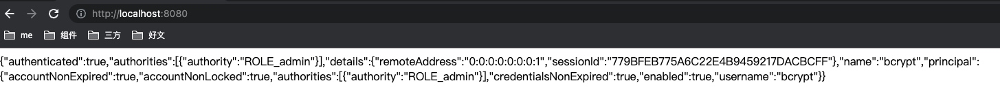
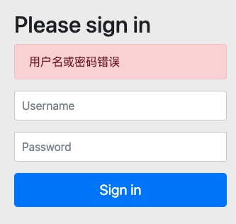

# 11.PasswordEncoder详解与实战
> security/day07

这节课我们开始讲PasswordEncoder，如果大家还有印象的话，我们前面有提到过PasswordEncoder:
为什么密码使用{noop}开头呢？我们也做出了相应的解释，这节课开始带大家真正的了解PasswordEncoder,
## PassworderEncoder 详解
### 主要方法
* String encode(CharSequence rawPassword)： 密码加密
* boolean matches(CharSequence rawPassword, String encodedPassword)： 密码匹配
* boolean upgradeEncoding(String encodedPassword): 升级密码，使用新规则来更新旧密码规则

### 主要实现
* DelegatingPasswordEncoder 加密代理 默认的PassworderEncoder实例
* BCryptPasswordEncoder DelegatingPasswordEncoder 中默认的加密方式
* NoOpPasswordEncoder 不加密
* LazyPasswordEncoder 需要用的时候才初始化
* MessageDigestPasswordEncoder
* Md4PasswordEncoder

### 默认PasswordEncoder
```
	public static PasswordEncoder createDelegatingPasswordEncoder() {
		String encodingId = "bcrypt";
		Map<String, PasswordEncoder> encoders = new HashMap<>();
		encoders.put(encodingId, new BCryptPasswordEncoder());
		encoders.put("ldap", new org.springframework.security.crypto.password.LdapShaPasswordEncoder());
		encoders.put("MD4", new org.springframework.security.crypto.password.Md4PasswordEncoder());
		encoders.put("MD5", new org.springframework.security.crypto.password.MessageDigestPasswordEncoder("MD5"));
		encoders.put("noop", org.springframework.security.crypto.password.NoOpPasswordEncoder.getInstance());
		encoders.put("pbkdf2", new Pbkdf2PasswordEncoder());
		encoders.put("scrypt", new SCryptPasswordEncoder());
		encoders.put("SHA-1", new org.springframework.security.crypto.password.MessageDigestPasswordEncoder("SHA-1"));
		encoders.put("SHA-256",
				new org.springframework.security.crypto.password.MessageDigestPasswordEncoder("SHA-256"));
		encoders.put("sha256", new org.springframework.security.crypto.password.StandardPasswordEncoder());
		encoders.put("argon2", new Argon2PasswordEncoder());
		return new DelegatingPasswordEncoder(encodingId, encoders);
	}
```
### 识别密码类型核心逻辑
```
public boolean matches(CharSequence rawPassword, String prefixEncodedPassword) {
		if (rawPassword == null && prefixEncodedPassword == null) {
			return true;
		}
		String id = extractId(prefixEncodedPassword);
		PasswordEncoder delegate = this.idToPasswordEncoder.get(id);
		if (delegate == null) {
			return this.defaultPasswordEncoderForMatches.matches(rawPassword, prefixEncodedPassword);
		}
		String encodedPassword = extractEncodedPassword(prefixEncodedPassword);
		return delegate.matches(rawPassword, encodedPassword);
	}
```
主要逻辑
* 如果密码为空，则返回true
* 解析密码ID->{xxxx}
* 根据ID从map中获取PassworderEncoder
* 如果获取不到PassworderEncoder: {xxxx}为空或者不是合法的值，则跑出异常
* 如果获取到，则使用对应的PasswordEncoder进行密码匹配


从这段源码中，我们其实就知道默认的provider提供的密码处理器逻辑
* 如果IOC容器中有且仅有一个PasswordEncoder，那么就使用IOC中的PassworderEncoder
* 如果没有，则使用DaoAuthenticationProvider 自己提供的，看构造方法逻辑：


## Passworder实战
### 验证默认的PassworderEncoder实例
#### 分别使用BCryptPasswordEncoder、Argon2PasswordEncoder加密密码
```
    public static void main(String[] args) {
        System.out.println("{pbkdf2}"+new Pbkdf2PasswordEncoder().encode("123456"));
        System.out.println("{bcrypt}"+new BCryptPasswordEncoder().encode("123456"));
    }
```

#### 基于内存模式添加用户
```
    @Bean
    public UserDetailsService userDetailsService(){
        UserDetails noop = User.withUsername("noop").password("{noop}123456").roles("admin").build();
        UserDetails bcypt = User.withUsername("bcrypt").password("{bcrypt}$2a$10$MI6ueeZD8uhAbCy1SH2FSuTxkARMc2x6Lzw.x4ax0ybpoXJLIrl8u").roles("admin").build();
        UserDetails pbkdf2 = User.withUsername("pbkdf2").password("{pbkdf2}ac487cc5d0df83aa3f4d130b1c94063feb6facfc597266175384b78eb432c382fe3aef332ffaff34").roles("admin").build();
        return new InMemoryUserDetailsManager(noop,bcypt,pbkdf2);
    }
```
#### 验证登录




### 指定PasswordEncoder
 #### 注入Bean
 ```
     @Bean
    public PasswordEncoder passwordEncoder(){
        return new BCryptPasswordEncoder();
    }
```
#### 验证登录

还是基于上面的配置，使用：
noop/123456
bcrypt/123456
pbkdf2/123456
发现全部登录失败，为什么呢

因为我们现在指定了PasswordEncoder=BcryptPasswordEncoder,替代了默认的DelegatingPasswordEncoder，所以我们只需要将密码前缀{xxx}去掉就行，但是使用其他加密方式:pbkdf2/123456 和 noop/123456 还是登录不上，因为你使用的是BcryptPasswordEncoder进行密码匹配，所以需要更新密码。
```
    @Bean
    public UserDetailsService userDetailsService(){
        UserDetails noop = User.withUsername("noop").password("{noop}123456").roles("admin").build();
        UserDetails bcypt = User.withUsername("bcrypt").password("$2a$10$MI6ueeZD8uhAbCy1SH2FSuTxkARMc2x6Lzw.x4ax0ybpoXJLIrl8u").roles("admin").build();
        UserDetails pbkdf2 = User.withUsername("pbkdf2").password("{pbkdf2}ac487cc5d0df83aa3f4d130b1c94063feb6facfc597266175384b78eb432c382fe3aef332ffaff34").roles("admin").build();
        return new InMemoryUserDetailsManager(noop,bcypt,pbkdf2);
    }
```
### 密码升级
这个了解即可，视频中有介绍。