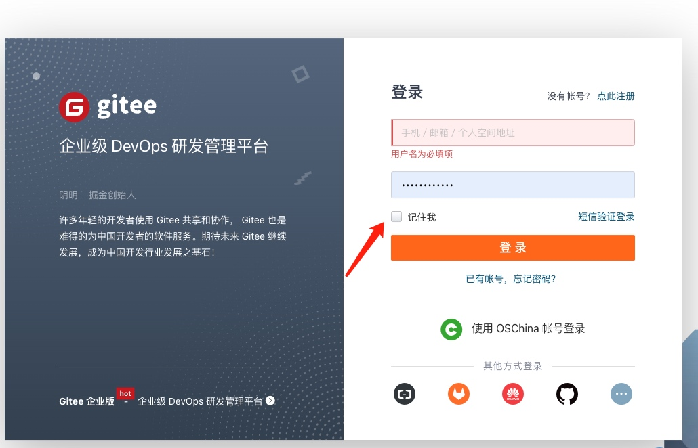
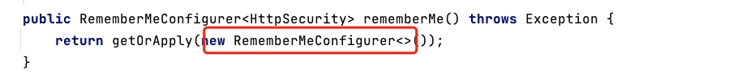

# 12.实现RememberMe 及 实现原理分析

> security/day08

这个功能大家还熟悉么？我们在登录网站的时候，除了让你输入用户名和密码，还会有个勾选框：
记住我！！！不是让大家记住我哈。


值得一提的是，Spring Security 也提供了这个功能，我们今天就来体验一把。

## 代码实战
其实想要开启rememberMe功能，其实很简单，只需要简单的修改下配置即可：
```
    @Bean
    public SecurityFilterChain securityFilterChain(HttpSecurity http) throws Exception {
        http.authorizeHttpRequests().anyRequest().authenticated()
                .and()
                .formLogin()
                .permitAll()
                .and()
                .rememberMe()
                .and()
                .csrf().disable();
        return http.build();
    }
```
## 实现思路
* 当用户登录网站后，并且勾选rememberMe
* 服务端认证通过，则把用户信息进行算法加密，加密完成后，通过cookie，让浏览器把cookie保存在本地
* 当浏览器关闭后重新打开网站，浏览器会把cookie带给服务端
* 服务端校验cookie确定用户身份，进而自动登录

## 源码分析
首先我们找切入点，我们前面讲过当引入一个新功能的时候，必定会引入一个configurer,rememberMe 也不例外：点击.rememberMe()进入源码

看到了RememberMeConfigurer，我们点进去看下主要是看init和configure方法
### init
```
	public void init(H http) throws Exception {
		validateInput();
		String key = getKey();
		RememberMeServices rememberMeServices = getRememberMeServices(http, key);
		http.setSharedObject(RememberMeServices.class, rememberMeServices);
		LogoutConfigurer<H> logoutConfigurer = http.getConfigurer(LogoutConfigurer.class);
		if (logoutConfigurer != null && this.logoutHandler != null) {
			logoutConfigurer.addLogoutHandler(this.logoutHandler);
		}
		RememberMeAuthenticationProvider authenticationProvider = new RememberMeAuthenticationProvider(key);
		authenticationProvider = postProcess(authenticationProvider);
		http.authenticationProvider(authenticationProvider);
		initDefaultLoginFilter(http);
	}
```
* getKey() 这个就是我们刚开始设置的key，如果不配置，每次系统都会重启，导致需要重新登录
* getRememberMeServices() 用来实现自动登录、处理登录成功和登录失败的逻辑，主要有两个继承
    * PersistentTokenBasedRememberMeServices 持久化令牌到数据库
    * TokenBasedRememberMeServices
* http.authenticationProvider(authenticationProvider);创建一个认证器放到providerList里面
* initDefaultLoginFilter(http); 在自定生成登录页面加上rememberMe 选框

### configure
```
	public void configure(H http) {
		RememberMeAuthenticationFilter rememberMeFilter = new RememberMeAuthenticationFilter(
				http.getSharedObject(AuthenticationManager.class), this.rememberMeServices);
		if (this.authenticationSuccessHandler != null) {
			rememberMeFilter.setAuthenticationSuccessHandler(this.authenticationSuccessHandler);
		}
		rememberMeFilter = postProcess(rememberMeFilter);
		http.addFilter(rememberMeFilter);
	}
```
* 创建了一个过滤器：RememberMeAuthenticationFilter
* postProcess(rememberMeFilter); 注入IOC容器
* 在http中加入rememberMe过滤器

看完了RememberMeConfigurer的两个核心方法之后，我们现在知道容器中已经有了RememberMeAuthenticationFilter和RememberMeAuthenticationProvider
现在分别来看下

### RememberMeAuthenticationFilter
```
private void doFilter(HttpServletRequest request, HttpServletResponse response, FilterChain chain)
			throws IOException, ServletException {
		Authentication rememberMeAuth = this.rememberMeServices.autoLogin(request, response);
		if (rememberMeAuth != null) {
			// Attempt authenticaton via AuthenticationManager
			try {
				rememberMeAuth = this.authenticationManager.authenticate(rememberMeAuth);
				// Store to SecurityContextHolder
				SecurityContext context = SecurityContextHolder.createEmptyContext();
				context.setAuthentication(rememberMeAuth);
				SecurityContextHolder.setContext(context);
				onSuccessfulAuthentication(request, response, rememberMeAuth);
			   this.securityContextRepository.saveContext(context, request, response);
				if (this.successHandler != null) {
					this.successHandler.onAuthenticationSuccess(request, response, rememberMeAuth);
					return;
				}
			}
			catch (AuthenticationException ex) {
				this.rememberMeServices.loginFail(request, response);
				onUnsuccessfulAuthentication(request, response, ex);
			}
		}
		chain.doFilter(request, response);
	}
```
* 调用autoLogin方法
    * 从cookie提取用户身份，在调用loadUserByUsername获取用户详细信息
    * 校验用户身份是否合法(根据不同的令牌存储方式进行不同校验)
    * 如果校验通过，则返回Authentication(RememberMeAuthenticationToken)
* authenticate
    * 如果autoLogin成功，则和前面普通登录一样进行认证
    * 因为这里生成的是RememberMeAuthenticationToken，则最终会被RememberMeAuthenticationProvider处理
* 如果认证返回则进行对应的响应处理

### RememberMeAuthenticationProvider
```
	public Authentication authenticate(Authentication authentication) throws AuthenticationException {
		if (!supports(authentication.getClass())) {
			return null;
		}
		if (this.key.hashCode() != ((RememberMeAuthenticationToken) authentication).getKeyHash()) {
			throw new BadCredentialsException(this.messages.getMessage("RememberMeAuthenticationProvider.incorrectKey",
					"The presented RememberMeAuthenticationToken does not contain the expected key"));
		}
		return authentication;
	}
```
这里的逻辑只做了一步，校验key的hashCode是否一致，如果一致，则校验通过