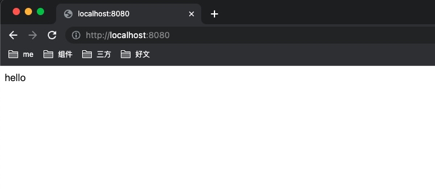
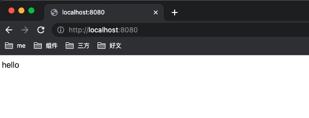
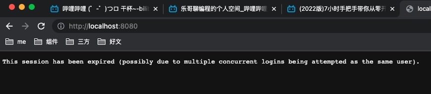
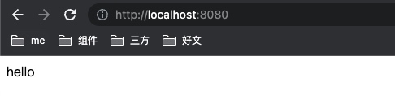
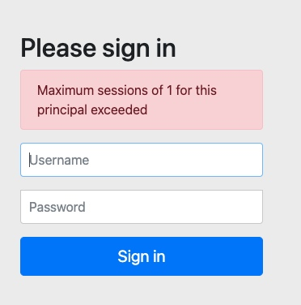
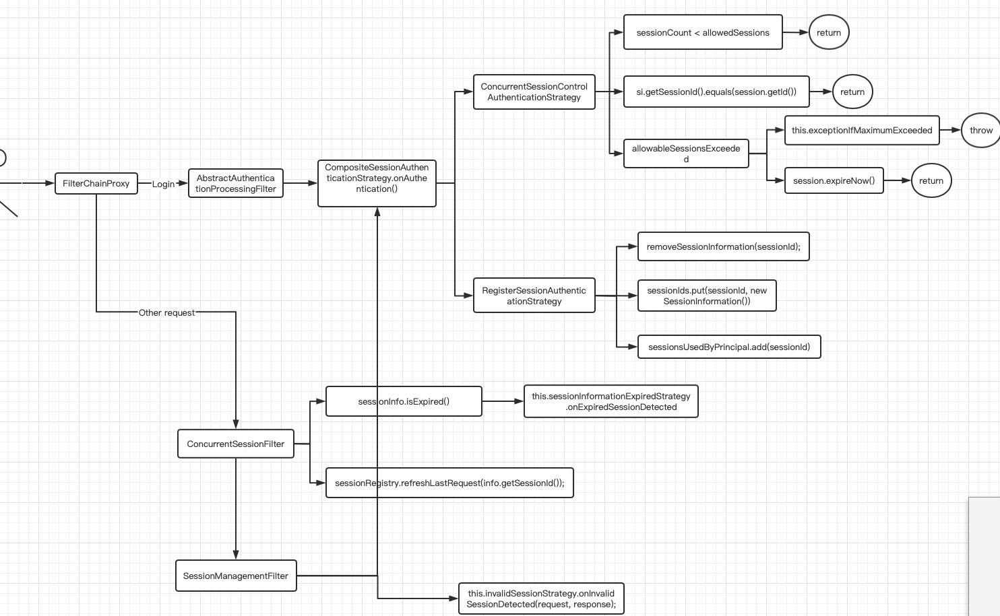

# 13.实现会话并发控制及实现原理
> security/day09

在SpringSecurity中实现会话并发控制，其实容易的，只需要配置一个会话数量就可以了，我们先给大家介绍下如何配置会话并发控制，然后给大家介绍下SpringSecurity 如何实现会话并发控制
## 代码实现
### 设置只有一个会话
```
@Configuration
public class SecurityConfig {
    @Bean
    public SecurityFilterChain securityFilterChain(HttpSecurity http) throws Exception {
        http.authorizeHttpRequests()
                .anyRequest().authenticated()
                .and()
                .formLogin()
                .permitAll()
                .and()
                .sessionManagement()
                .maximumSessions(1);
        return http.build();
    }
}
```
#### 登陆一个客户端

#### 登陆第二个客户端

#### 刷新第一个客户端

发现已经被挤掉了。

目前默认策略是：后来的会把前面的给挤掉，现在我们通过配置，禁止第二个客户端登陆

### 禁止第二个客户端登陆
```
    @Bean
    public SecurityFilterChain securityFilterChain(HttpSecurity http) throws Exception {
        http.authorizeHttpRequests()
                .anyRequest().authenticated()
                .and()
                .formLogin()
                .permitAll()
                .and()
                .sessionManagement()
                .maximumSessions(1)
                .maxSessionsPreventsLogin(true);
        return http.build();
    }
```

#### 登陆第一个客户端

#### 登陆第二个客户端

## 实现原理分析
如果大家是跟着我前面的视频学习过来的话，肯定都知道窍门了，要想看原理，肯定需要找到这个特性的过滤器。我们来看看session默认的过滤器是啥：
### SessionManagementConfigurer
点击.sessionManagement()进去,找到SessionManagementConfigurer，还是同样的配方，先找他init和configure方法
#### init
* 创建SecurityContextRepository
* 初始化 SessionAuthenticationStrategy，并添加到容器
    * setMaximumSessions
    * setExceptionIfMaximumExceeded = maxSessionsPreventsLogin
    * CompositeSessionAuthenticationStrategy
        * ConcurrentSessionControlAuthenticationStrategy
        * defaultSessionAuthenticationStrategy
        * RegisterSessionAuthenticationStrategy
    * InvalidSessionStrategy

#### configure
* 初始化 SessionManagementFilter
* 添加sessionManagementFilter 到http链中
* isConcurrentSessionControlEnabled &&添加ConcurrentSessionFilter 到http链中
* !this.enableSessionUrlRewriting && 添加 DisableEncodeUrlFilter 
* SessionCreationPolicy.ALWAYS && 添加 ForceEagerSessionCreationFilter
### CompositeSessionAuthenticationStrategy
CompositeSessionAuthenticationStrategy是一个代理策略，它里面会包含很多SessionAuthenticationStrategy，主要有ConcurrentSessionControlAuthenticationStrategy和RegisterSessionAuthenticationStrategy
### RegisterSessionAuthenticationStrategy
处理并发登录人数的数量
```
	public void onAuthentication(Authentication authentication, HttpServletRequest request,
			HttpServletResponse response) {
		this.sessionRegistry.registerNewSession(request.getSession().getId(), authentication.getPrincipal());
	}
``` 
这里直接调用this.sessionRegistry.registerNewSession方法
```
	public void registerNewSession(String sessionId, Object principal) {
		Assert.hasText(sessionId, "SessionId required as per interface contract");
		Assert.notNull(principal, "Principal required as per interface contract");
		if (getSessionInformation(sessionId) != null) {
			removeSessionInformation(sessionId);
		}
		this.sessionIds.put(sessionId, new SessionInformation(principal, sessionId, new Date()));
		this.principals.compute(principal, (key, sessionsUsedByPrincipal) -> {
			if (sessionsUsedByPrincipal == null) {
				sessionsUsedByPrincipal = new CopyOnWriteArraySet<>();
			}
			sessionsUsedByPrincipal.add(sessionId);
			this.logger.trace(LogMessage.format("Sessions used by '%s' : %s", principal, sessionsUsedByPrincipal));
			return sessionsUsedByPrincipal;
		});
	}
```
* 根据sessionId查找session，如果有，则移除
* 创建新的SessionInformation，维护到sessionIds中
* 维护sessionId到principals中
### ConcurrentSessionControlAuthenticationStrategy
#### onAuthentication
```
	public void onAuthentication(Authentication authentication, HttpServletRequest request,
			HttpServletResponse response) {
		int allowedSessions = getMaximumSessionsForThisUser(authentication);
		if (allowedSessions == -1) {
			// We permit unlimited logins
			return;
		}
		List<SessionInformation> sessions = this.sessionRegistry.getAllSessions(authentication.getPrincipal(), false);
		int sessionCount = sessions.size();
		if (sessionCount < allowedSessions) {
			// They haven't got too many login sessions running at present
			return;
		}
		if (sessionCount == allowedSessions) {
			HttpSession session = request.getSession(false);
			if (session != null) {
				// Only permit it though if this request is associated with one of the
				// already registered sessions
				for (SessionInformation si : sessions) {
					if (si.getSessionId().equals(session.getId())) {
						return;
					}
				}
			}
			// If the session is null, a new one will be created by the parent class,
			// exceeding the allowed number
		}
		allowableSessionsExceeded(sessions, allowedSessions, this.sessionRegistry);
	}
```
* 获取当前用户允许同时在线的数量，如果 == -1(没有限制)则跳过并发校验
* 获取当前用户的所有在线session数量，如果小于限制数量则返回
* 如果等于限制数量，则判断当前的sessionId是否已经在集合中，如果在，则返回
* 否则走allowableSessionsExceeded 校验

#### allowableSessionsExceeded
```
	protected void allowableSessionsExceeded(List<SessionInformation> sessions, int allowableSessions,
			SessionRegistry registry) throws SessionAuthenticationException {
		if (this.exceptionIfMaximumExceeded || (sessions == null)) {
			throw new SessionAuthenticationException(
					this.messages.getMessage("ConcurrentSessionControlAuthenticationStrategy.exceededAllowed",
							new Object[] { allowableSessions }, "Maximum sessions of {0} for this principal exceeded"));
		}
		// Determine least recently used sessions, and mark them for invalidation
		sessions.sort(Comparator.comparing(SessionInformation::getLastRequest));
		int maximumSessionsExceededBy = sessions.size() - allowableSessions + 1;
		List<SessionInformation> sessionsToBeExpired = sessions.subList(0, maximumSessionsExceededBy);
		for (SessionInformation session : sessionsToBeExpired) {
			session.expireNow();
		}
	}
```
* 如果配置了 maxSessionsPreventsLogin，则直接抛出异常，禁止新用户登录，否则往下走
* 将当前用户的所有session按照最后访问时间排序
* 获取最大允许同时在线的数量，然后在集合中 top n,其余的全部设置过期
* expireNow();
    * this.expired = true;
### SessionManagementFilter
```
private void doFilter(HttpServletRequest request, HttpServletResponse response, FilterChain chain)
			throws IOException, ServletException {
		if (!this.securityContextRepository.containsContext(request)) {
			Authentication authentication = SecurityContextHolder.getContext().getAuthentication();
			if (authentication != null && !this.trustResolver.isAnonymous(authentication)) {
				// The user has been authenticated during the current request, so call the
				// session strategy
				try {
					this.sessionAuthenticationStrategy.onAuthentication(authentication, request, response);
				}
				catch (SessionAuthenticationException ex) {
					SecurityContextHolder.clearContext();
					this.failureHandler.onAuthenticationFailure(request, response, ex);
					return;
				}				this.securityContextRepository.saveContext(SecurityContextHolder.getContext(), request, response);
			}
			else {
				if (request.getRequestedSessionId() != null && !request.isRequestedSessionIdValid()) {
					if (this.invalidSessionStrategy != null) {
					this.invalidSessionStrategy.onInvalidSessionDetected(request, response);
						return;
					}
				}
			}
		}
		chain.doFilter(request, response);
	}
```
* 如果securityContextRepository 有Context信息
    * 获取authentication
    * 如果authentication 不为空，则调用sessionAuthenticationStrategy.onAuthentication
        * 如果抛出异常，则进行异常处理，并清楚context信息
    * 如果为空，则调用invalidSessionStrategy的onInvalidSessionDetected方法
### ConcurrentSessionFilter
```
	private void doFilter(HttpServletRequest request, HttpServletResponse response, FilterChain chain)
			throws IOException, ServletException {
		HttpSession session = request.getSession(false);
		if (session != null) {
			SessionInformation info = this.sessionRegistry.getSessionInformation(session.getId());
			if (info != null) {
				if (info.isExpired()) {
					// Expired - abort processing
					this.logger.debug(LogMessage
							.of(() -> "Requested session ID " + request.getRequestedSessionId() + " has expired."));
					doLogout(request, response);
					this.sessionInformationExpiredStrategy
							.onExpiredSessionDetected(new SessionInformationExpiredEvent(info, request, response));
					return;
				}
				// Non-expired - update last request date/time
				this.sessionRegistry.refreshLastRequest(info.getSessionId());
			}
		}
		chain.doFilter(request, response);
	}
```

### AbstractAuthenticationProcessingFilter
大家还记得这个过滤器吧，这里面也会调用sessionStrategy.onAuthentication,进行session维护
```
private void doFilter(HttpServletRequest request, HttpServletResponse response, FilterChain chain)
			throws IOException, ServletException {
		
			Authentication authenticationResult = attemptAuthentication(request, response);
			this.sessionStrategy.onAuthentication(authenticationResult, request, response);
	}
```

## 最后再来个整体流程图，帮大家梳理下


