# 14.session共享解决方案
> security/day10/day11

前面所有的会话都是基于单机，如果服务部署在集群中，就会出现session失效的问题，为什么在集群环境下会出现session失效呢？
## 集群环境下session失效的原因
当用户第一次访问项目时，是机器1处理了登录请求，然后将session信息保存在机器1的内存中，登陆之后，用户再次访问，由于负载均衡，用户被路由到了机器2，但是机器2没有保存用户登陆的session信息，所以会引导用户到登陆页面，进行登陆操作，这就是session失效。我们接下来给大家演示下

### 搭建两个服务
创建一个项目，开启security，配置一个controller
```
@RestController
public class IndexController {
    @Value("${server.port}")
    public Integer port;
    @RequestMapping("/")
    public String index(Authentication authentication){
        return "hello"+authentication.getName()+",i`m port:"+port;
    }
}
```

分别打成两个jar包，启动端口分别为8080和8081
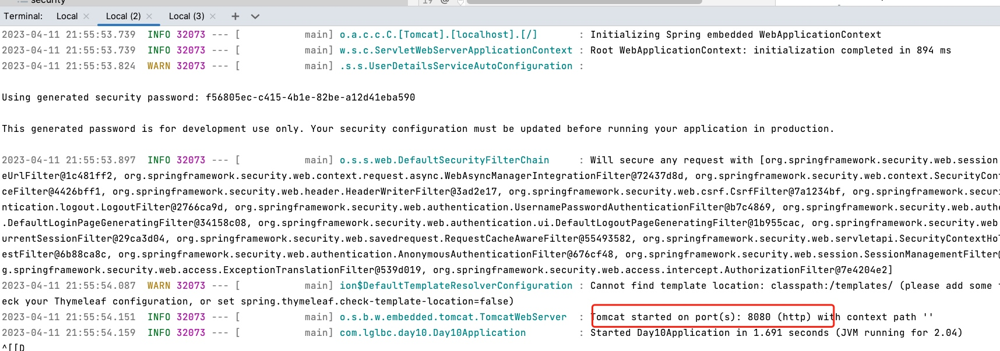

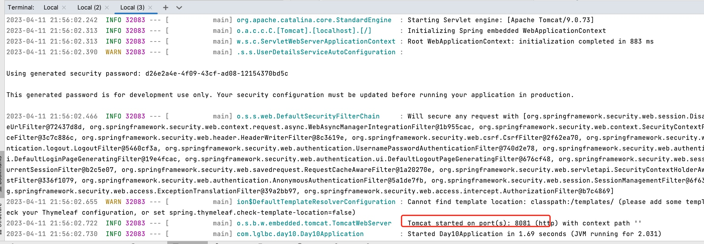
### 安装nginx
我这边安装的有可视化界面的nginx WebUi，docker安装
```
docker run -itd --restart=always --name=nginxWebUI -v /home/nginxWebUI:/home/nginxWebUI -e BOOT_OPTIONS="--server.port=8083" --privileged=true --net=host  cym1102/nginxwebui:latest /bin/bash
```
#### 访问nginx 页面
浏览器输入 http://192.168.64.2:8083
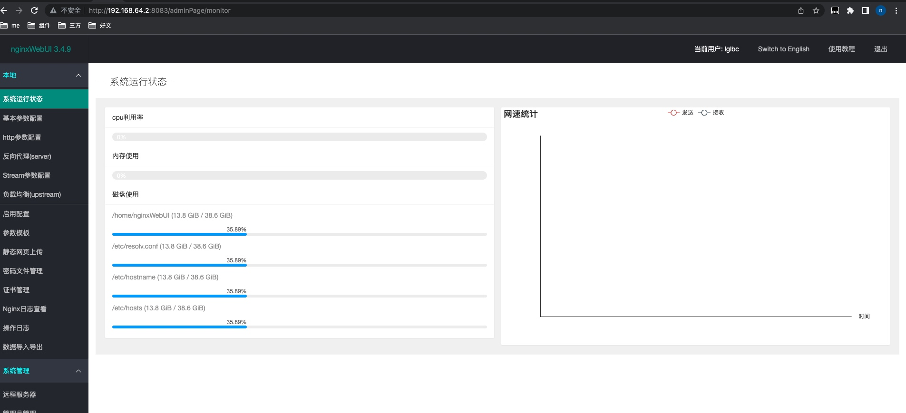
#### 配置负载均衡
使用IP Hash策略，权重分别为10和1
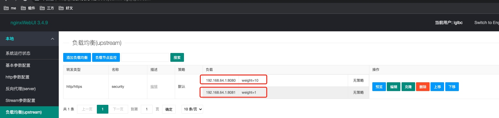
#### 配置反向代理
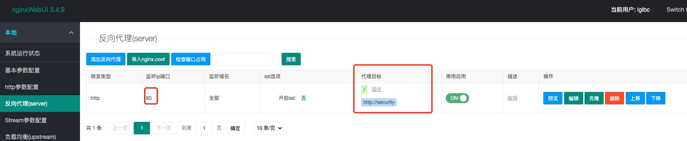
#### 启用配置
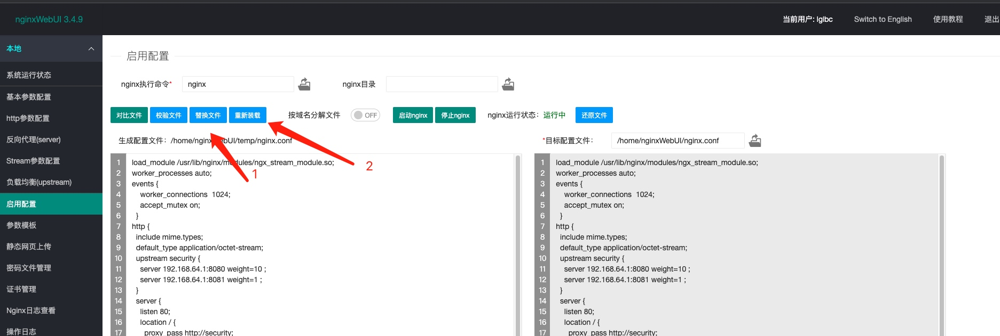
#### 访问服务地址
http://192.168.64.2
输入用户名和密码： user/123456
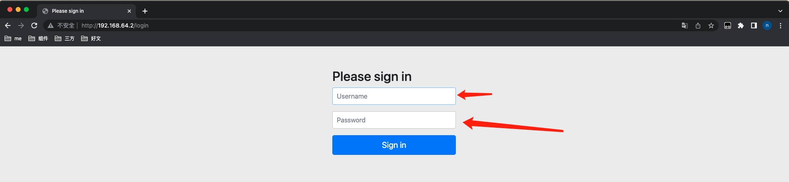
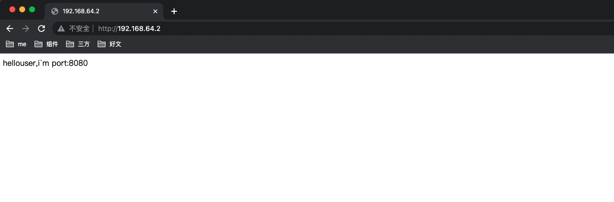
登陆成功，当前是8080机器响应，成功登陆到8080机器
我们刚才配置的权重是8080=10，8081=1，我们可以验证我们刷新页面10次，是否会跳转到8081机器
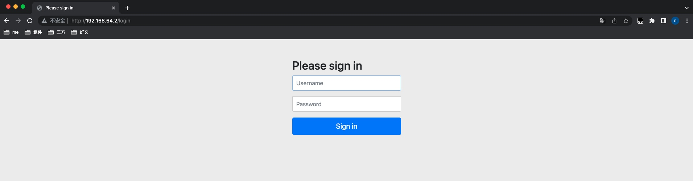
刷到第11次之后，我们跳转到了登录页面，因为8081机器没有保存登录用户的session信息，所以需要登录，这也就是session在集群下，为什么会失效的原因，那么我们看下有哪些解决方案？

## session 失效解决方案
### 主要三种
* session复制
    * 多个服务之间相互复制session信息，用户登录任何一机器，生成的session信息都会在其他服务之间保存一份
    * 其实tomcat通过IP组播的方式支持了这种，但是不建议使用，因为随着机器越多，复制的就越多，效率和并发都会相应的降低
* Session 粘滞
    * 即会话保持，始终保证用户在一台机器上，也就不会出现session丢失的问题
    * 但是无法解决并发问题，因为每台机器都维护自己的session，无法进行统一管理
* session 共享
    * 将所有机器产生的session会话放在统一存储空间中，任何机器都能访问
    * 一般可以借助redis或memcached 都可以实现，这节内容主要使用redis完成session共享

### 利用spring-session+redis 实现session 共享
#### 引入spring-session相关依赖
```
    implementation 'org.springframework.boot:spring-boot-starter-data-redis'
    implementation 'org.springframework.session:spring-session-data-redis'
```
#### 配置securityConfig
```
    @Autowired
    private FindByIndexNameSessionRepository sessionRepository;
    @Bean
    public SecurityFilterChain securityFilterChain(HttpSecurity http) throws Exception {
        http.authorizeHttpRequests()
                .anyRequest().authenticated()
                .and()
                .formLogin()
                .permitAll().and()
                        .sessionManagement()
                                .maximumSessions(-1)
                                        .sessionRegistry(sessionRegistry());
        http.csrf().disable();
        return http.build();
    }
    @Bean
    public SpringSessionBackedSessionRegistry sessionRegistry(){
        return new SpringSessionBackedSessionRegistry(sessionRepository);
    }
```
#### 配置redis 连接信息
```
server.port=8081
spring.security.user.password=123456
spring.redis.port=6379
spring.redis.host=192.168.64.2
```
#### 重新打两个包：8080，8081
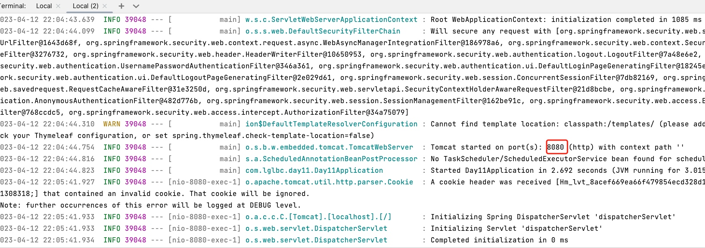

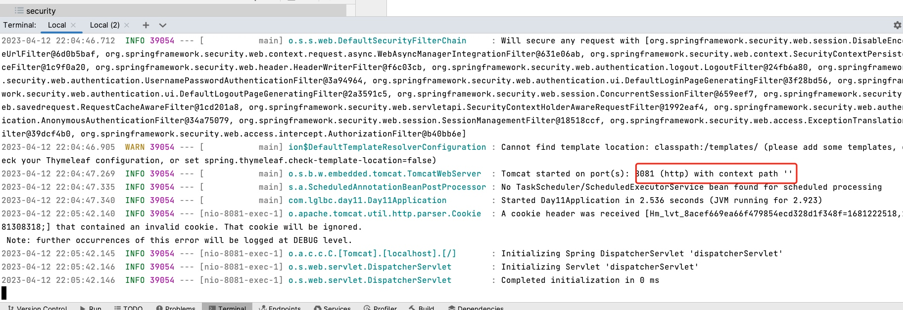
#### 将负载均衡的权重给移除
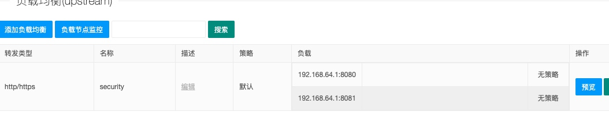
#### 访问验证
http://192.168.64.2
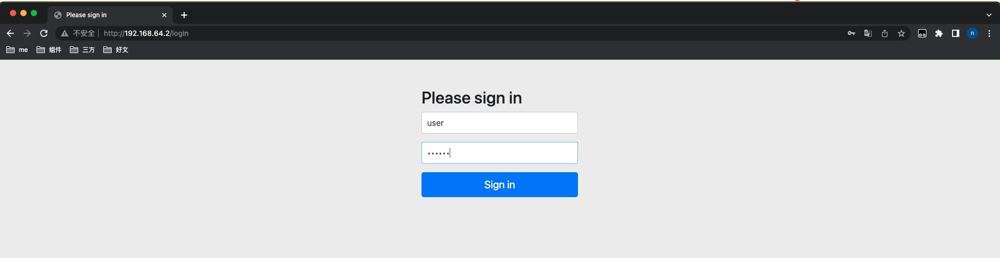
点击登录，跳转到8081
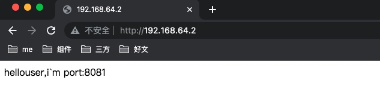
刷新页面，跳转到8080
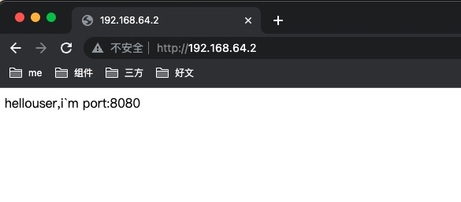
再刷新，跳转到8081
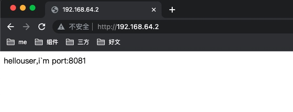
session 共享已经实现，我们再看下redis中存储的数据
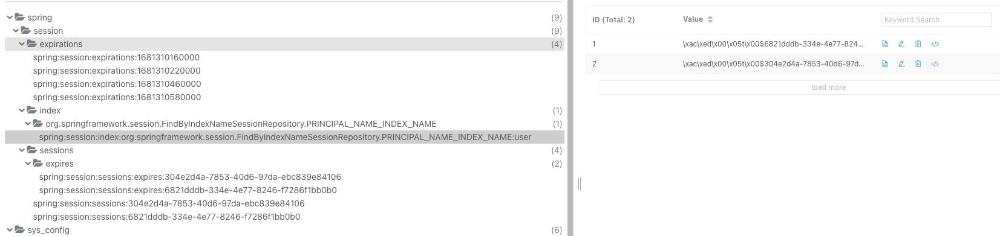

