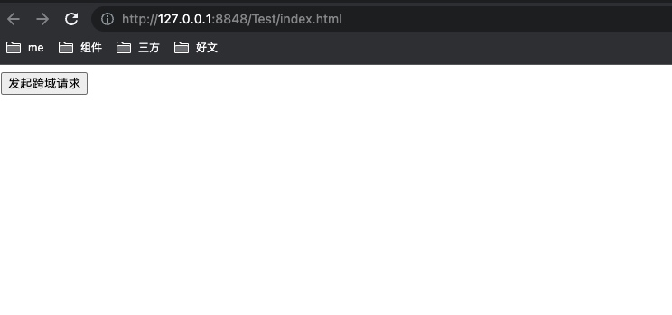
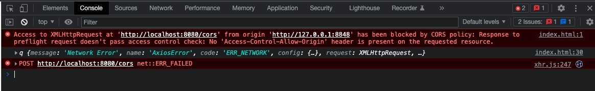
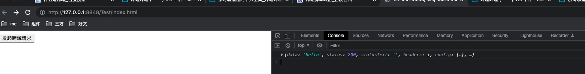
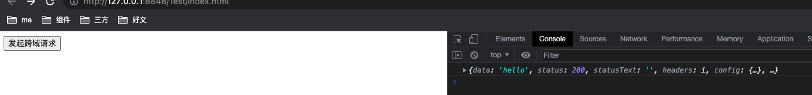
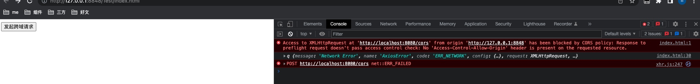
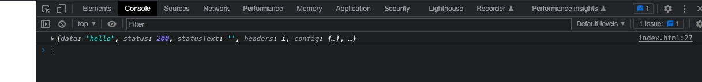
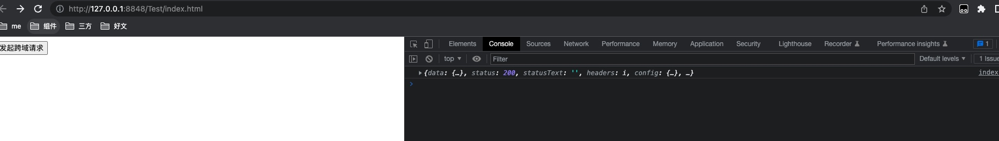
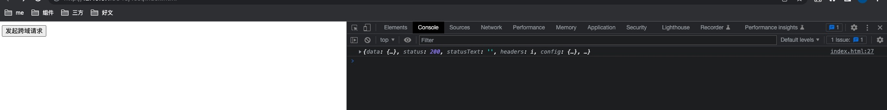

# 15.Spring + Spring Security 如何解决跨域问题
> security/day13

本节主要是给大家解释什么是跨域，在Spring中如何解决跨域，引入Spring Security后Spring解决跨域的方式失效，Spring Security 如何解决跨域
## 什么是跨域
浏览器不能执行其他网站的脚本，从一个域名的网页去请求另一个域名的资源时，域名、端口、协议任一不同，都是跨域。跨域是由浏览器的同源策略造成的，是浏览器施加的安全限制。a页面想获取b页面资源，如果a、b页面的协议、域名、端口、子域名不同，所进行的访问行动都是跨域的。
## 跨域演示
### 后端接口
```
@RequestMapping
@RestController
public class IndexController {
    @PostMapping("/cors")
    public String hello() {
        return "hello";
    }
}
```
### 前端页面
```
<!DOCTYPE html>
<html>
	<head>
		<meta charset="utf-8" />
		<title></title>
		<!-- <script src="https://unpkg.com/vue@next"></script> -->
		<script src="js/v3.2.8/vue.global.prod.js" type="text/javascript" charset="utf-8"></script>
		<script src="https://unpkg.com/axios/dist/axios.min.js"></script>
	</head>
	<body>
		<div id="app">
			<button @click="sendCorsRequest">发起跨域请求</button>
		</div>
		<script>
			const App = {
				data() {
					return {
					}
				},
				methods: {
					sendCorsRequest() {
						axios.post('http://localhost:8080/cors', {
						 firstName: 'Fred',
						 lastName: 'Flintstone'
						})
						.then(function (response) {
						 console.log(response)
						})
						.catch(function (error) {
						 console.log(error);
						});
					}
				},
				
			};
			Vue.createApp(App).mount('#app');
		</script>
	</body>
</html>
```
### 演示
打开页面

点击按钮，发送跨域请求，最终也发生了跨域请求

## 跨域解决
解决跨域有很多中方式，代码层面和非代码层面(nginx)，这节内容主讲解通过代码来解决跨域
### Spring 解决跨域
#### Cors注解
* 标注在方法上
```
@RequestMapping
@RestController
public class IndexController {
    @RequestMapping("/cors")
    @CrossOrigin("http://127.0.0.1:8848")
    public String hello() {
        return "hello";
    }
}
```


* 标注在类上
```
@RequestMapping
@RestController
@CrossOrigin("http://127.0.0.1:8848")
public class IndexController {
    @RequestMapping("/cors")
    public String hello() {
        return "hello";
    }
}
```


#### 配置 CorsRegistry
```
@Configuration
public class WebMVCConfig implements WebMvcConfigurer {
    @Override
    public void addCorsMappings(CorsRegistry registry) {
        registry.addMapping("/cors")
                .allowCredentials(false)
                .allowedHeaders("*")
                .allowedMethods("POST")
                .allowedOrigins("*");
    }
}
```
#### Cors 过滤器
```
@Configuration
public class WebMvcFilterConfig {
    @Bean
    FilterRegistrationBean<CorsFilter> cors(){
        FilterRegistrationBean<CorsFilter> registrationBean = new FilterRegistrationBean<>();
        CorsConfiguration configuration = new CorsConfiguration();
        configuration.addAllowedHeader("*");
        configuration.addAllowedMethod("*");
        configuration.addAllowedOrigin("*");
        configuration.addExposedHeader("*");
        UrlBasedCorsConfigurationSource source = new UrlBasedCorsConfigurationSource();
        source.registerCorsConfiguration("/**",configuration);
        registrationBean.setFilter(new CorsFilter(source));
        return registrationBean;
    }
}
```
以上三种使用spring解决跨域的方式讲解完了，接下来我们来说下如何在SpringSecurity中解决跨域
### 为什么在SpringSecurity中使用之前的跨域解决方案会失效
或许有好多人在项目中都碰到这个问题了，今天我先给大家演示下，然后和大家解释下为什么会出现这个问题。
#### 演示跨域失效
基于上面的代码，我们加上security依赖
```
    implementation 'org.springframework.boot:spring-boot-starter-security'
```
 配置securityConfig
```
    @Bean
    public SecurityFilterChain config(HttpSecurity http) throws Exception {
        http.authorizeHttpRequests()
                .anyRequest().authenticated()
                .and()
                .exceptionHandling()
           .accessDeniedHandler((req, resp, e) -> {
                    Map<String, Object> result = new HashMap<>();
                    result.put("code", -1);
                    result.put("msg", "访问失败");
                    result.put("data", e.getMessage());
                    writeResp(result, resp);})
                .and()
                .csrf().disable();

        return http.build();
    }
    public void writeResp(Object content, HttpServletResponse response) {
        response.setContentType("application/json;charset=utf-8");
        try {
            response.getWriter().println(JSON.toJSONString(content));
        } catch (IOException e) {
            throw new RuntimeException(e);
        }
    }
```
再次访问，发现还是跨域，之前的解决方案失效

#### 跨域解决失效的原因
为什么会失效呢，这个得要看下web中过滤器和拦截器执行顺序了，我们用一张图来回忆下web个组件的执行顺序


* 首先经过过滤器，包括web filter和security filter
* 再经过Dispatcherservlet
* 再来到拦截器
* 最后才到controller
这样梳理下，不知道大家有没有明白点，首先理清一点，spring实现跨域解决主要是通过拦截器(两个注解实现)和过滤器，那么为什么会失效呢，
主要有以下几点
* security 是基于过滤器开启全路径拦截(需要拦截的)，包括options请求
* 注解是基于拦截器实现，在security filter之后，所以options请求会被拦截，最终不起作用
* 过滤器方式不生效 是由于它的优先级在security filter之后，所以也会被拦截，最终不起作用

所以基于上面的分析，我们看下如何一一解决
### Spring Security 跨域解决
#### 粗暴方式 让Spring 方式生效
首先拦截器不生效，是由于请求被拦截，所以我们需要将请求放过去，配置如下
```
    @Bean
    public SecurityFilterChain config(HttpSecurity http) throws Exception {
        http.authorizeHttpRequests()
                .antMatchers("/cors").permitAll()
                .anyRequest().authenticated()
                .and()
                .exceptionHandling()
           .accessDeniedHandler((req, resp, e) -> {
                    Map<String, Object> result = new HashMap<>();
                    result.put("code", -1);
                    result.put("msg", "访问失败");
                    result.put("data", e.getMessage());
                    writeResp(result, resp);})
            .accessDeniedHandler(new AccessDeniedHandler() {
                    @Override
                    public void handle(HttpServletRequest request, HttpServletResponse response, AccessDeniedException accessDeniedException) throws IOException, ServletException {
                        Map<String, Object> result = new HashMap<>();
                        result.put("code", -1);
                        result.put("msg", "访问失败");
                        result.put("data", accessDeniedException.getMessage());
                        writeResp(result, response);
                    }
                })
                .and()
                .csrf().disable();

        return http.build();
    }
```

这种方式虽然可以，但是违背了我们业务，如果这个接口需要认证呢，所以这种方式一般用不上

#### 将跨域过滤器提前于Security 过滤器
如果想让过滤器提前，我们仅需要设置过滤器的优先级就好，我们调整下代码：
只需要加上一行代码:        registrationBean.setOrder(Ordered.HIGHEST_PRECEDENCE);
同时移除上面的配置。
```
    @Bean
    FilterRegistrationBean<CorsFilter> cors(){
        FilterRegistrationBean<CorsFilter> registrationBean = new FilterRegistrationBean<>();
        CorsConfiguration configuration = new CorsConfiguration();
        configuration.addAllowedHeader("*");
        configuration.addAllowedMethod("*");
        configuration.addAllowedOrigin("*");
        configuration.addExposedHeader("*");
        UrlBasedCorsConfigurationSource source = new UrlBasedCorsConfigurationSource();
        source.registerCorsConfiguration("/**",configuration);
        registrationBean.setFilter(new CorsFilter(source));
        registrationBean.setOrder(Ordered.HIGHEST_PRECEDENCE);
        return registrationBean;
    }
```

请求成功，但是由于cors接口需要认证被拦截，但是接口已经调用成功，说明跨域已经解决

#### 通过.cors()解决
```
    @Bean
    public CorsConfigurationSource corsConfigurationSource() {
        CorsConfiguration configuration = new CorsConfiguration();
        configuration.addAllowedHeader("*");
        configuration.addAllowedMethod("*");
        configuration.addAllowedOrigin("*");
        configuration.addExposedHeader("*");
        UrlBasedCorsConfigurationSource source = new UrlBasedCorsConfigurationSource();
        source.registerCorsConfiguration("/**", configuration);
        return source;
    }
```

以上几种方式都能解决，但是个人建议如果使用了SpringSecurity，那么就使用它提供的方案将会更优雅