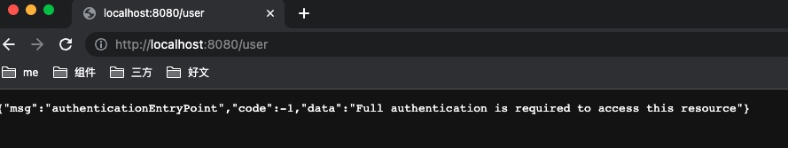
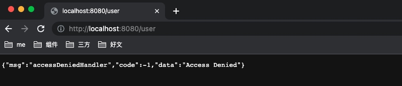
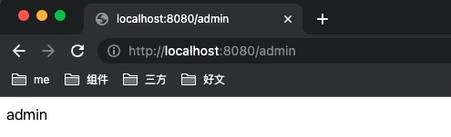
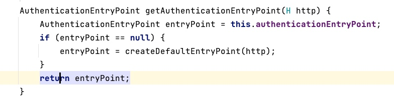
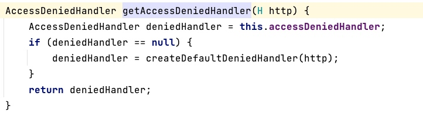
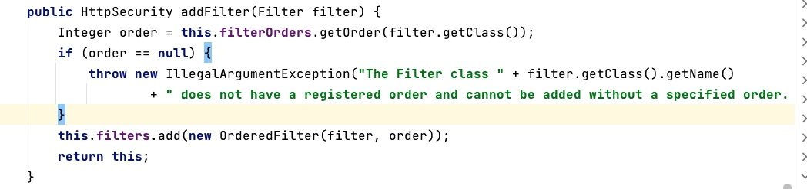
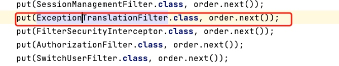
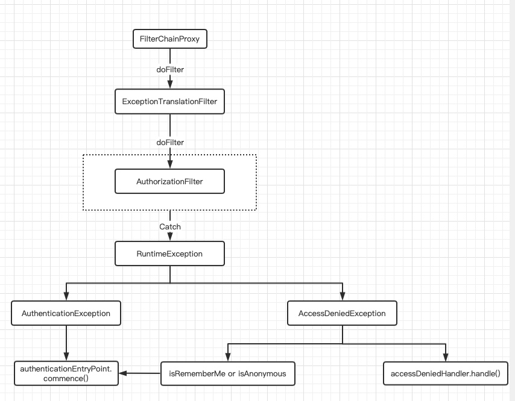

# 16.Spring Security 认证和授权异常处理
> security/day14

其实这节课内容前面已经讲过，这里就给大家汇总下
在Spring Security中异常分为两种：
* AuthenticationException 认证异常
* AccessDeniedException 权限异常
我们先给大家演示下如何自定义异常处理器，然后再结合源码帮助大家进行分析

## 自定义异常处理器
### 配置SecurityConfig
这里主要是authenticationEntryPoint和accessDeniedHandler配置
```
  @Bean
    public SecurityFilterChain config(HttpSecurity http) throws Exception {
        http.authorizeHttpRequests()
                .anyRequest().authenticated()
                .and()
                .formLogin()
                .loginPage("/login.html")
                .loginProcessingUrl("/login")
                .permitAll()
                .and()
                .cors()
                .configurationSource(corsConfigurationSource())
                .and()
                .exceptionHandling()
                .authenticationEntryPoint(new AuthenticationEntryPoint() {
                    @Override
                    public void commence(HttpServletRequest request, HttpServletResponse response, AuthenticationException authException) throws IOException, ServletException {
                        Map<String, Object> result = new HashMap<>();
                        result.put("code", -1);
                        result.put("msg", "authenticationEntryPoint");
                        result.put("data", authException.getMessage());
                        System.out.println("调用次数");
                        writeResp(result, response);
                    }
                }).accessDeniedHandler(new AccessDeniedHandler() {
                    @Override
                    public void handle(HttpServletRequest request, HttpServletResponse response, AccessDeniedException accessDeniedException) throws IOException, ServletException {
                        Map<String, Object> result = new HashMap<>();
                        result.put("code", -1);
                        result.put("msg", "accessDeniedHandler");
                        result.put("data", accessDeniedException.getMessage());
                        writeResp(result, response);
                    }
                })
                .and()
                .csrf().disable();
        http.headers().cacheControl();
        return http.build();
    }
```
### 自定义登录页面
为什么要自定义登录页面呢，因为如果我们实现了异常处理端点，security 就不会将生成登录页面的过滤器加入，我们看下源码：
“authenticationEntryPoint == null)”才会添加自定义生成登录页面的过滤器。
```
	public void configure(H http) {
		AuthenticationEntryPoint authenticationEntryPoint = null;
		ExceptionHandlingConfigurer<?> exceptionConf = http.getConfigurer(ExceptionHandlingConfigurer.class);
		if (exceptionConf != null) {
			authenticationEntryPoint = exceptionConf.getAuthenticationEntryPoint();
		}
		if (this.loginPageGeneratingFilter.isEnabled() && authenticationEntryPoint == null) {
			this.loginPageGeneratingFilter = postProcess(this.loginPageGeneratingFilter);
			http.addFilter(this.loginPageGeneratingFilter);
			LogoutConfigurer<H> logoutConfigurer = http.getConfigurer(LogoutConfigurer.class);
			if (logoutConfigurer != null) {
				http.addFilter(this.logoutPageGeneratingFilter);
			}
		}
	}
```

登陆页面代码：
```
<!DOCTYPE html>
<html lang="en" xmlns:th="http://www.thymeleaf.org">
<head>
    <meta charset="UTF-8">
    <title>Title</title>
</head>
<body>
<div th:text="SPRING_SECURITY_LAST_EXCEPTION"></div>
<form action="/login" method="post">
    用户名:<input name="username" type="text"><br>
    密码:<input name="password" type="password"><br>
    <button type="submit">登陆</button>
</form>
</body>
</html>
```
### 配置用户信息
```
spring.security.user.password=123456
spring.security.user.roles=admin
spring.security.user.name=example
``` 
### 添加controller
```
    @RequestMapping("/user")
    @PreAuthorize("hasRole('user')")
    public String user() {
        return "hello";
    }
    @RequestMapping("/admin")
    @PreAuthorize("hasRole('admin')")
    public String admin() {
        return "admin";
    }
```
### 验证
#### 验证匿名访问user接口
http://localhost:8080/user

返回的是自定义异常，被Authentication进行处理，稍后从源码角度分析
#### 验证登录后访问user接口

返回的是自定义异常，被accessDeniedHandler处理，因为当前接口需要user角色

#### 验证登录后访问admin接口

请求成功，返回接口数据
需要注意的是，如果实现了异常端点，想之前自动跳转到登录页面将不再生效，因为这些逻辑都是在默认的异常端点里面处理

## 异常过滤器实现原理分析
上面讲到自定义异常端点的回调都是通过异常处理过滤器实现，我们现在就从这块开始看，
 首先，我们还是从入口开始找：.exceptionHandling()
 点击.exceptionHandling()进入到代码中，我们发现我们熟悉的ExceptionHandlingConfigurer
 ```
 public ExceptionHandlingConfigurer<HttpSecurity> exceptionHandling() throws Exception {
		return getOrApply(new ExceptionHandlingConfigurer<>());
	}
```
如果有了前面的经验，我们接下来肯定需要去看他的init和configure方法，没错就是这样

### init
不好意思，ExceptionHandlingConfigurer没有重写，所以我们就直接看configure方法
### configure
```
	public void configure(H http) {
		AuthenticationEntryPoint entryPoint = getAuthenticationEntryPoint(http);
		ExceptionTranslationFilter exceptionTranslationFilter = new ExceptionTranslationFilter(entryPoint,
				getRequestCache(http));
		AccessDeniedHandler deniedHandler = getAccessDeniedHandler(http);
		exceptionTranslationFilter.setAccessDeniedHandler(deniedHandler);
		exceptionTranslationFilter = postProcess(exceptionTranslationFilter);
		http.addFilter(exceptionTranslationFilter);
	}
```
* 创建过滤 ExceptionTranslationFilter
* 获取两种异常的处理端点，如果我们配置了就会使用我们自己的，否则使用默认的
    * 
    * 
* 将端点配置到ExceptionTranslationFilter中
* 将ExceptionTranslationFilter 放到IOC容器中，并且放到过滤器链中
    * 
* 加入的时候，会获取过滤器的优先级，ExceptionTranslationFilter放在了AuthorizationFilter之前，这个后面讲到为什么这么做

    * 
看configure方法就是为了看它到底使用什么过滤器，现在我们直接看ExceptionTranslationFilter、

### ExceptionTranslationFilter
```
private void doFilter(HttpServletRequest request, HttpServletResponse response, FilterChain chain)
			throws IOException, ServletException {
		try {
			chain.doFilter(request, response);
		}
		catch (IOException ex) {
			throw ex;
		}
		catch (Exception ex) {
			// Try to extract a SpringSecurityException from the stacktrace
			Throwable[] causeChain = this.throwableAnalyzer.determineCauseChain(ex);
			RuntimeException securityException = (AuthenticationException) this.throwableAnalyzer
					.getFirstThrowableOfType(AuthenticationException.class, causeChain);
			if (securityException == null) {
				securityException = (AccessDeniedException) this.throwableAnalyzer
						.getFirstThrowableOfType(AccessDeniedException.class, causeChain);
			}
			if (securityException == null) {
				rethrow(ex);
			}
			if (response.isCommitted()) {
				throw new ServletException("Unable to handle the Spring Security Exception "
						+ "because the response is already committed.", ex);
			}
			handleSpringSecurityException(request, response, chain, securityException);
		}
	}
```
在doFilter方法中，异常过滤器直接调用了下个过滤器，并没有做什么
* 捕获执行下个过滤器的异常
* 将异常丢给handleSpringSecurityException()方法进行处理

#### handleSpringSecurityException
```
	private void handleSpringSecurityException(HttpServletRequest request, HttpServletResponse response,
			FilterChain chain, RuntimeException exception) throws IOException, ServletException {
		if (exception instanceof AuthenticationException) {
			handleAuthenticationException(request, response, chain, (AuthenticationException) exception);
		}
		else if (exception instanceof AccessDeniedException) {
			handleAccessDeniedException(request, response, chain, (AccessDeniedException) exception);
		}
	}
```
* 根据异常类型不同，分别调用不同的处理方法

#### handleAuthenticationException
```
	private void handleAuthenticationException(HttpServletRequest request, HttpServletResponse response,
			FilterChain chain, AuthenticationException exception) throws ServletException, IOException {
		this.logger.trace("Sending to authentication entry point since authentication failed", exception);
		sendStartAuthentication(request, response, chain, exception);
	}
	
		protected void sendStartAuthentication(HttpServletRequest request, HttpServletResponse response, FilterChain chain,
			AuthenticationException reason) throws ServletException, IOException {
		// SEC-112: Clear the SecurityContextHolder's Authentication, as the
		// existing Authentication is no longer considered valid
		SecurityContext context = SecurityContextHolder.createEmptyContext();
		SecurityContextHolder.setContext(context);
		this.requestCache.saveRequest(request, response);
		this.authenticationEntryPoint.commence(request, response, reason);
	}
```
这个是直接调用了this.authenticationEntryPoint.commence方法，authenticationEntryPoint刚才我们讲过，如果我们配置了就使用配置的，否则使用默认的端点处理

#### handleAccessDeniedException
```
private void handleAccessDeniedException(HttpServletRequest request, HttpServletResponse response,
			FilterChain chain, AccessDeniedException exception) throws ServletException, IOException {
		Authentication authentication = SecurityContextHolder.getContext().getAuthentication();
		boolean isAnonymous = this.authenticationTrustResolver.isAnonymous(authentication);
		if (isAnonymous || this.authenticationTrustResolver.isRememberMe(authentication)) {
			sendStartAuthentication(request, response, chain,
					new InsufficientAuthenticationException(
							this.messages.getMessage("ExceptionTranslationFilter.insufficientAuthentication",
									"Full authentication is required to access this resource")));
		}
		else {
			this.accessDeniedHandler.handle(request, response, exception);
		}
	}
```
这个处理逻辑和前面有点不同
* 如果未登录或者是rememberMe，则还是调用sendStartAuthentication
* 否则调用this.accessDeniedHandler.handle（），这个和前面的逻辑一致

## 最后用一张图总结

