# 18.Spring Security Oauth2 四种授权模式实战
> security/day17

## OAuth2 介绍
### 什么是OAuth2
OAuth 2.0 是一种用于授权的开放标准，允许用户授权第三方应用程序访问他们的资源，例如照片、视频或其他个人信息。OAuth 2.0 提供了一些不同的授权模式，包括授权码模式、简化模式、密码模式和客户端模式等。这些授权模式允许客户端应用程序在不要求用户提供其密码或其他敏感信息的情况下，安全地访问受保护资源。

OAuth 2.0 的核心思想是将认证和授权分离开来，允许用户授权一个应用程序代表他们执行某些操作。OAuth 2.0 框架中的主要角色包括：

用户：资源的所有者，可以授权应用程序访问他们的资源。
客户端：请求访问资源的应用程序。
授权服务器：处理 OAuth 2.0 协议，负责验证用户身份并生成访问令牌。
资源服务器：存储受保护的资源，并根据授权服务器颁发的访问令牌控制对这些资源的访问。
OAuth 2.0 在互联网应用程序开发中被广泛使用，大多数社交网络和 API 都支持该协议。它允许开发人员构建安全的应用程序，用户可以控制对其资源的访问权限。

### OAuth2 的四种模式
### 授权码模式（Authorization Code Grant）
##### 什么是授权码模式
授权码模式是 OAuth 2.0 的标准授权方式，常用于服务端应用程序，也适用于移动应用程序。该模式通过授权服务器为客户端生成一个授权码，在授权码的基础上请求访问令牌。
##### 授权流程
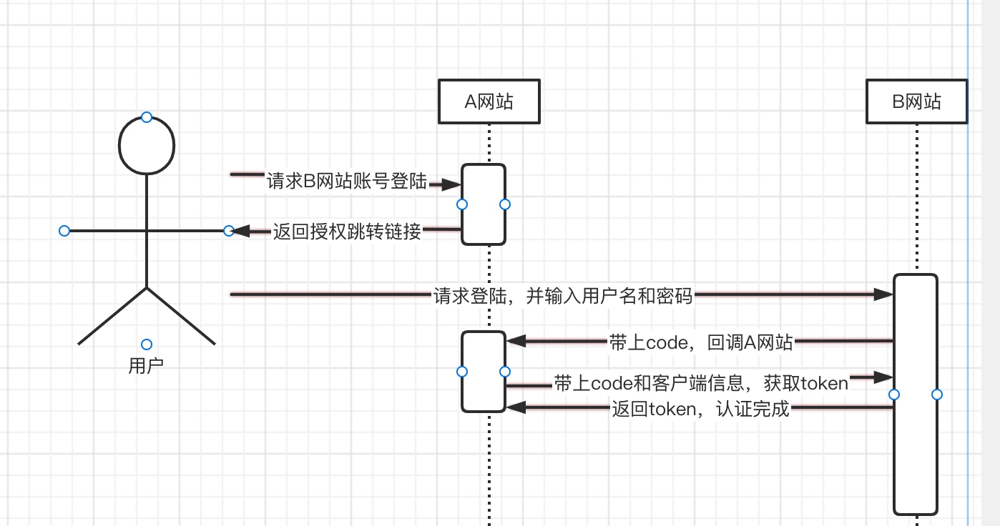

* 客户端向用户展示认证页面。
* 用户输入用户名和密码，向授权服务器发送请求。
* 授权服务器验证用户信息，如果验证成功，生成授权码。
* 授权服务器返回授权码给客户端。
* 客户端使用授权码向授权服务器请求令牌。
* 授权服务器验证授权码的有效性，如果有效则返回令牌。

### 简化模式（Implicit Grant）

#### 什么是简化模式
简化模式主要用于移动应用程序和 Web 前端应用程序等场景下。该模式省略了授权码这一步骤，直接通过浏览器在客户端和授权服务器之间进行交互。
#### 授权流程
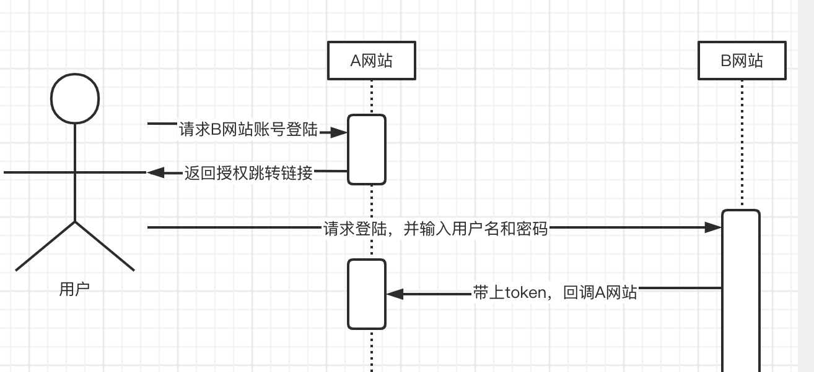

* 客户端向授权服务器发送认证请求。
* 授权服务器验证用户身份，如果验证成功则向浏览器返回令牌。
* 浏览器将令牌传递给客户端。

### 密码模式（Resource Owner Password Credentials Grant）
#### 什么是密码模式
密码模式是一种简单的授权方式，主要用于受信任的客户端应用程序。该模式要求用户将自己的用户名和密码直接提供给客户端应用程序，客户端应用程序使用这些凭证向授权服务器请求访问令牌。

#### 授权流程
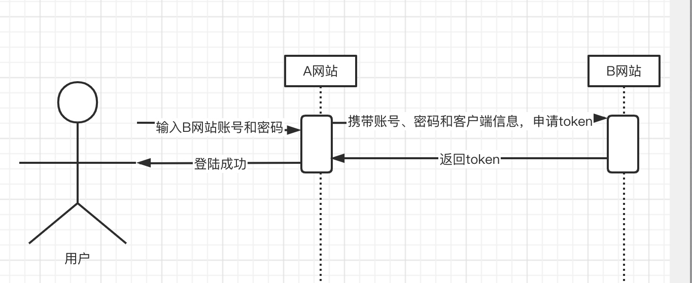

* 用户向客户端提供用户名和密码。
* 客户端向授权服务器发送包含用户凭证的请求。
* 授权服务器验证用户凭证，如果验证成功则返回令牌。

### 客户端模式（Client Credentials Grant）
#### 什么是客户端模式
客户端模式适用于后台服务与其他服务进行通信的场景。该模式下，客户端应用程序通过自身的身份向授权服务器请求访问令牌，并使用该令牌访问资源服务器。
#### 授权流程
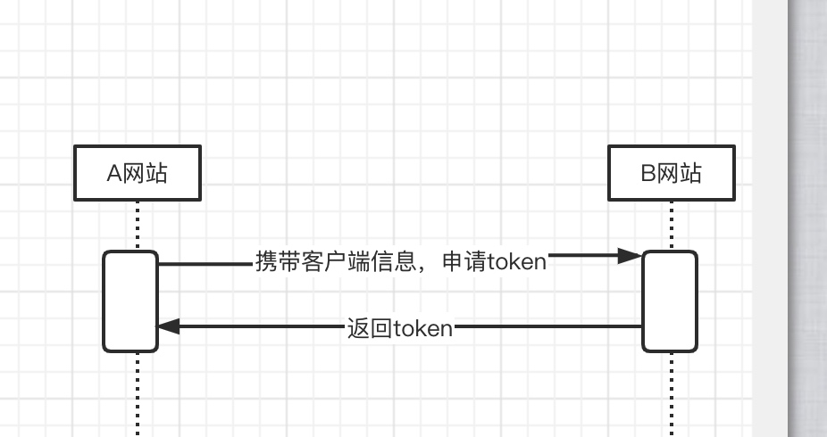

* 客户端向授权服务器发送包含自身身份信息的请求，包括客户端 ID 和密钥。
* 授权服务器验证客户端身份，如果验证成功则返回令牌。
* 客户端使用令牌向资源服务器请求访问资源。


## 基于Spring Security Oauth2 + JWT 实现四种授权模式

### 代码实现

#### 配置JWT token转化器
```
   @Bean
    public JwtAccessTokenConverter jwtAccessTokenConverter() {
        RsaSigner signer = new RsaSigner(KeyConfig.getSignerKey());
        JwtAccessTokenConverter converter = new JwtAccessTokenConverter();
        converter.setSigner(signer);
        converter.setVerifier(new RsaVerifier(KeyConfig.getVerifierKey()));
        return converter;
    }
    @Bean
    public JWKSet jwkSet() {
        RSAKey.Builder builder = new RSAKey.Builder(KeyConfig.getVerifierKey())
                .keyUse(KeyUse.SIGNATURE)
                .algorithm(JWSAlgorithm.RS256);
        return new JWKSet(builder.build());
    }
```
#### 配置OAuth2 相关配置
创建一个类 继承 AuthorizationServerConfigurerAdapter，重写对应方法
##### 创建tokenService
用来配置生成token的相关信息及设置JWT token存储
```
@Bean
    AuthorizationServerTokenServices tokenServices() {
        DefaultTokenServices services = new DefaultTokenServices();
        services.setClientDetailsService(clientDetailsService);
        services.setSupportRefreshToken(true);
        services.setTokenStore(tokenStore);
        services.setAccessTokenValiditySeconds(60 * 60 * 2);
        services.setRefreshTokenValiditySeconds(60 * 60 * 24 * 3);
        TokenEnhancerChain tokenEnhancerChain = new TokenEnhancerChain();
        tokenEnhancerChain.setTokenEnhancers(Arrays.asList(jwtAccessTokenConverter));
        services.setTokenEnhancer(tokenEnhancerChain);
        return services;
    }
```
##### 配置Client信息
这里是基于内存方式，可以自行改成从数据库读取
```
    public void configure(ClientDetailsServiceConfigurer clients) throws Exception {
        clients.inMemory()
                .withClient("admin")
                .secret(passwordEncoder.encode("123"))
                .authorizedGrantTypes("authorization_code","refresh_token","implicit","password","client_credentials")
                .scopes("read:user","read:msg")
                .autoApprove(true)
                .redirectUris("http://www.baidu.com");
    }
```
#### 配置SecurityConfig
这里主要是配置用户信息-UserDetailService,前面的章节已经介绍过
```
    protected void configure(AuthenticationManagerBuilder auth) throws Exception {
        auth.inMemoryAuthentication()
                .withUser("example1")
                .password(passwordEncoder().encode("123"))
                .roles("ADMIN")
                .and()
                .withUser("example2")
                .password(passwordEncoder().encode("123"))
                .roles("USER");
    }
```
#### 主要依赖
```
dependencies {
    implementation 'com.alibaba:fastjson:+'
    implementation 'cn.hutool:hutool-all:5.8.16'
    implementation 'org.springframework.security.oauth:spring-security-oauth2:2.3.5.RELEASE'
    implementation 'org.springframework.boot:spring-boot-starter-web'
    implementation 'org.projectlombok:lombok:1.18.22'
    implementation 'javax.xml.bind:jaxb-api:2.3.1'
    implementation 'com.sun.xml.bind:jaxb-core:4.0.1'
    implementation 'com.sun.xml.bind:jaxb-impl:2.3.4'
    implementation 'javax.activation:activation:1.1.1'
    implementation 'com.nimbusds:nimbus-jose-jwt:9.30'
    implementation 'org.springframework.security:spring-security-jwt:1.1.0.RELEASE'
    testImplementation 'org.springframework.boot:spring-boot-starter-test'

}
```
#### 生成jks文件

文件生成后拷贝到resources
```
keytool -genkey -alias jwt -keyalg RSA -keystore jwt.jks
密码设置成和上文一致：123321
一直回车，到最后按一个yes就生成了
```
## 演示四种授权模式
### 授权码模式
#### 获取授权码
- 浏览器打开,跳转到登录页面
http://localhost:8080/oauth/authorize?response_type=code&client_id=admin

- 输入用户名和密码
example1:123
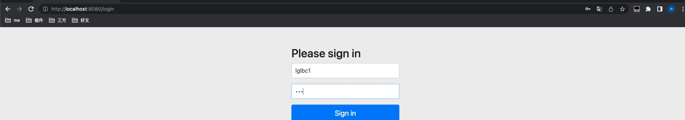

- 点击登录，获取授权码

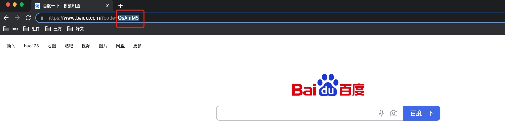

#### 获取token
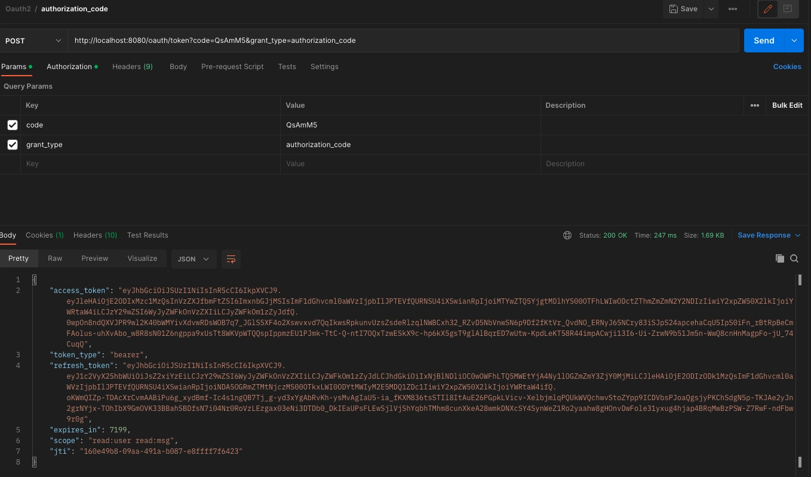

#### 刷新token
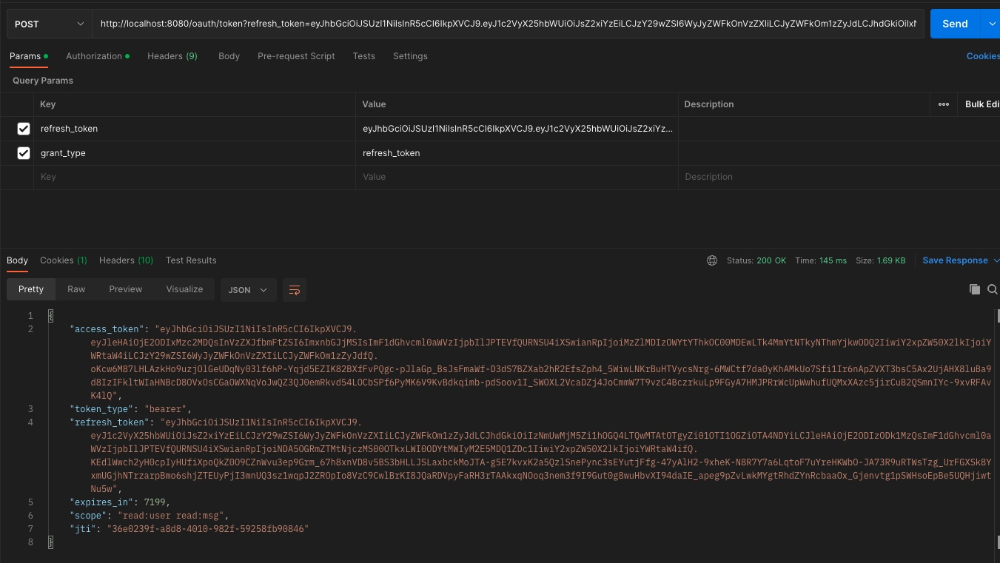


### 简单模式

- 浏览器访问：
http://localhost:8080/oauth/authorize?response_type=token&client_id=admin

- 输入用户名和密码(用户信息，不是客户端)

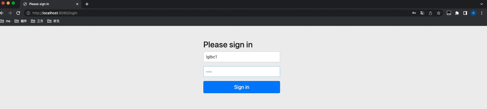

- 点击登录，直接获取token
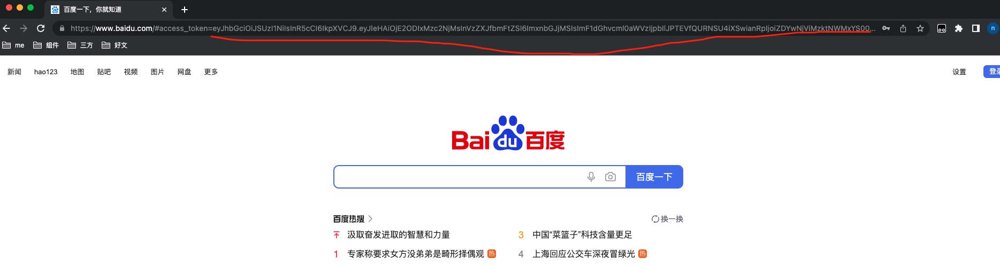


### 用户名密码模式
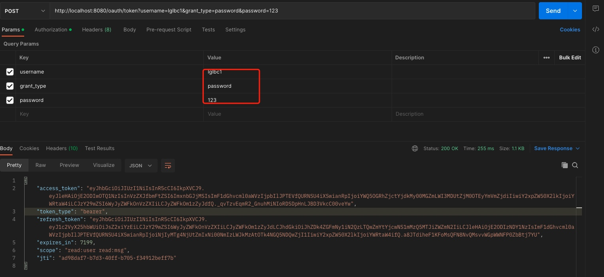
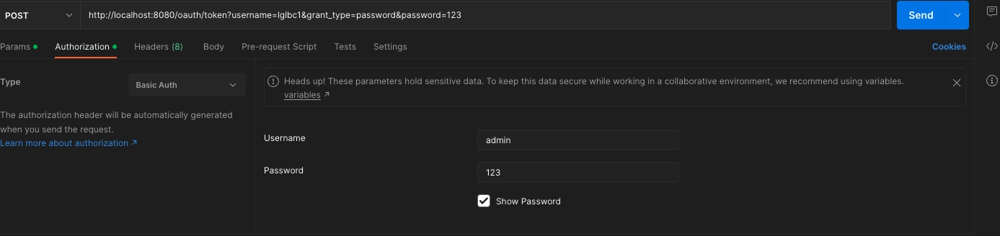

### 客户端模式


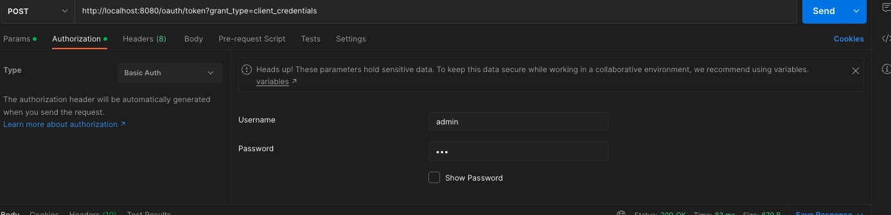
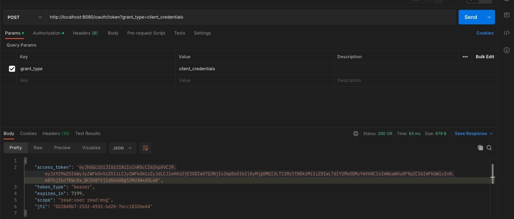
