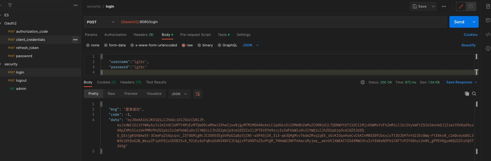
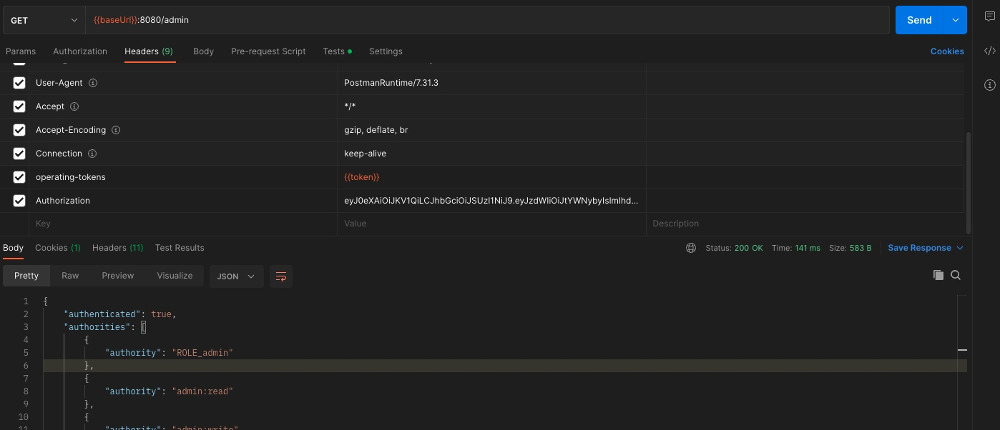
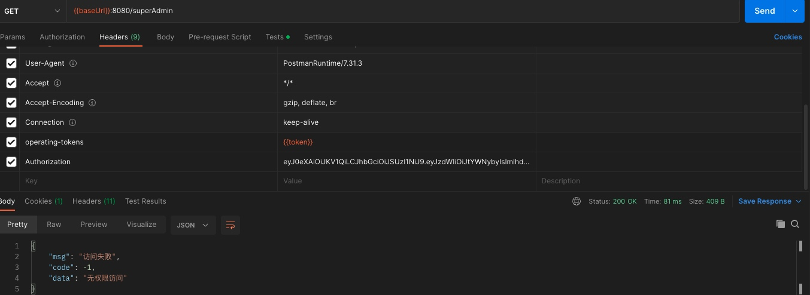
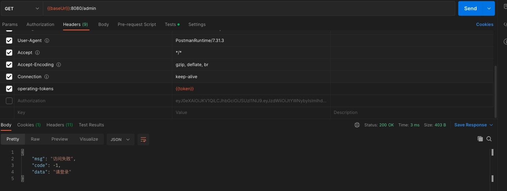

# 19.Spring Security + JWT+RBAC 前后端分离权限实战
> security/day18

到目前为止，所有课程基本讲完，最后我们通过一节实战教程来串联前面所有的知识点，希望能够对大家有帮助

## 背景
因为目前所有的项目都是前后端分离架构，所以我们直接使用Spring Security是满足不了我们的需求，所以我们往往都需要做一些配置的改动，来兼容前后端分离架构，本节内容将结合JWT来实现一个完整的前后端分离解决方案。

## 代码实现
### 支持JSON 方式登录
```
    @Bean
    public JsonLoginFilter jsonLoginFilter(){
        JsonLoginFilter jsonLoginFilter = new JsonLoginFilter();
        jsonLoginFilter.setAuthenticationManager(authenticationManager());
        jsonLoginFilter.setAuthenticationFailureHandler((request, response, exception) -> {
            Map<String,Object> result = new HashMap<>();
            result.put("code",-1);
            result.put("msg","登录失败");
            result.put("data",exception.getMessage());
            writeResp(result,response);
        });
        jsonLoginFilter.setAuthenticationSuccessHandler((request, response, authentication) -> {
            Collection<? extends GrantedAuthority> authorities = authentication.getAuthorities();
            List<String> permissions = authorities.stream().map(GrantedAuthority::getAuthority).collect(Collectors.toList());
            String token = JwtTokenUtil.generateTokenByRSA(authentication.getName(), permissions);
            Map<String,Object> result = new HashMap<>();
            result.put("code",-1);
            result.put("msg","登录成功");
            result.put("data",token);
            writeResp(result,response);
        });
        return jsonLoginFilter;
    }
```
### 配置无权限访问异常处理器
```
      .exceptionHandling()
      .accessDeniedHandler(new AccessDeniedHandler() {
                    @Override
                    public void handle(HttpServletRequest request, HttpServletResponse response, AccessDeniedException accessDeniedException) throws IOException, ServletException {
                        Map<String,Object> result = new HashMap<>();
                        result.put("code",-1);
                        result.put("msg","访问失败");
                        result.put("data","无权限访问");
                        writeResp(result,response);
                    }
                })
```
### 配置认证失败异常处理器
```
.exceptionHandling() 
.authenticationEntryPoint(new AuthenticationEntryPoint() {
                    @Override
                    public void commence(HttpServletRequest request, HttpServletResponse response, AuthenticationException authException) throws IOException, ServletException {
                        Map<String,Object> result = new HashMap<>();
                        result.put("code",-1);
                        result.put("msg","访问失败");
                        result.put("data","请登录");
                        writeResp(result,response);
                    }
                })
```
### 配置UserDetailService 定义用户来源
```
@Service
public class UserDetailService implements UserDetailsService {
    @Autowired
    private UserMapper userMapper;
    @Override
    public UserDetails loadUserByUsername(String username) throws UsernameNotFoundException{
        User user = userMapper.queryUserByUsername(username);
        List<Role> roles = userMapper.getRolesByUserId(user.getId());
        user.setRoles(roles);
        if (Objects.isNull(user)) {
            throw new UsernameNotFoundException("user not found");
        }
        return user;
    }
}
```
### 配置token处理器
token过滤器是用来解析token，如果解析成功，则放到SecurityContext中
```
@Component
@WebFilter(filterName = "TokenLoginFilter", urlPatterns = "/*")//先全部拦截
public class TokenLoginFilter extends OncePerRequestFilter {

    @Override
    protected void doFilterInternal(HttpServletRequest request, HttpServletResponse response, FilterChain filterChain) throws ServletException, IOException, IOException {

        String authorization = request.getHeader("Authorization");
        if (StringUtils.isEmpty(authorization)) {
            filterChain.doFilter(request, response);
            return;
        }
        AccessToken accessToken = JwtTokenUtil.verifyTokenByRSA(authorization);
        if (Objects.isNull(accessToken)) {
            filterChain.doFilter(request, response);
            return;
        }
        //已登录，获取用户信息，进行授权
        List<SimpleGrantedAuthority> authorities = accessToken.getAuthorities().stream().map(permission ->
                new SimpleGrantedAuthority(permission)
        ).collect(Collectors.toList());
        UsernamePasswordAuthenticationToken token =
                new UsernamePasswordAuthenticationToken(accessToken.getUsername(), null, authorities);
        SecurityContextHolder.getContext().setAuthentication(token);
        System.out.println("SecurityContextHolder信息：" + JSON.toJSONString(SecurityContextHolder.getContext()));
        filterChain.doFilter(request, response);
    }
}
```
### 将json过滤器和token过滤器加入SecurityFilterChain
```
.addFilterAt(jsonLoginFilter(), UsernamePasswordAuthenticationFilter.class)
                .addFilterAt(tokenLoginFilter, JsonLoginFilter.class)
```
### 创建测试接口
```
/**
 * @Author 编程学习
 * @Date 2023/4/22
 * @Description
 */
@RestController
public class IndexController {
    @RequestMapping("/admin")
    @PreAuthorize("hasAnyAuthority('admin:write')")
    public String admin(Authentication authentication){
        return JSON.toJSONString(authentication);
    }
    @RequestMapping("/superAdmin")
    @PreAuthorize("hasAnyAuthority('super:write')")
    public String superAdmin(Authentication authentication){
        return JSON.toJSONString(authentication);
    }
}
```
## 验证
### 访问登录接口

### 访问admin接口，成功

### 访问superAdmin接口，权限拒绝

### 不带token访问admin接口

